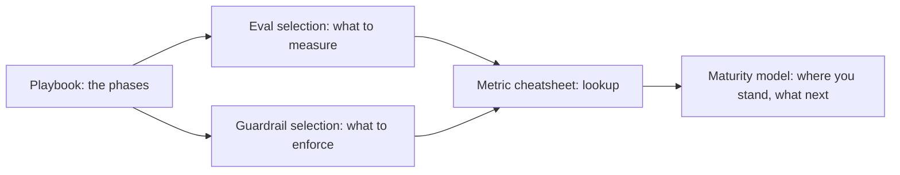

# 05 — Decision Framework

> **TL;DR**
> - **Turn theory into action.** Use these decision trees, checklists, and scorecards to select your evaluations and guardrails.
> - **Match controls to your architecture and risk.** Pick the right metrics and runtime guardrails for your specific system archetype.
> - **Follow a phased rollout.** Build from initial trace analysis to automated CI gates and production monitoring.
> - **Score your maturity.** Evaluate your team across five dimensions and prioritize your next two improvements.

**You will learn:** How to navigate the decision framework · Which guide solves your current problem · How to sequence your implementation  
**Prerequisites:** [00-foundations](../00-foundations/README.md)  
**Related:** [01-datasets](../01-datasets/README.md), [02-offline-evals](../02-offline-evals/README.md), [03-online-evals-and-observability](../03-online-evals-and-observability/README.md), [04-guardrails](../04-guardrails/README.md)

This section uses one running example across all guides: an **internal enterprise assistant**. The assistant searches company documents, runs **text-to-SQL** queries, **calls tools** to create tickets, and enforces role-based access control (RBAC). You can apply these frameworks to simple RAG chatbots, agentic RAG, text-to-SQL agents, multi-agent workflows, and multi-turn assistants.

## Start here if you are…

| You are… | Go to | Then |
|---|---|---|
| **Building your first RAG prototype** | [Playbook — Phases 0–1](./04-implementation-playbook.md#phase-0--define-success-and-risks) (define success, tracing, 30–100 examples, error analysis) | [Eval selection §8.0 universal core](./01-eval-selection-decision-tree.md#80-the-universal-core-every-archetype-every-stage) |
| **Choosing metrics for an agent / text-to-SQL / multi-agent system** | [Eval selection decision tree](./01-eval-selection-decision-tree.md) — find your archetype in §8 | [Metric cheatsheet quick picks](./03-metric-cheatsheet.md#3-quick-picks-by-question) |
| **Asking "which metric tells me X?"** | [Metric cheatsheet](./03-metric-cheatsheet.md) | Follow the table link to the detailed metric card |
| **About to launch** | [Launch readiness checklist](./04-implementation-playbook.md#42-launch-readiness-checklist) | [Guardrail selection](./02-guardrail-selection-decision-tree.md) to confirm your tier's required controls |
| **Facing a security / risk review** | [Guardrail selection: risk questionnaire + lethal trifecta](./02-guardrail-selection-decision-tree.md#2-risk-assessment-questionnaire) | [Threat model & OWASP](../04-guardrails/07-threat-model-owasp.md), [Access control & RBAC](../04-guardrails/06-access-control-rbac.md) |
| **Adding a write/action tool to an existing assistant** | [Lethal-trifecta check](./02-guardrail-selection-decision-tree.md#3-the-lethal-trifecta-check) and [A2 guardrail stack](./02-guardrail-selection-decision-tree.md#112-a2--agentic-rag-with-tools) | [A2 eval stack](./01-eval-selection-decision-tree.md#82-a2--agentic-rag-with-tools) |
| **Already in production and quality dropped** | [Playbook — Phase 5](./04-implementation-playbook.md#phase-5--production-online-evals-monitoring-feedback) (online evals, weekly review) | [Monitoring & drift](../03-online-evals-and-observability/04-monitoring-alerting-and-drift.md), [Production quick picks](./03-metric-cheatsheet.md#37-production) |
| **Upgrading the model or embedding provider** | [CI gates](./04-implementation-playbook.md#41-ci-gates) — treat it as a code change | [Running offline experiments](../02-offline-evals/08-running-offline-experiments.md) |
| **Unsure whether your LLM judge can be trusted** | [Deterministic vs judge vs human](./01-eval-selection-decision-tree.md#4-decision-deterministic-vs-llm-judge-vs-human) | [LLM-as-a-judge](../02-offline-evals/07-llm-as-a-judge.md) |
| **Short on budget or SME time** | [Budget section](./01-eval-selection-decision-tree.md#9-budget-making-the-plan-affordable) and [which dataset at which stage](./01-eval-selection-decision-tree.md#7-decision-which-dataset-at-which-stage) | [Synthetic datasets](../01-datasets/03-synthetic-datasets.md) |
| **A lead planning a roadmap / reporting status** | [Maturity model](./05-maturity-model.md) — run the scorecard | [Playbook RACI & 30/60/90 plan](./04-implementation-playbook.md#1-roles-and-raci) |

## Files in this section

| File | What it covers | Read when… |
|---|---|---|
| [01-eval-selection-decision-tree.md](./01-eval-selection-decision-tree.md) | Five input questions, master decision tree, method choices, dataset mapping, and minimum eval stacks for five archetypes | You need to decide *which evals* to build |
| [02-guardrail-selection-decision-tree.md](./02-guardrail-selection-decision-tree.md) | Risk questionnaire, lethal-trifecta check, required guardrails by tier, runtime modes, latency budgets, and archetype stacks | You need to decide *which guardrails* to build and configure |
| [03-metric-cheatsheet.md](./03-metric-cheatsheet.md) | One reference table of every metric, eval, and guardrail check with ground-truth needs, methods, costs, and quick picks | You need to look up a metric fast |
| [04-implementation-playbook.md](./04-implementation-playbook.md) | Phases 0–6 from defining success to the production flywheel, with checklists, RACI, CI gates, and anti-patterns | You are planning or executing the rollout |
| [05-maturity-model.md](./05-maturity-model.md) | Levels 0–4, capability matrix, self-assessment scorecard, and step-by-step leveling checklists | You want to score your current state and plan next steps |

## Suggested reading order

1. **Skim** the phase table and anti-patterns in the [Implementation playbook](./04-implementation-playbook.md) to learn the overall workflow.
2. **Select** your archetype and minimum viable eval suite in the [Eval selection decision tree](./01-eval-selection-decision-tree.md).
3. **Run** the risk questionnaire and lethal-trifecta check in the [Guardrail selection decision tree](./02-guardrail-selection-decision-tree.md).
4. **Keep** the [Metric cheatsheet](./03-metric-cheatsheet.md) open as a quick reference while you build.
5. **Score** your system with the [Maturity model](./05-maturity-model.md) now and repeat the assessment every quarter.

## How this section relates to the rest of the repo

| Need | Section |
|---|---|
| Concepts and vocabulary | [00-foundations](../00-foundations/README.md) |
| Building the datasets your evals run on | [01-datasets](../01-datasets/README.md) |
| Detailed metric cards (formulas, examples, pitfalls) | [02-offline-evals](../02-offline-evals/README.md) |
| Production evals, tracing, feedback, monitoring | [03-online-evals-and-observability](../03-online-evals-and-observability/README.md) |
| How each guardrail works | [04-guardrails](../04-guardrails/README.md) |
| Which tools implement what | [06-tooling-landscape](../06-tooling-landscape/README.md) |
| Papers, posts, standards | [07-references](../07-references/README.md) |
