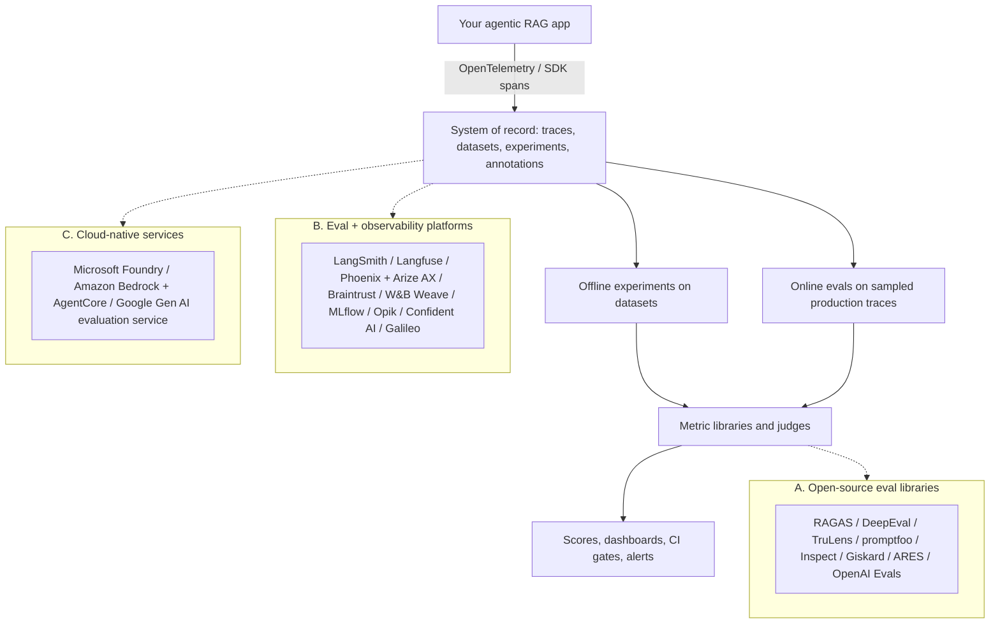
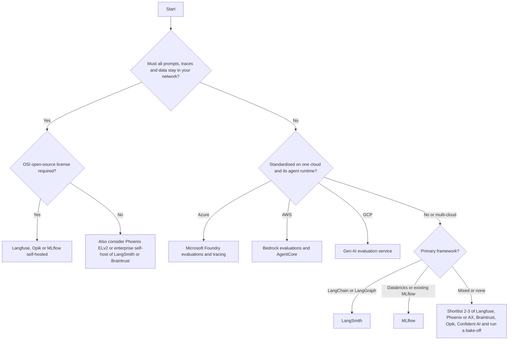
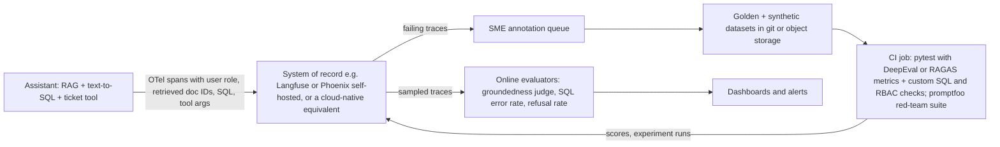

# Eval and Observability Tools: The Landscape (October 2026 snapshot)

> **TL;DR** — Eval tooling splits into three layers: open-source **metric libraries** (RAGAS, DeepEval, promptfoo, Inspect …), **eval + observability platforms** that act as your system of record for traces, datasets and experiments (LangSmith, Langfuse, Phoenix, Braintrust, MLflow, Opik …), and **cloud-native evaluation services** (Microsoft Foundry, Amazon Bedrock, Google's Gen AI evaluation service). Pick one platform as the system of record, use libraries for metrics, instrument with OpenTelemetry so you can switch later, and validate every metric against your own labeled data before trusting it.

**You'll learn:** what each major tool is good at · which metrics each ships · a capability matrix across 8 dimensions · ownership/status changes that affect tool choice · how to choose and how to run a bake-off  ·  **Prerequisites:** [The evals & guardrails map](../00-foundations/02-the-evals-and-guardrails-map.md), [End-to-end RAG evals](../02-offline-evals/01-end-to-end-rag-evals.md)  ·  **Related:** [Guardrail tools](./02-guardrail-tools.md), [Observability & tracing](../03-online-evals-and-observability/02-observability-and-tracing.md), [Running offline experiments](../02-offline-evals/08-running-offline-experiments.md), [LLM-as-a-judge](../02-offline-evals/07-llm-as-a-judge.md)

---

## Read this first: this is a dated snapshot

This document reflects the state of the ecosystem as of **October 2026**. The LLM tooling market moves faster than any other part of this repository: in the 18 months before this snapshot, several of the tools below were acquired, rebranded, re-licensed, rewritten or sunset (see [Ownership and status changes](#ownership-and-status-changes-to-know-about)).

- [ ] Before adopting anything, re-check the project's README/changelog, last release date, license, and pricing page.
- [ ] Treat the capability matrix as a starting hypothesis, not a spec sheet. Vendors ship monthly.
- [ ] Never trust a metric because it has a familiar name. Two tools' "faithfulness" can use different prompts, judge models, decompositions and score scales. Calibrate on your data (see [LLM-as-a-judge](../02-offline-evals/07-llm-as-a-judge.md)).

The concepts in the rest of this repository (datasets, metrics, judges, guardrail architecture) are durable; the tool names are not. Design your stack so that tools are replaceable.

---

## The landscape at a glance

| Layer | What it gives you | What it does *not* give you | Typical owner |
|---|---|---|---|
| **A. Eval libraries** | Metric implementations, judge prompts, test runners, synthetic data generators | A durable store of traces/datasets/experiment history, team UI, production sampling | ML/AI engineers, in code and CI |
| **B. Platforms** | Tracing, datasets, experiment comparison, annotation queues, online evaluators, prompt management | Domain-correct metrics out of the box (you still define what "good" means) | Platform / AI engineering team |
| **C. Cloud-native** | Managed judges, safety evaluators, integration with the cloud's model catalog, IAM and monitoring | Portability; parity of features across regions; independence from that cloud's model catalog | Teams already standardised on that cloud |

> **Heuristic:** most production teams end up with **one platform (B or C) + one or two libraries (A) + custom code** for domain metrics like SQL execution accuracy or RBAC leakage checks.

---

## Ownership and status changes to know about

These changes matter for procurement, long-term maintenance risk and data-residency reviews. All were verified against project pages in October 2026.

| Tool | Change | What it means for you |
|---|---|---|
| **Humanloop** | Team joined Anthropic; the Humanloop platform is being **sunset** ([announcement](https://humanloop.com)). | Do not start new projects on it. If you have data there, plan an export and migration. |
| **promptfoo** | "Promptfoo is now part of OpenAI" — remains open source and MIT licensed ([README](https://github.com/promptfoo/promptfoo)). | Still usable with any model provider; watch roadmap direction. |
| **Langfuse** | Acquired by ClickHouse (January 2026); stated commitment to stay open source and self-hostable ([blog](https://langfuse.com/blog/joining-clickhouse)). | No licensing change announced. Core is MIT; enterprise features live in `ee/` folders under a separate license. |
| **Galileo** | Docs state that as of August 7, 2026, "Galileo is now Splunk Agent Observability" ([docs](https://docs.galileo.ai/what-is-galileo)). | Expect product/pricing/packaging changes; new customers are pointed at Splunk docs. |
| **Weights & Biases (Weave)** | W&B docs, including Weave, are now hosted under CoreWeave ([docs](https://docs.coreweave.com/products/wandb/weave)). | Product continues; check contract/hosting terms. |
| **Patronus AI** | Homepage now emphasises RL environments, benchmarks and research rather than the eval platform ([site](https://www.patronus.ai/)). | Its open models (Lynx, Glider) remain on Hugging Face; verify the commercial eval product's availability before relying on it. |
| **Giskard** | v3 is a fresh rewrite (`giskard-checks`, `giskard-scan`) for agents; **v2 is no longer actively maintained** ([repo](https://github.com/Giskard-AI/giskard-oss)). | Old tutorials using v2 APIs (RAGET, `giskard.scan` on LLMs) are outdated. |
| **RAGAS** | Repository moved from `explodinggradients/ragas` to `vibrantlabsai/ragas`; latest release at snapshot time was v0.4.3 (January 2026). | Still widely used; check release cadence and API changes (metric names changed across 0.1 → 0.2+). |
| **OpenAI Evals** | The `openai/evals` repo README points to running evals in the OpenAI dashboard / Evals API. | Use the hosted Evals product if you are OpenAI-centric; the OSS registry is mainly of historical/benchmark interest. |
| **TruLens** | Originally TruEra; maintained in open source by Snowflake since the acquisition ([site](https://www.trulens.org/)). | Active (2.x releases in 2026). |

---

## A. Open-source eval libraries

Each card uses the same fields: **Link · Type/License · Strengths · Notable metrics · Best for · Watch-outs**. "Notable metrics" lists only metrics the tool documents; names change between versions — check the docs.

### RAGAS

| Field | Details |
|---|---|
| **Link** | [docs.ragas.io](https://docs.ragas.io) · [GitHub](https://github.com/vibrantlabsai/ragas) |
| **Type / License** | OSS library (Python), Apache-2.0 |
| **Strengths** | The reference implementation of reference-free RAG metrics (from the [RAGAS paper](https://arxiv.org/abs/2309.15217)); test-set generation for RAG and agent scenarios via a knowledge-graph approach; integrations with LangChain, LlamaIndex, Langfuse, Phoenix and others. |
| **Notable metrics** | RAG: Context Precision, Context Recall, Context Entities Recall, Noise Sensitivity, Response Relevancy, Faithfulness. Agent/tool: Topic Adherence, Tool Call Accuracy, Tool Call F1, Agent Goal Accuracy. SQL: Datacompy Score (execution-based), SQL Query Equivalence. General: Aspect Critic, Simple Criteria, rubric-based and instance-specific rubric scoring; Factual Correctness; non-LLM string metrics (BLEU, ROUGE, chrF, exact match). |
| **Best for** | Fast, defensible RAG metrics in a notebook or CI job; bootstrapping a synthetic test set. |
| **Watch-outs** | Judge-based metrics inherit judge cost and variance; metric names and APIs changed between 0.1 and 0.2+; scores are not comparable across RAGAS versions or judge models. No UI or store — pair with a platform. |

### DeepEval (and DeepTeam)

| Field | Details |
|---|---|
| **Link** | [deepeval.com](https://deepeval.com) · [GitHub](https://github.com/confident-ai/deepeval) · red teaming: [DeepTeam](https://github.com/confident-ai/deepteam) |
| **Type / License** | OSS (Python), Apache-2.0. Commercial platform: Confident AI. |
| **Strengths** | "Pytest for LLMs": test cases + metrics + thresholds, runnable as unit tests in CI; 50+ metrics, almost all LLM-as-a-judge using QAG, DAG (deep acyclic graph) or [G-Eval](https://arxiv.org/abs/2303.16634); every metric returns a 0–1 score plus reasoning; synthetic "golden" generation and conversation simulation; trajectory metrics for agents. |
| **Notable metrics** | RAG: Answer Relevancy, Faithfulness, Contextual Precision, Contextual Recall, Contextual Relevancy. Agents: tool correctness, task completion and trajectory-level metrics. Custom: G-Eval, DAG. Safety: bias, toxicity, PII-leakage style metrics. Multi-turn conversational metrics. |
| **Best for** | Teams that want evals to look and fail like unit tests; CI regression gates. |
| **Watch-outs** | Default threshold is 0.5 for all metrics — set your own per metric after calibration. Many metrics make several judge calls per test case; budget for it. |

### TruLens

| Field | Details |
|---|---|
| **Link** | [trulens.org](https://www.trulens.org/) · [GitHub](https://github.com/truera/trulens) |
| **Type / License** | OSS (Python), MIT; maintained by Snowflake |
| **Strengths** | Popularised the **RAG triad** (context relevance → groundedness → answer relevance) as a reference-free diagnostic; "feedback functions" as a general abstraction for LLM or classical scorers; OpenTelemetry-based tracing and a local dashboard for experiment comparison. |
| **Notable metrics** | Context Relevance, Groundedness, Answer Relevance; plus moderation-style and custom feedback functions. |
| **Best for** | RAG prototypes where you want tracing + triad scores locally with minimal setup; Snowflake-centric stacks. |
| **Watch-outs** | Triad is reference-free — it cannot tell you the answer is *correct*, only that it is supported and on-topic. Pair with reference-based correctness on a golden set. |

### promptfoo

| Field | Details |
|---|---|
| **Link** | [promptfoo.dev](https://www.promptfoo.dev) · [GitHub](https://github.com/promptfoo/promptfoo) |
| **Type / License** | OSS CLI + library (Node.js; also installable via `pip`/`brew`), MIT. Now part of OpenAI. Commercial/enterprise offering exists. |
| **Strengths** | Declarative YAML test matrices (prompts × providers × test cases × assertions); side-by-side comparison UI; excellent CI ergonomics; a large **red-teaming** module (plugins + attack strategies, OWASP/NIST/MITRE-aligned presets) — see [Guardrail tools](./02-guardrail-tools.md#promptfoo-red-teaming). |
| **Notable metrics** | Deterministic assertions (equals, contains, regex, JSON schema, latency, cost …); model-graded assertions such as `llm-rubric`, `g-eval`, `factuality`, `agent-rubric`, `select-best`; RAG-oriented `context-faithfulness`, `context-recall`, `context-relevance`, `answer-relevance`; custom JavaScript/Python assertions. |
| **Best for** | Prompt/model comparisons, regression suites in CI, and combined eval + red-team pipelines in one tool. |
| **Watch-outs** | Not an observability platform. YAML scales poorly to very large, versioned datasets — keep datasets in a store and generate configs. |

### OpenAI Evals (repo) and the OpenAI Evals API

| Field | Details |
|---|---|
| **Link** | [GitHub](https://github.com/openai/evals) · [Evals guide](https://developers.openai.com/api/docs/guides/evals) · [Evaluation best practices](https://developers.openai.com/api/docs/guides/evaluation-best-practices) |
| **Type / License** | OSS framework + registry (repo); hosted Evals in the OpenAI platform (commercial) |
| **Strengths** | Early, influential registry of model evals and "model-graded" eval templates; the hosted product lets you define graders over datasets and compare runs of OpenAI models/prompts. The best-practices guide is worth reading regardless of tooling. |
| **Notable metrics** | String-check, text-similarity, model-graded (score/label) graders, Python graders (hosted); match/fuzzy-match and model-graded templates (repo). |
| **Best for** | OpenAI-centric teams; prompt/model migration checks on OpenAI models. |
| **Watch-outs** | Hosted evals tie you to one vendor's models and platform. The OSS repo is lightly maintained relative to the hosted product. |

### Inspect (UK AI Security Institute)

| Field | Details |
|---|---|
| **Link** | [inspect.aisi.org.uk](https://inspect.aisi.org.uk/) · [GitHub](https://github.com/UKGovernmentBEIS/inspect_ai) |
| **Type / License** | OSS (Python), MIT; developed by the UK AI Security Institute |
| **Strengths** | Rigorous, composable eval framework: **datasets → solvers → scorers**; first-class **agent** support (ReAct agent, multi-agent, custom agents, MCP tools, sandboxed tool execution, tool approval), model grading, multiple scorers, eval sets, rich log viewer and VS Code extension. Large ecosystem of published benchmark implementations. |
| **Notable metrics** | Built-in scorers (match, includes, pattern, model-graded QA/fact …), custom scorers and metrics (accuracy, stderr, etc.). |
| **Best for** | Agentic evals that need sandboxed tool execution and reproducible, auditable runs; safety/capability evals; teams that like a research-grade harness. |
| **Watch-outs** | No production tracing/online evals — it is an offline harness. RAG metrics are yours to implement (or wrap from another library). |

### Giskard (open source, v3)

| Field | Details |
|---|---|
| **Link** | [docs.giskard.ai](https://docs.giskard.ai) · [GitHub](https://github.com/Giskard-AI/giskard-oss) |
| **Type / License** | OSS (Python 3.12+), Apache-2.0; commercial Giskard Hub |
| **Strengths** | v3 rewrite targeting agents: `giskard-checks` (scenario API, multi-turn, built-in checks, LLM-as-judge) and `giskard-scan` (vulnerability scan for prompt injection, jailbreaks, harmful content + knowledge-base quality evaluation, successor of v2 RAGET). Async-first, light dependencies. |
| **Notable metrics** | String/regex/comparison checks, semantic similarity, LLM-judge checks such as `Groundedness`, `Conformity`, `LLMJudge`. |
| **Best for** | Scenario-based multi-turn agent tests plus a vulnerability scan in one OSS package. |
| **Watch-outs** | v2 is unmaintained; most blog posts and tutorials online use v2 APIs. |

### lm-evaluation-harness (EleutherAI) — for model benchmarking context

| Field | Details |
|---|---|
| **Link** | [GitHub](https://github.com/EleutherAI/lm-evaluation-harness) |
| **Type / License** | OSS (Python), MIT |
| **Strengths** | The de-facto harness for running standard academic benchmarks against base/instruct models (it backs many public leaderboards); reproducible few-shot settings; supports HF, vLLM and API models. |
| **Notable metrics** | Benchmark-defined (accuracy, exact match, perplexity, etc.) across hundreds of tasks. |
| **Best for** | Choosing or fine-tuning a **model**; checking that a fine-tune did not regress general capabilities. |
| **Watch-outs** | It evaluates models, not your **application**. Benchmark scores say little about your retrieval quality, tool use or RBAC behaviour. |

### ARES

| Field | Details |
|---|---|
| **Link** | [GitHub](https://github.com/stanford-futuredata/ARES) · [paper](https://arxiv.org/abs/2311.09476) |
| **Type / License** | OSS research code (Python), Apache-2.0 |
| **Strengths** | Trains lightweight **fine-tuned judges** on synthetic data for context relevance, answer faithfulness and answer relevance, then uses **prediction-powered inference (PPI)** with a small human-labeled set to produce confidence intervals. Important idea: combine cheap judges with a few hundred human labels to get statistically valid estimates. |
| **Notable metrics** | Context relevance, answer faithfulness, answer relevance (with confidence intervals). |
| **Best for** | Learning the PPI approach; high-volume scoring where per-call LLM judging is too expensive. |
| **Watch-outs** | Research code with infrequent updates (last push March 2025 at snapshot time); expect integration work. Borrow the idea even if you don't use the code. |

---

## B. Eval + observability platforms

These are candidate **systems of record**: they store traces, datasets, experiment runs, human annotations and scores, and they run evaluators online. See [Observability & tracing](../03-online-evals-and-observability/02-observability-and-tracing.md) for what to capture.

### LangSmith (LangChain)

| Field | Details |
|---|---|
| **Link** | [Evaluation docs](https://docs.langchain.com/langsmith/evaluation) · [Observability docs](https://docs.langchain.com/langsmith/observability) · OSS evaluators: [openevals](https://github.com/langchain-ai/openevals), [agentevals](https://github.com/langchain-ai/agentevals) |
| **Type / License** | Commercial SaaS; self-hosted deployment available (enterprise). `openevals`/`agentevals` are MIT. |
| **Strengths** | Deep LangChain/LangGraph integration (works framework-agnostically too); datasets + experiments + pairwise comparison; online evaluators on production runs; annotation queues; pytest/vitest integrations; agent trajectory evaluators. |
| **Notable metrics** | Bring-your-own evaluators; prebuilt LLM-as-judge prompts in openevals (e.g. correctness, conciseness, hallucination, toxicity, RAG groundedness / helpfulness / retrieval relevance, tool selection, trajectory accuracy, prompt injection, PII leakage) and trajectory match/judge evaluators in agentevals. |
| **Best for** | Teams building on LangGraph/LangChain who want tracing, evals and prompt iteration in one place. |
| **Watch-outs** | Commercial pricing per trace volume; self-hosting is an enterprise feature. |

### Langfuse

| Field | Details |
|---|---|
| **Link** | [langfuse.com/docs](https://langfuse.com/docs) · [GitHub](https://github.com/langfuse/langfuse) |
| **Type / License** | OSS (MIT core; `ee/` folders under a separate enterprise license) + Langfuse Cloud. Owned by ClickHouse since January 2026. |
| **Strengths** | The most widely adopted **self-hostable** LLM observability platform; OpenTelemetry-native tracing; datasets and experiments; managed LLM-as-a-judge evaluators that run on live traces or dataset runs; annotation queues; user feedback scores; prompt management; integrations with RAGAS and most frameworks. |
| **Notable metrics** | Managed LLM-as-a-judge evaluators from a template gallery or a blank prompt (numeric, categorical or boolean scores; variables can map to input, output, metadata or tool calls) plus any custom score you push via SDK/API. |
| **Best for** | Data-residency-sensitive orgs that need to self-host; teams that want an open, framework-neutral system of record. |
| **Watch-outs** | Self-hosting means operating ClickHouse, Postgres, Redis and object storage at scale. Some enterprise features are licensed separately — check the current feature matrix. |

### Arize Phoenix and Arize AX

| Field | Details |
|---|---|
| **Link** | [Phoenix docs](https://arize.com/docs/phoenix) · [Phoenix GitHub](https://github.com/Arize-ai/phoenix) · [Arize AX docs](https://arize.com/docs/ax) · instrumentation: [OpenInference](https://github.com/Arize-ai/openinference) |
| **Type / License** | Phoenix: source-available, **Elastic License 2.0** (free to self-host; restrictions on offering as a managed service). Arize AX: commercial managed platform. |
| **Strengths** | Built on OpenTelemetry + OpenInference semantic conventions (portable traces); strong eval library with LLM-judge templates for RAG and agents; datasets & experiments; runs locally in a notebook or as a server. AX adds managed scale, online evals, monitoring and agent observability. |
| **Notable metrics** | Judge templates for hallucination, QA correctness, retrieval relevance, toxicity, summarisation, tool-calling / agent path evaluations; code evaluators; custom judges. |
| **Best for** | OTel-first teams that want an open local tool now and a managed path later. |
| **Watch-outs** | ELv2 is not an OSI-approved open-source license — check with legal if you plan to embed or resell. |

### Braintrust

| Field | Details |
|---|---|
| **Link** | [braintrust.dev](https://www.braintrust.dev/) · [docs](https://www.braintrust.dev/docs) · scorers: [autoevals](https://github.com/braintrustdata/autoevals) (MIT) |
| **Type / License** | Commercial SaaS; self-hosted data plane on the Enterprise plan (Braintrust runs the UI/control plane) or BYOC |
| **Strengths** | Experiment-centric workflow (`Eval(...)` in code → diff experiments in UI); playgrounds for prompt iteration; online scoring of production logs; SDKs in many languages (Python, TypeScript, Go, Ruby, C# …); strong dataset and human-review UX. |
| **Notable metrics** | `autoevals` library: LLM-judge scorers (factuality, closed-QA, etc.), RAG scorers, embedding similarity, JSON/structured comparisons; custom code scorers. |
| **Best for** | Product + engineering teams iterating quickly on prompts and agents with tight experiment comparison loops. |
| **Watch-outs** | Full self-hosting is enterprise-only and hybrid (control plane stays with the vendor). |

### W&B Weave

| Field | Details |
|---|---|
| **Link** | [Weave docs](https://docs.coreweave.com/products/wandb/weave) · [GitHub](https://github.com/wandb/weave) |
| **Type / License** | SDK Apache-2.0; hosted W&B platform (commercial; dedicated/self-managed options for enterprise). W&B is part of CoreWeave. |
| **Strengths** | Decorator-based tracing (`@weave.op`), Evaluations with scorers, leaderboards, built-in scorers, human feedback; natural fit if you already use W&B for model training/experiments. |
| **Notable metrics** | Built-in and custom scorers (LLM-judge and code); hallucination/relevance/moderation-style scorers. |
| **Best for** | Organisations already on W&B for ML experiment tracking that want one vendor for training and app evals. |
| **Watch-outs** | Check data-hosting terms after the CoreWeave acquisition; the strongest value is when you also use W&B Models. |

### MLflow (GenAI evaluation & tracing)

| Field | Details |
|---|---|
| **Link** | [MLflow for Agents and LLMs](https://mlflow.org/docs/latest/genai/) · [GitHub](https://github.com/mlflow/mlflow) · [Predefined judges](https://mlflow.org/docs/latest/genai/eval-monitor/scorers/llm-judge/predefined/) |
| **Type / License** | OSS, Apache-2.0; managed on Databricks and other clouds |
| **Strengths** | MLflow 3 reoriented around GenAI: OpenTelemetry-compatible tracing, `mlflow.genai.evaluate` with scorers, predefined LLM judges, custom judges, evaluation datasets, prompt registry/optimisation, AI gateway, production monitoring. Fits existing MLOps governance (model registry, lineage). |
| **Notable metrics** | Predefined judges including `RetrievalGroundedness`, `RetrievalRelevance`, `RetrievalSufficiency`, `RelevanceToQuery`, `Correctness`, `Safety`, `Guidelines`; tool-call judges `ToolCallCorrectness`, `ToolCallEfficiency` (marked experimental); multi-turn conversation judges (experimental). Several require traces. |
| **Best for** | Databricks shops and orgs that already run MLflow for classic ML and want one open-source system for both. |
| **Watch-outs** | Some judges are experimental and may change; the richest monitoring UX is on managed offerings. |

### Comet Opik

| Field | Details |
|---|---|
| **Link** | [Opik docs](https://www.comet.com/docs/opik/) · [GitHub](https://github.com/comet-ml/opik) |
| **Type / License** | OSS, Apache-2.0; Comet-hosted cloud option |
| **Strengths** | Fully open-source tracing + evaluation + datasets + experiments with a self-hostable server; online evaluation rules on production traces; prompt optimisation tooling; agent observability. |
| **Notable metrics** | Heuristic metrics (equals, contains, regex, BLEU/ROUGE …) and LLM-judge metrics such as hallucination, answer relevance, context precision, context recall, factuality, moderation, usefulness, structured-output compliance, trajectory accuracy, G-Eval and LLM juries; custom metrics. |
| **Best for** | Teams that want an Apache-licensed, self-hostable alternative with both offline and online evals. |
| **Watch-outs** | As with any self-hosted platform, you operate the storage backends. |

### Galileo (now Splunk Agent Observability)

| Field | Details |
|---|---|
| **Link** | [galileo.ai](https://galileo.ai/) · [docs](https://docs.galileo.ai/what-is-galileo) |
| **Type / License** | Commercial. Per its docs, Galileo became **Splunk Agent Observability** on August 7, 2026. |
| **Strengths** | 20+ out-of-the-box evals for RAG, agents, safety and security; custom LLM-judge metrics; distils judge metrics into small **Luna** models for low-latency, low-cost scoring of 100% of traffic — positioned as "offline evals become production guardrails". |
| **Notable metrics** | Agentic: Action Advancement, Action Completion, Agent Efficiency, Agent Flow, Tool Selection Quality, Tool Error, Reasoning Coherence. Response quality: Correctness, Ground Truth Adherence, Instruction Adherence; RAG, safety and security metrics; Autotune for custom LLM-judge metrics. |
| **Best for** | Enterprises that want evaluator models cheap enough to run on all traffic, and Splunk customers consolidating observability. |
| **Watch-outs** | Product direction and packaging are in flux after the acquisition — confirm roadmap, pricing and deployment model. |

### Patronus AI

| Field | Details |
|---|---|
| **Link** | [patronus.ai](https://www.patronus.ai/) · models: [Lynx](https://huggingface.co/PatronusAI/Llama-3-Patronus-Lynx-8B-Instruct), [Glider](https://huggingface.co/PatronusAI/glider) |
| **Type / License** | Commercial; open-weight evaluator models on Hugging Face (check each model's license) |
| **Strengths** | Known for evaluator models: **Lynx** (RAG hallucination detection) and **Glider** (small general-purpose judge model), plus research benchmarks. |
| **Notable metrics** | Hallucination/faithfulness (Lynx); rubric-based judging (Glider). |
| **Best for** | Self-hosting a specialised open judge model for hallucination checks. |
| **Watch-outs** | **Status:** the October 2026 homepage focuses on RL environments and benchmarks; verify whether the hosted evaluation product is still offered before planning around it. |

### Humanloop — sunset

| Field | Details |
|---|---|
| **Link** | [humanloop.com](https://humanloop.com) |
| **Status** | The team joined Anthropic and the platform is being sunset. Listed here only so you recognise the name in older articles. **Do not adopt.** |

### Confident AI

| Field | Details |
|---|---|
| **Link** | [confident-ai.com](https://www.confident-ai.com/) · [docs](https://www.confident-ai.com/docs) |
| **Type / License** | Commercial platform built by the DeepEval maintainers; the platform's metrics are DeepEval's metrics. |
| **Strengths** | Turns DeepEval tests into a team workflow: datasets, regression testing in CI/CD, tracing with evaluation on traces/spans/threads, online evals, drift alerts, human metric alignment, multi-turn simulation, red teaming (DeepTeam), and an "AI governance" gate that blocks releases failing evals. |
| **Notable metrics** | All DeepEval metrics (RAG, agent, conversational, safety, G-Eval/DAG custom). |
| **Best for** | Teams already using DeepEval in code who want a UI, history and production monitoring without changing metric definitions. |
| **Watch-outs** | Commercial; check deployment options (cloud vs. on-prem) for regulated data. |

---

## C. Cloud-native evaluation services

Choose these when you are already standardised on a cloud and want IAM, networking, billing and model catalog integration. Expect tighter coupling to that cloud's models and regions.

### Microsoft Foundry (formerly Azure AI Foundry) — evaluations & observability

| Field | Details |
|---|---|
| **Link** | [Observability concepts](https://learn.microsoft.com/en-us/azure/foundry/concepts/observability) · [Built-in evaluators](https://learn.microsoft.com/en-us/azure/foundry/concepts/built-in-evaluators) · [RAG evaluators](https://learn.microsoft.com/en-us/azure/foundry/concepts/evaluation-evaluators/rag-evaluators) |
| **Type** | Managed cloud service + Azure AI Evaluation SDK (Python) |
| **Strengths** | Broadest catalog of built-in evaluators among the clouds, spanning quality, RAG, safety/security and agents; OpenTelemetry tracing integrated with Azure Monitor Application Insights; production monitoring dashboards and alerts; AI red-teaming integration. |
| **Notable metrics** | General: Coherence, Fluency. Similarity: Similarity, F1, BLEU, GLEU, ROUGE, METEOR. RAG: Retrieval, Document Retrieval, Groundedness (1–5 judge), Groundedness Pro (preview, pass/fail via Content Safety), Relevance, Response Completeness (preview). Safety: Hate and Unfairness, Sexual, Violence, Self-Harm, Protected Materials, Indirect Attack (XPIA), Code Vulnerability, Ungrounded Attributes, Prohibited Actions, Sensitive Data Leakage. Agent: Task Adherence, Task Completion, Intent Resolution, Task Navigation Efficiency, Tool Call Accuracy, Customer Satisfaction (several in preview). |
| **Best for** | Azure-standardised enterprises; agents built on Microsoft Agent Framework / Foundry Agent Service. |
| **Watch-outs** | Many evaluators are preview; safety evaluators run as hosted services (region availability varies). Groundedness Pro and Groundedness are different methods — don't mix their scores. |

### Amazon Bedrock evaluations (+ AgentCore Evaluations)

| Field | Details |
|---|---|
| **Link** | [Bedrock evaluations](https://docs.aws.amazon.com/bedrock/latest/userguide/evaluation.html) · [RAG evaluations](https://docs.aws.amazon.com/bedrock/latest/userguide/evaluation-kb.html) · [AgentCore Evaluations](https://docs.aws.amazon.com/bedrock-agentcore/latest/devguide/evaluations.html) |
| **Type** | Managed AWS services |
| **Strengths** | Model evaluation jobs (programmatic, human-worker, LLM-as-judge); **RAG evaluation** jobs in "retrieve only" or "retrieve and generate" mode against Bedrock Knowledge Bases *or* your own RAG system's outputs (bring-your-own inference responses); AgentCore Evaluations scores agent traces (Strands, LangGraph via OpenTelemetry/OpenInference) with built-in and custom LLM-judge evaluators. |
| **Notable metrics** | Judge-based quality metrics for models and RAG (correctness/completeness/helpfulness-style and retrieval relevance/coverage-style metrics — check the current metric list per job type); built-in agent evaluators such as helpfulness in AgentCore; custom metrics. |
| **Best for** | AWS-native teams, especially those on Bedrock Knowledge Bases or AgentCore. |
| **Watch-outs** | RAG evaluation jobs expect ground truth in the dataset; evaluator model availability varies by region. |

### Google Gen AI evaluation service (Vertex AI → Gemini Enterprise Agent Platform docs)

| Field | Details |
|---|---|
| **Link** | [Gen AI evaluation service overview](https://docs.cloud.google.com/gemini-enterprise-agent-platform/models/evaluation-overview) (formerly under Vertex AI docs) |
| **Type** | Managed Google Cloud service + SDK |
| **Strengths** | **Adaptive rubrics** (recommended): auto-generates per-prompt pass/fail tests, which works well for heterogeneous prompts; static rubrics; computation-based metrics; custom Python functions; dataset creation from files, production logs or synthetic generation; agent evaluation using traces and response quality. |
| **Notable metrics** | Rubric-based judge metrics (adaptive/static), ROUGE/BLEU-style computation metrics, agent trajectory and response metrics, custom functions. |
| **Best for** | GCP-standardised teams; comparing Google and third-party models on your own data; model migrations. |
| **Watch-outs** | Product naming and doc locations have moved recently (Vertex AI → Gemini Enterprise Agent Platform); pin SDK versions. |

---

## Comparison matrix

**Legend:** ✅ first-class / native · 🟡 partial, via integration, preview, or enterprise-only · ❌ not a primary capability (may exist in limited form) · ❔ not verified — ask the vendor. "Self-host" for libraries means "runs entirely in your environment" (the judge model may still be an external API).

> This matrix is the author's assessment from public docs as of **October 2026**. Verify before deciding.

| Tool | RAG metrics | Agent / tool evals | LLM-judge customization | Dataset mgmt | Tracing | Online evals | CI integration | Self-host |
|---|---|---|---|---|---|---|---|---|
| **RAGAS** | ✅ | 🟡 | ✅ | 🟡 (generation, no store) | ❌ | ❌ | 🟡 | ✅ |
| **DeepEval** | ✅ | ✅ | ✅ | 🟡 (synthesizer; store via Confident AI) | 🟡 | 🟡 (via Confident AI) | ✅ | ✅ |
| **TruLens** | ✅ | 🟡 | ✅ | 🟡 | ✅ | 🟡 | 🟡 | ✅ |
| **promptfoo** | 🟡 | 🟡 | ✅ | 🟡 (YAML/CSV) | ❌ | ❌ | ✅ | ✅ |
| **OpenAI Evals** | ❌ | 🟡 | ✅ | 🟡 (hosted) | 🟡 (hosted) | ❌ | 🟡 | 🟡 (repo only) |
| **Inspect** | 🟡 (build your own) | ✅ | ✅ | 🟡 | 🟡 (eval logs) | ❌ | 🟡 | ✅ |
| **Giskard v3** | ✅ | ✅ | ✅ | 🟡 | ❌ | ❌ | 🟡 | ✅ |
| **lm-eval-harness** | ❌ | ❌ | ❌ | 🟡 (benchmarks) | ❌ | ❌ | 🟡 | ✅ |
| **ARES** | ✅ | ❌ | 🟡 (trained judges) | 🟡 | ❌ | ❌ | ❌ | ✅ |
| **LangSmith** | 🟡 (openevals / custom) | ✅ | ✅ | ✅ | ✅ | ✅ | ✅ | 🟡 (enterprise) |
| **Langfuse** | 🟡 (judge templates, RAGAS) | 🟡 | ✅ | ✅ | ✅ | ✅ | 🟡 | ✅ |
| **Phoenix / Arize AX** | ✅ | ✅ | ✅ | ✅ | ✅ | 🟡 (Phoenix) / ✅ (AX) | 🟡 | ✅ (Phoenix, ELv2) / ❔ (AX) |
| **Braintrust** | 🟡 (autoevals) | 🟡 | ✅ | ✅ | ✅ | ✅ | ✅ | 🟡 (enterprise, hybrid) |
| **W&B Weave** | 🟡 | 🟡 | ✅ | ✅ | ✅ | 🟡 | 🟡 | 🟡 (enterprise) |
| **MLflow** | ✅ | ✅ | ✅ | ✅ | ✅ | 🟡 | 🟡 | ✅ |
| **Opik** | ✅ | 🟡 | ✅ | ✅ | ✅ | ✅ | 🟡 | ✅ |
| **Galileo / Splunk** | ✅ | ✅ | ✅ | ✅ | ✅ | ✅ | 🟡 | ❔ |
| **Confident AI** | ✅ | ✅ | ✅ | ✅ | ✅ | ✅ | ✅ | ❔ |
| **Microsoft Foundry** | ✅ | ✅ | ✅ | 🟡 | ✅ | ✅ | 🟡 | ❌ |
| **Bedrock + AgentCore** | ✅ | 🟡 | ✅ | 🟡 | 🟡 | 🟡 | 🟡 | ❌ |
| **Google Gen AI eval** | 🟡 | ✅ | ✅ | 🟡 | 🟡 | 🟡 | 🟡 | ❌ |

Not in the matrix: **Patronus AI** (status unclear) and **Humanloop** (sunset).

### What the matrix does *not* capture

- **Domain metrics.** No tool ships "did the text-to-SQL agent return rows the user's role may not see?" You will write that yourself (see [Text-to-SQL evals](../02-offline-evals/05-text-to-sql-evals.md) and [Access control & RBAC](../04-guardrails/06-access-control-rbac.md)).
- **Judge quality.** A ✅ for judge customization means you *can* customise; it does not mean the default judge agrees with your SMEs.
- **Scale and cost.** Trace volume pricing, judge-call cost and storage retention often decide the outcome more than features.
- **Security posture.** SSO/SCIM, RBAC inside the tool, audit logs, PII redaction before storage, data residency.

---

## Same concept, different names: a metric crosswalk

The same idea appears under different names (and different implementations). Names below are as documented at snapshot time; implementations differ, so scores are **not** interchangeable.

| Concept | RAGAS | DeepEval | TruLens | MLflow | Microsoft Foundry |
|---|---|---|---|---|---|
| Answer supported by retrieved context | Faithfulness | Faithfulness | Groundedness | RetrievalGroundedness | Groundedness / Groundedness Pro |
| Answer addresses the question | Response Relevancy | Answer Relevancy | Answer Relevance | RelevanceToQuery | Relevance |
| Retrieved chunks are relevant | Context Precision | Contextual Precision / Contextual Relevancy | Context Relevance | RetrievalRelevance | Retrieval |
| Retrieved chunks cover what's needed | Context Recall | Contextual Recall | — | RetrievalSufficiency (closest) | Document Retrieval (needs labels) |
| Answer matches reference | Factual Correctness | custom G-Eval / correctness-style metrics | — | Correctness | Similarity, F1, Response Completeness |
| Tool calls correct | Tool Call Accuracy / Tool Call F1 | tool correctness metric | — | ToolCallCorrectness | Tool Call Accuracy |

For definitions and formulas see [End-to-end RAG evals](../02-offline-evals/01-end-to-end-rag-evals.md), [Retrieval metrics](../02-offline-evals/02-retrieval-metrics.md) and [Agent, tool & trajectory evals](../02-offline-evals/04-agent-tool-and-trajectory-evals.md).

---

## How to choose

### Step 1 — Decide the system of record first

The system of record holds traces, datasets, experiments and annotations. It is the hardest component to replace, so decide it first and pick metric libraries second.

### Step 2 — Add libraries for metrics and CI

| Need | Good default | Alternatives |
|---|---|---|
| Reference-free RAG metrics | RAGAS or DeepEval | TruLens triad, Phoenix evals, MLflow judges |
| Evals as unit tests in CI | DeepEval (pytest) or promptfoo (CLI/YAML) | LangSmith pytest integration, Braintrust `Eval` |
| Agentic evals with sandboxed tool execution | Inspect | Giskard checks, framework-native trajectory evaluators |
| Prompt/model A/B across providers | promptfoo | Braintrust playgrounds, Google Gen AI eval |
| Cheap high-volume scoring | Small judge / distilled models (e.g., Galileo Luna, open judge models), ARES-style trained judges | Sampled LLM judges |
| Statistical confidence on small label sets | ARES/PPI approach | Bootstrap CIs in your own code ([Running offline experiments](../02-offline-evals/08-running-offline-experiments.md)) |
| Base-model selection | lm-evaluation-harness, HELM | Cloud model-eval jobs |
| Red teaming | promptfoo redteam, garak, PyRIT, DeepTeam | See [Guardrail tools](./02-guardrail-tools.md#red-teaming-tools) |

### Step 3 — Rules of thumb

1. **Instrument with OpenTelemetry** (OpenInference or the OTel GenAI semantic conventions) rather than a vendor-only SDK where possible. Your traces then become portable between Langfuse, Phoenix, MLflow, Foundry, AgentCore and others.
2. **Own your datasets.** Keep golden datasets in version control or your own storage (JSONL/Parquet + schema) and sync them into tools. A tool's dataset store is a cache, not the source of truth. See [Dataset strategy](../01-datasets/01-dataset-strategy.md).
3. **Own your judge prompts.** Copy judge prompts into your repo, version them, and calibrate them against SME labels (TPR/TNR, Cohen's κ) before using them as gates. See [LLM-as-a-judge](../02-offline-evals/07-llm-as-a-judge.md).
4. **Pin versions** of libraries *and* judge models. A RAGAS or DeepEval upgrade, or a judge-model update, can shift scores with no change in your app.
5. **Write domain metrics as plain code.** SQL execution accuracy, RBAC leakage, citation validity and tool-argument validation are usually deterministic and cheaper than any judge.
6. **Avoid two systems of record.** Running LangSmith *and* Langfuse *and* Phoenix produces three partial truths. One platform; many libraries is fine.
7. **Budget the judge.** Estimate `#examples × #metrics × judge calls per metric × price` before scheduling nightly runs; many metrics make several calls per example.

### Step 4 — Run a bake-off on your own data

Feature lists converge; fit to *your* data and workflow does not. Time-box a bake-off to 1–2 weeks.

- [ ] Pick 2–3 candidates from the decision flow.
- [ ] Instrument the same branch of your app with each (OTel makes this cheap).
- [ ] Load the same golden dataset (e.g., 100–200 examples across RAG, SQL and tool-call cases) into each.
- [ ] Re-implement 2–3 of *your* key metrics (e.g., faithfulness, SQL execution accuracy, citation validity) in each tool.
- [ ] Compare each tool's built-in judge to ~100 SME labels: agreement, false-pass rate, cost, latency.
- [ ] Test the human workflow: can an SME annotate a trace in < 1 minute? Can a failing trace become a dataset example in two clicks?
- [ ] Test online evals: sample 5% of traffic, run a judge, alert on a drop.
- [ ] Test CI: fail a PR when a metric drops beyond a tolerance.
- [ ] Review security: SSO, RBAC within the tool, PII redaction before ingest, retention, residency, audit logs.
- [ ] Estimate 12-month cost at expected trace volume and judge usage.
- [ ] Check exit cost: can you export traces, datasets, scores and annotations in an open format?

---

## A reference stack for the running example

Running example: an internal enterprise assistant that answers questions over company docs (vector search), queries a data warehouse via text-to-SQL, can create tickets, and serves users in different roles.

| Concern | Choice in this example | Why |
|---|---|---|
| Tracing + datasets + annotations | One self-hosted platform (Langfuse or Phoenix) *or* the cloud you already run on | Company docs and warehouse results are sensitive; one source of truth |
| RAG metrics | RAGAS or DeepEval faithfulness, context precision/recall, answer relevancy | Mature, documented, calibratable |
| Text-to-SQL | Custom code: execution accuracy on a test warehouse, result-set comparison, plus RAGAS SQL metrics as a secondary signal | Execution-based checks beat string similarity ([Text-to-SQL evals](../02-offline-evals/05-text-to-sql-evals.md)) |
| Tool calls | Deterministic checks on tool name + JSON-schema-valid args, plus trajectory judge for multi-step cases | Cheap and precise ([Agent, tool & trajectory evals](../02-offline-evals/04-agent-tool-and-trajectory-evals.md)) |
| RBAC | Custom test suite: same question asked as different roles; assert no forbidden rows/docs appear | No tool ships this ([Access control & RBAC](../04-guardrails/06-access-control-rbac.md)) |
| CI gates | DeepEval/pytest or promptfoo in GitHub Actions; block on regressions beyond tolerance | Fast feedback |
| Red teaming | promptfoo redteam or garak/PyRIT on staging, before each release | See [Guardrail tools](./02-guardrail-tools.md) |
| Online | Sampled groundedness judge (1–10% of traffic), 100% deterministic checks, user feedback | See [Online evals](../03-online-evals-and-observability/01-online-evals.md) |

---

## Common mistakes

| Mistake | Consequence | Do instead |
|---|---|---|
| Choosing a tool before defining metrics and datasets | Metrics follow what the tool ships, not what your users need | Start from [failure modes](../00-foundations/03-agentic-rag-failure-modes.md) → metrics → tools |
| Trusting default judges and thresholds | False sense of quality; noisy CI | Calibrate against SME labels; set per-metric thresholds |
| Comparing scores across tools or versions | Apples-to-oranges conclusions | Compare runs within one pinned tool + judge version |
| Storing raw PII in a SaaS trace store | Compliance incident | Redact at the SDK/collector before export; or self-host |
| Running everything through a judge | Cost and latency explode | Deterministic checks first, judges for what code can't check |
| Ignoring project health | Stuck on an archived/unmaintained library | Check releases, maintainers, ownership changes yearly |

---

## Key takeaways

- Separate the **system of record** (traces, datasets, experiments, annotations) from **metric libraries**; choose the former carefully and keep the latter swappable.
- Instrument with **OpenTelemetry** and keep datasets and judge prompts **in your own repo** to minimise lock-in.
- Same metric name ≠ same metric. Calibrate every judge on your data and never compare scores across tools or versions.
- Self-hosting/data residency is the most common hard filter: Langfuse, Opik, MLflow (OSI licenses) and Phoenix (ELv2) self-host fully; several commercial platforms offer enterprise or hybrid options.
- Domain metrics (SQL execution accuracy, RBAC leakage, citation validity) will be **your code** regardless of tool.
- The market is consolidating fast (Humanloop sunset, promptfoo → OpenAI, Langfuse → ClickHouse, Galileo → Splunk). Re-verify status before adopting and budget for migration.

## Further reading

- [Guardrail tools](./02-guardrail-tools.md) — companion landscape for runtime protection and red teaming
- [Observability & tracing](../03-online-evals-and-observability/02-observability-and-tracing.md) — what to capture in spans
- [Running offline experiments](../02-offline-evals/08-running-offline-experiments.md) — experiment design, significance, CI gates
- [Implementation playbook](../05-decision-framework/04-implementation-playbook.md) — where tool choice fits in the rollout
- Hamel Husain, [Your AI Product Needs Evals](https://hamel.dev/blog/posts/evals/) — why tools come after error analysis
- Eugene Yan, [Evaluating the Effectiveness of LLM-Evaluators](https://eugeneyan.com/writing/llm-evaluators/) — what to check before trusting any tool's judge
- OpenAI, [Evaluation best practices](https://developers.openai.com/api/docs/guides/evaluation-best-practices)
- Anthropic, [Demystifying evals for AI agents](https://www.anthropic.com/engineering/demystifying-evals-for-ai-agents)
- [References](../07-references/README.md) — full curated reading list
