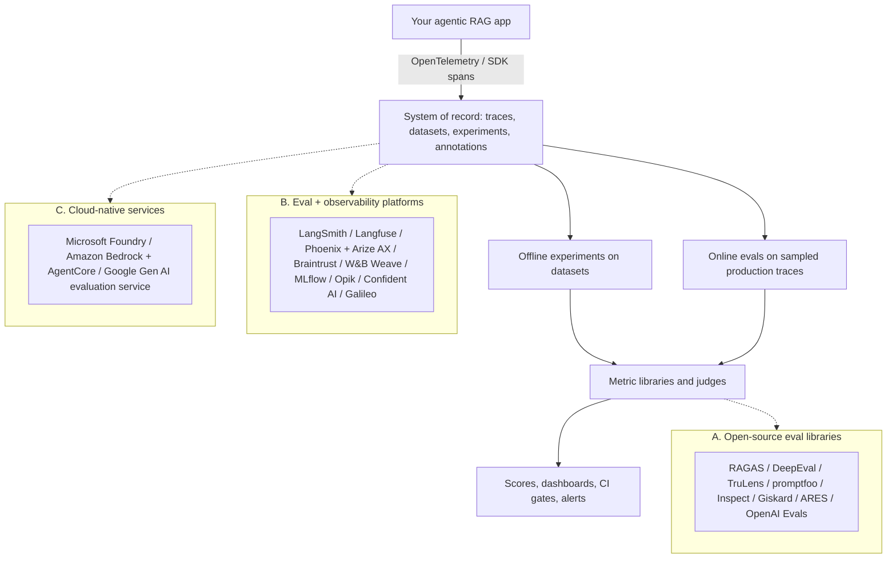
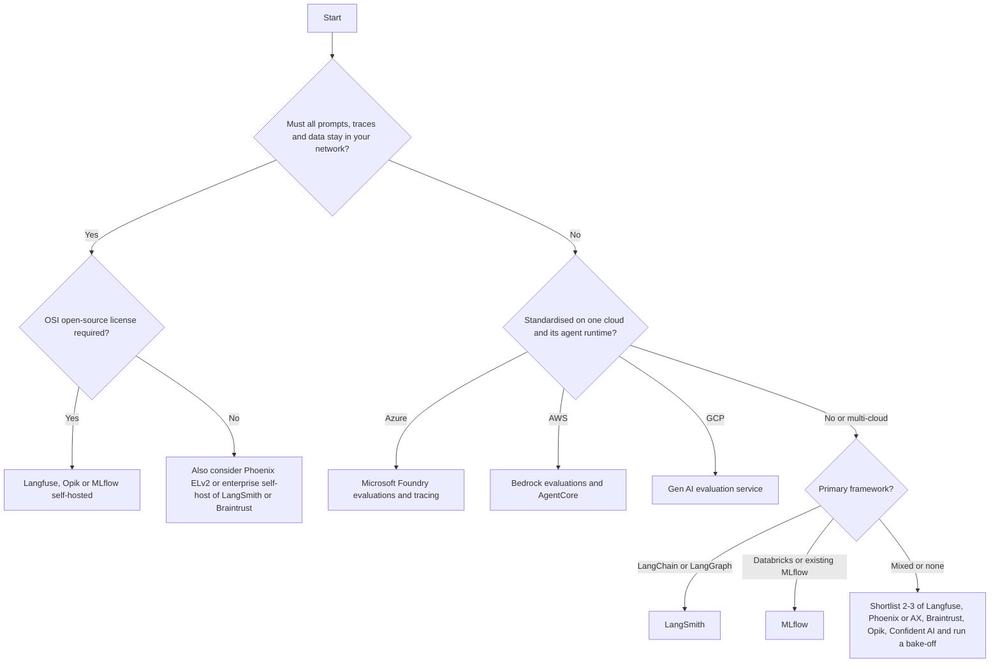
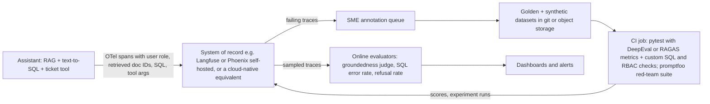

# Eval and Observability Tools: The Landscape (October 2026 snapshot)

> **TL;DR**
>
> - **Separate your system of record from metric libraries.** Pick one platform for traces, datasets, and experiments, and use swappable libraries for metrics.
> - **Instrument once with OpenTelemetry.** Use OpenInference or OTel GenAI semantic conventions so you can switch backends without rewriting application code.
> - **Calibrate every judge on your own data.** Two tools with "faithfulness" metrics use different prompts and scales, so validate against human labels.
> - **Write domain metrics as deterministic code.** Check SQL execution accuracy, RBAC leakage, and tool-argument schemas directly in code.

- **You will learn:**
    - What each major eval tool does best
    - Which metrics each tool ships
    - Capability matrix across 8 dimensions
    - Other tools to recognize, including dormant and discontinued ones
    - How to run a bake-off
- **Prerequisites:** [The evals & guardrails map](../00-foundations/02-the-evals-and-guardrails-map.md), [End-to-end RAG evals](../02-offline-evals/01-end-to-end-rag-evals.md)
- **Related:** [Guardrail tools](./02-guardrail-tools.md), [Observability & tracing](../03-online-evals-and-observability/02-observability-and-tracing.md), [Running offline experiments](../02-offline-evals/08-running-offline-experiments.md), [LLM-as-a-judge](../02-offline-evals/07-llm-as-a-judge.md)

---

## Read this first: this is a dated snapshot

This document reflects the ecosystem as of **October 2026**. The LLM tooling market moves faster than any other part of this repository. In the 18 months before this snapshot, vendors acquired, rebranded, re-licensed, rewrote, or sunset several tools (see [Ownership and status changes](#ownership-and-status-changes-to-know-about)).

- [ ] **Check current project status:** Review the project's README, changelog, latest release date, license, and pricing page before you adopt it.
- [ ] **Verify capabilities directly:** Treat the capability matrix as a starting hypothesis because vendors ship new features every month.
- [ ] **Calibrate every metric on your data:** Never trust a metric by name alone because prompts, judge models, and scales differ ([LLM-as-a-judge](../02-offline-evals/07-llm-as-a-judge.md)).

The concepts in this repository (datasets, metrics, judges, and guardrail architecture) are durable. Tool names change quickly, so design your stack to make tools replaceable.

---

## The landscape at a glance

| Layer | What it gives you | What it does *not* give you | Typical owner |
|---|---|---|---|
| **A. Eval libraries** | Metric implementations, judge prompts, test runners, and synthetic data generators | Durable trace storage, dataset history, team UI, or production sampling | ML and AI engineers in code and CI |
| **B. Platforms** | Tracing, datasets, experiment comparison, annotation queues, online evaluators, and prompt management | Ready-made domain metrics, because you must still define what "good" means | Platform or AI engineering team |
| **C. Cloud-native** | Managed judges, safety evaluators, cloud model catalog integration, IAM, and monitoring | Cross-cloud portability, regional feature parity, or independence from that cloud's models | Teams standardized on that cloud |

> **Heuristic:** Most production teams combine **one platform (B or C) + one or two libraries (A) + custom code** for domain checks like SQL execution accuracy and RBAC leakage.

---

## Ownership and status changes to know about

These changes affect procurement, long-term maintenance risk, and data-residency reviews. We verified all entries against official project pages in October 2026.

| Tool | Change | What it means for you |
|---|---|---|
| **Humanloop** | The team joined Anthropic and **sunset** the Humanloop platform ([announcement](https://humanloop.com)). | Do not start new projects on Humanloop. Export and migrate any existing data. |
| **promptfoo** | Promptfoo joined OpenAI and remains open source under the MIT license ([README](https://github.com/promptfoo/promptfoo)). | You can still use it with any model provider. Watch the roadmap for changes. |
| **Langfuse** | ClickHouse acquired Langfuse in January 2026 and committed to keeping it open source and self-hostable ([blog](https://langfuse.com/blog/joining-clickhouse)). | Core code stays MIT-licensed. Enterprise features live in `ee/` folders under a separate commercial license. |
| **Galileo** | **Cisco** acquired Galileo ([Splunk announcement](https://www.splunk.com/en_us/about-splunk/acquisitions/galileo.html)). Since August 7, 2026, Cisco sells it as **Splunk Agent Observability** ([docs](https://docs.galileo.ai/what-is-galileo)). | Expect product, pricing, and packaging changes. New customers use Splunk documentation. |
| **Weights & Biases (Weave)** | CoreWeave acquired W&B and now hosts the Weave documentation ([docs](https://docs.coreweave.com/products/wandb/weave)). | The product continues actively. Review updated contract and hosting terms. |
| **Patronus AI** | The homepage now highlights RL environments, benchmarks, and research over the eval platform ([site](https://www.patronus.ai/)). | Open models (Lynx, Glider) remain on Hugging Face under **CC-BY-NC-4.0 (non-commercial)**. Verify commercial platform availability before adopting it. |
| **Giskard** | Giskard v3 is a fresh agent-focused rewrite (`giskard-checks`, `giskard-scan`), while **v2 is unmaintained** ([repo](https://github.com/Giskard-AI/giskard-oss)). | Older tutorials that use v2 APIs (RAGET or `giskard.scan` on LLMs) are outdated. |
| **RAGAS** | The repository moved from `explodinggradients/ragas` to `vibrantlabsai/ragas`. The latest release is v0.4.3 (January 2026), and the last commit to `main` was in February 2026. Community pull requests from October 2026 are still open. | RAGAS remains widely used, but maintenance has slowed. Pin the version, wrap metrics behind your own interface, and check release notes carefully because metric names and APIs changed from v0.1 to v0.2+. |
| **OpenAI Evals** | OpenAI is **retiring** the hosted Evals platform, including its graders. Existing evals become read-only on October 31, 2026. The dashboard and API shut down on November 30, 2026 ([deprecations](https://developers.openai.com/api/docs/deprecations#2026-06-03-evals-platform), checked October 18, 2026). | Do not start new projects on hosted Evals. Export and migrate existing evals. OpenAI points to promptfoo ([migration guide](https://developers.openai.com/cookbook/examples/evaluation/moving-from-openai-evals-to-promptfoo)). Treat the `openai/evals` repo as a historical benchmark registry. |
| **TruLens** | Snowflake acquired TruEra and continues to maintain TruLens as open source ([site](https://www.trulens.org/)). | TruLens remains active with 2.x releases in 2026. |
| **WhyLabs** | [WhyLabs, Inc. is discontinuing operations](https://whylabs.ai) and open-sourced its platform. [whylogs](https://github.com/whylabs/whylogs) and [LangKit](https://github.com/whylabs/langkit) have had no pushes since early 2025 and late 2024. | Do not start new monitoring work on WhyLabs. Treat whylogs and LangKit as unmaintained. |
| **UpTrain** | The [UpTrain repo](https://github.com/uptrain-ai/uptrain) has had no pushes since August 2024. | Treat it as dormant. Migrate to a maintained library. |

---

## A. Open-source eval libraries

Each card covers six fields: **Link · Type/License · Strengths · Notable metrics · Best for · Watch-outs**. "Notable metrics" lists documented metrics at snapshot time. Check the official docs because metric names change across versions.

### RAGAS

| Field | Details |
|---|---|
| **Link** | [docs.ragas.io](https://docs.ragas.io) · [GitHub](https://github.com/vibrantlabsai/ragas) |
| **Type / License** | OSS library (Python), Apache-2.0 |
| **Strengths** | Provides the reference implementation of reference-free RAG metrics from the [RAGAS paper](https://arxiv.org/abs/2309.15217). Generates synthetic test sets for RAG and agents using a knowledge-graph approach. Integrates with LangChain, LlamaIndex, Langfuse, and Phoenix. |
| **Notable metrics** | RAG: Context Precision, Context Recall, Context Entities Recall, Noise Sensitivity, Answer Relevancy (formerly Response Relevancy), Faithfulness. Agent/tool: Topic Adherence, Tool Call Accuracy, Tool Call F1, Agent Goal Accuracy. SQL: DataCompy Score (execution-based), SQL Semantic Equivalence (legacy class `LLMSQLEquivalence`). General: Aspect Critic, Simple Criteria, rubric scoring, Factual Correctness, BLEU, ROUGE, chrF, and exact match. |
| **Best for** | Running fast, defensible RAG metrics in notebooks or CI jobs, and bootstrapping synthetic test sets. |
| **Watch-outs** | Judge-based metrics inherit LLM cost and variance. Metric names and APIs changed between v0.1 and v0.2+, so do not compare scores across versions or judge models. Pair RAGAS with a platform for storage and UI. As of October 2026, `main` has had no commits since February 2026, so pin the version and monitor maintenance. |

### DeepEval (and DeepTeam)

| Field | Details |
|---|---|
| **Link** | [deepeval.com](https://deepeval.com) · [GitHub](https://github.com/confident-ai/deepeval) · red teaming: [DeepTeam](https://github.com/confident-ai/deepteam) |
| **Type / License** | OSS (Python), Apache-2.0. Commercial platform: Confident AI. |
| **Strengths** | Works like Pytest for LLMs by combining test cases, metrics, and thresholds in CI unit tests. Ships 50+ LLM-as-a-judge metrics built on QAG, DAG (deep acyclic graph), or [G-Eval](https://arxiv.org/abs/2303.16634). Returns a 0–1 score with reasoning, generates synthetic goldens, simulates conversations, and evaluates agent trajectories. |
| **Notable metrics** | RAG: Answer Relevancy, Faithfulness, Contextual Precision, Contextual Recall, Contextual Relevancy. Agents: tool correctness, task completion, and trajectory metrics. Custom: G-Eval and DAG. Safety: bias, toxicity, PII leakage, and multi-turn conversational metrics. |
| **Best for** | Running evaluations that behave like unit tests and enforce CI regression gates. |
| **Watch-outs** | DeepEval sets a default threshold of 0.5 for every metric, so calibrate and set your own thresholds. Budget carefully because many metrics make multiple judge calls per test case. |

### TruLens

| Field | Details |
|---|---|
| **Link** | [trulens.org](https://www.trulens.org/) · [GitHub](https://github.com/truera/trulens) |
| **Type / License** | OSS (Python), MIT. Maintained by Snowflake. |
| **Strengths** | Popularized the **RAG triad** (context relevance, groundedness, and answer relevance) as a reference-free diagnostic. Provides "feedback functions" for LLM or classical scorers, OpenTelemetry-based tracing, and a local dashboard for comparing experiments. |
| **Notable metrics** | Context Relevance, Groundedness, Answer Relevance, moderation scorers, and custom feedback functions. |
| **Best for** | Prototyping RAG pipelines with local tracing and triad scores, or building on Snowflake-centric stacks. |
| **Watch-outs** | The RAG triad is reference-free. It checks whether an answer is supported and on-topic, not whether it is factually complete. Pair it with reference-based correctness on a golden dataset. |

### promptfoo

| Field | Details |
|---|---|
| **Link** | [promptfoo.dev](https://www.promptfoo.dev) · [GitHub](https://github.com/promptfoo/promptfoo) |
| **Type / License** | OSS CLI + library (Node.js, also installable via `pip` or `brew`), MIT. Part of OpenAI. Commercial enterprise edition available. |
| **Strengths** | Runs declarative YAML test matrices across prompts, providers, test cases, and assertions. Includes a side-by-side comparison UI, fast CI workflows, and a built-in **red-teaming** module with OWASP, NIST, and MITRE presets (see [Guardrail tools](./02-guardrail-tools.md#promptfoo-red-teaming)). |
| **Notable metrics** | Deterministic checks (equals, contains, regex, JSON schema, latency, cost). Model-graded checks (`llm-rubric`, `g-eval`, `factuality`, `agent-rubric`, `select-best`). RAG checks (`context-faithfulness`, `context-recall`, `context-relevance`, `answer-relevance`) and custom JS or Python assertions. |
| **Best for** | Comparing prompts and models, running CI regression suites, and combining offline evals with red teaming in one CLI. |
| **Watch-outs** | Promptfoo is not a production observability platform. Hand-written YAML files scale poorly for large datasets, so store datasets externally and generate configs. |

### OpenAI Evals (repo) and the OpenAI Evals API

| Field | Details |
|---|---|
| **Link** | [GitHub](https://github.com/openai/evals) · [Evals guide](https://developers.openai.com/api/docs/guides/evals) · [Evaluation best practices](https://developers.openai.com/api/docs/guides/evaluation-best-practices) |
| **Status** | **Hosted platform retiring** ([deprecations](https://developers.openai.com/api/docs/deprecations#2026-06-03-evals-platform), checked October 18, 2026). Read-only from October 31, 2026. Dashboard and API shut down November 30, 2026. |
| **Type / License** | OSS framework and registry (repo). GitHub reports the repo license as NOASSERTION (no standard license detected), so review the LICENSE file before you reuse code or data. Hosted Evals API in the commercial OpenAI platform (retiring). |
| **Strengths** | Created an early, influential registry of model benchmarks and model-graded evaluation templates. The best-practices guide stays useful regardless of which tool you choose. |
| **Notable metrics** | Hosted (retiring): string-check, text-similarity, model-graded score or label graders, and Python graders. Repo: exact/fuzzy match and model-graded templates. |
| **Best for** | Historical reference only. Existing hosted users should migrate. OpenAI recommends promptfoo ([migration guide](https://developers.openai.com/cookbook/examples/evaluation/moving-from-openai-evals-to-promptfoo)). |
| **Watch-outs** | The shutdown affects the hosted product only. It does not retire the `openai/evals` repo or the evaluation practices in the best-practices guide. The repo receives light maintenance. |

### Inspect (UK AI Security Institute)

| Field | Details |
|---|---|
| **Link** | [inspect.aisi.org.uk](https://inspect.aisi.org.uk/) · [GitHub](https://github.com/UKGovernmentBEIS/inspect_ai) |
| **Type / License** | OSS (Python), MIT. Developed by the UK AI Security Institute. |
| **Strengths** | Provides a composable evaluation pipeline: **datasets → solvers → scorers**. Includes first-class **agent** support (ReAct, multi-agent, MCP tools, sandboxed execution, and tool approval), model grading, a log viewer, and a VS Code extension. Ships a large ecosystem of standard benchmark implementations. |
| **Notable metrics** | Built-in scorers (match, includes, pattern, model-graded QA and factuality), custom scorers, accuracy, and standard error. |
| **Best for** | Running agentic evaluations that require sandboxed tool execution, reproducible audit logs, or safety and capability benchmarks. |
| **Watch-outs** | Inspect is an offline evaluation harness with no production tracing or online scoring. You must implement RAG-specific metrics yourself or wrap another library. |

### Giskard (open source, v3)

| Field | Details |
|---|---|
| **Link** | [docs.giskard.ai](https://docs.giskard.ai) · [GitHub](https://github.com/Giskard-AI/giskard-oss) |
| **Type / License** | OSS (Python 3.12+), Apache-2.0. Commercial Giskard Hub available. |
| **Strengths** | Rewritten in v3 for agents with an async-first design and light dependencies. Ships `giskard-checks` for multi-turn scenario testing and `giskard-scan` for vulnerability scanning (prompt injection, jailbreaks, harmful content) and RAG knowledge-base quality checks. |
| **Notable metrics** | String, regex, and comparison checks, semantic similarity, and LLM-judge checks (`Groundedness`, `Conformity`, `LLMJudge`). |
| **Best for** | Running scenario-based multi-turn agent tests and automated vulnerability scans in one Python package. |
| **Watch-outs** | Maintainers no longer update v2, and most older blog posts still show v2 APIs. |

### lm-evaluation-harness (EleutherAI): for model benchmarking context

| Field | Details |
|---|---|
| **Link** | [GitHub](https://github.com/EleutherAI/lm-evaluation-harness) |
| **Type / License** | OSS (Python), MIT |
| **Strengths** | Serves as the standard harness for running academic benchmarks against base and instruct models. Supports reproducible few-shot configurations across Hugging Face, vLLM, and commercial API models. |
| **Notable metrics** | Benchmark-defined metrics (accuracy, exact match, log-likelihood perplexity) across hundreds of academic tasks. |
| **Best for** | Selecting a base model or verifying that fine-tuning did not degrade general model capabilities. |
| **Watch-outs** | This harness evaluates base **models**, not your **application**. Academic benchmark scores do not predict your retrieval quality, tool use, or RBAC safety. |

### ARES

| Field | Details |
|---|---|
| **Link** | [GitHub](https://github.com/stanford-futuredata/ARES) · [paper](https://arxiv.org/abs/2311.09476) |
| **Type / License** | OSS research code (Python), Apache-2.0 |
| **Strengths** | Fine-tunes lightweight **classifier judges** on synthetic data for context relevance, answer faithfulness, and answer relevance. Uses **prediction-powered inference (PPI)** ([Angelopoulos et al., 2023](https://arxiv.org/abs/2301.09633)) with a small human-labeled set to compute valid confidence intervals at low cost. |
| **Notable metrics** | Context relevance, answer faithfulness, and answer relevance with statistical confidence intervals. |
| **Best for** | Learning the PPI calibration method and scoring high-volume datasets where frontier LLM judges cost too much. |
| **Watch-outs** | ARES is research code with infrequent updates (last updated March 2025). Borrow the PPI statistical method even if you write your own integration code. |

---

## B. Eval + observability platforms

These platforms act as candidate **systems of record**. They store traces, datasets, experiment runs, human annotations, and scores, and they run evaluators on live traffic. See [Observability & tracing](../03-online-evals-and-observability/02-observability-and-tracing.md) for what to record in spans.

### LangSmith (LangChain)

| Field | Details |
|---|---|
| **Link** | [Evaluation docs](https://docs.langchain.com/langsmith/evaluation) · [Observability docs](https://docs.langchain.com/langsmith/observability) · OSS evaluators: [openevals](https://github.com/langchain-ai/openevals), [agentevals](https://github.com/langchain-ai/agentevals) |
| **Type / License** | Commercial SaaS with enterprise self-hosting. `openevals` and `agentevals` are MIT-licensed. |
| **Strengths** | Integrates deeply with LangChain and LangGraph while working with any framework. Supports datasets, experiment diffs, pairwise comparisons, online production evaluators, annotation queues, pytest/vitest runners, and agent trajectory evaluations. |
| **Notable metrics** | Custom evaluators plus prebuilt LLM judge prompts in `openevals` (correctness, conciseness, hallucination, toxicity, RAG groundedness, retrieval relevance, tool selection, prompt injection, PII leakage) and trajectory evaluators in `agentevals`. |
| **Best for** | Teams building on LangGraph or LangChain that want tracing, datasets, evals, and prompt iteration in one platform. |
| **Watch-outs** | Pricing scales with trace volume, and self-hosting requires an enterprise contract. |

### Langfuse

| Field | Details |
|---|---|
| **Link** | [langfuse.com/docs](https://langfuse.com/docs) · [GitHub](https://github.com/langfuse/langfuse) |
| **Type / License** | OSS (MIT core, with `ee/` folders under a commercial enterprise license) + Langfuse Cloud. Owned by ClickHouse since January 2026. |
| **Strengths** | Ranks among the most popular **self-hostable** LLM observability platforms by GitHub stars. Features OpenTelemetry-native tracing, datasets, experiments, managed LLM-as-a-judge evaluators on live traces or datasets, annotation queues, user feedback capture, and prompt management. |
| **Notable metrics** | Managed LLM-as-a-judge templates (numeric, categorical, or boolean scores mapped to inputs, outputs, metadata, or tool calls) plus any custom score pushed via SDK or API. |
| **Best for** | Organizations with strict data-residency rules that need a self-hosted, framework-neutral system of record. |
| **Watch-outs** | Self-hosting at scale requires operating ClickHouse, PostgreSQL, Redis, and object storage. Check the feature matrix to see which features require an enterprise license. |

### Arize Phoenix and Arize AX

| Field | Details |
|---|---|
| **Link** | [Phoenix docs](https://arize.com/docs/phoenix) · [Phoenix GitHub](https://github.com/Arize-ai/phoenix) · [Arize AX docs](https://arize.com/docs/ax) · instrumentation: [OpenInference](https://github.com/Arize-ai/openinference) |
| **Type / License** | Phoenix: source-available under **Elastic License 2.0** (free to self-host, restricted for managed resale). Arize AX: commercial managed platform. |
| **Strengths** | Builds natively on OpenTelemetry and OpenInference semantic conventions for portable traces. Ships an evaluation library with LLM-judge templates for RAG and agents, dataset and experiment tracking, and local notebook or server modes. Arize AX adds managed scale, online monitoring, and enterprise observability. |
| **Notable metrics** | LLM-judge templates for hallucination, QA correctness, retrieval relevance, toxicity, summarization, and tool-calling or agent trajectories, plus custom code evaluators. |
| **Best for** | OpenTelemetry-first teams that want a free self-hosted tool today and a managed enterprise upgrade path later. |
| **Watch-outs** | ELv2 is not an OSI-approved open-source license. Check with your legal team if you embed Phoenix in a commercial service. |

### Braintrust

| Field | Details |
|---|---|
| **Link** | [braintrust.dev](https://www.braintrust.dev/) · [docs](https://www.braintrust.dev/docs) · scorers: [autoevals](https://github.com/braintrustdata/autoevals) (MIT) |
| **Type / License** | Commercial SaaS. Enterprise plan offers a hybrid self-hosted data plane (BYOC) while Braintrust hosts the UI control plane. |
| **Strengths** | Centers on fast experiment loops (`Eval(...)` in code with visual diffs in the UI). Offers interactive prompt playgrounds, online production log scoring, multi-language SDKs (Python, TypeScript, Go, Ruby, C#, Java, Rust), and strong dataset and human-review workflows. |
| **Notable metrics** | Open-source `autoevals` scorers (factuality, closed-QA, RAG metrics, embedding similarity, structured JSON diffs) plus custom code and LLM-judge scorers. |
| **Best for** | Product and engineering teams that iterate rapidly on prompts and agents and want tight experiment comparison workflows. |
| **Watch-outs** | Self-hosting requires an enterprise plan and uses a hybrid architecture where the control plane remains cloud-hosted. |

### W&B Weave

| Field | Details |
|---|---|
| **Link** | [Weave docs](https://docs.coreweave.com/products/wandb/weave) · [GitHub](https://github.com/wandb/weave) |
| **Type / License** | Apache-2.0 SDK with a commercial hosted W&B platform (dedicated and self-managed enterprise options available). Owned by CoreWeave. |
| **Strengths** | Uses lightweight `@weave.op` decorators for tracing and pairs them with dataset evaluations, leaderboards, built-in scorers, and human feedback. Fits naturally if your team already uses Weights & Biases for model training. |
| **Notable metrics** | Built-in and custom LLM-judge or code scorers for hallucination, relevance, and moderation. |
| **Best for** | Organizations already using W&B for ML experiment tracking that want one vendor for training and application evals. |
| **Watch-outs** | Review updated data-hosting terms following the CoreWeave acquisition. Weave delivers the most value when paired with W&B Models. |

### MLflow (GenAI evaluation & tracing)

| Field | Details |
|---|---|
| **Link** | [MLflow for Agents and LLMs](https://mlflow.org/docs/latest/genai/) · [GitHub](https://github.com/mlflow/mlflow) · [Predefined judges](https://mlflow.org/docs/latest/genai/eval-monitor/scorers/llm-judge/predefined/) |
| **Type / License** | OSS, Apache-2.0. Managed offerings available on Databricks and major clouds. |
| **Strengths** | MLflow 3 focuses heavily on GenAI with OpenTelemetry-compatible tracing, `mlflow.genai.evaluate`, predefined and custom LLM judges, evaluation datasets, a prompt registry, an AI gateway, and production monitoring. Integrates with existing MLOps governance and lineage. |
| **Notable metrics** | Predefined judges: `RetrievalGroundedness`, `RetrievalRelevance`, `RetrievalSufficiency`, `RelevanceToQuery`, `Correctness`, `Safety`, `Guidelines`, and experimental tool-call (`ToolCallCorrectness`, `ToolCallEfficiency`) and multi-turn judges. |
| **Best for** | Databricks users and teams that already run MLflow for classical ML and want one open-source platform. |
| **Watch-outs** | Several agent and multi-turn judges remain experimental and require full traces. Managed Databricks deployments offer the richest monitoring UI. |

### Comet Opik

| Field | Details |
|---|---|
| **Link** | [Opik docs](https://www.comet.com/docs/opik/) · [GitHub](https://github.com/comet-ml/opik) |
| **Type / License** | OSS, Apache-2.0. Managed Comet Cloud option available. |
| **Strengths** | Provides a fully open-source, Apache-2.0 server for tracing, datasets, offline experiments, online production evaluation rules, prompt optimization, and agent observability. |
| **Notable metrics** | Deterministic checks (equals, contains, regex, BLEU, ROUGE) and LLM-judge metrics (hallucination, answer relevance, context precision, context recall, factuality, moderation, usefulness, trajectory accuracy, G-Eval, and LLM juries). |
| **Best for** | Teams that want an Apache-2.0 self-hostable platform with both offline and online evaluations. |
| **Watch-outs** | Self-hosting requires your team to operate and scale the underlying storage databases. |

### Galileo (now Splunk Agent Observability)

| Field | Details |
|---|---|
| **Link** | [galileo.ai](https://galileo.ai/) · [docs](https://docs.galileo.ai/what-is-galileo) |
| **Type / License** | Commercial platform. **Cisco** acquired Galileo, and since August 7, 2026 it is sold as **Splunk Agent Observability** ([announcement](https://www.splunk.com/en_us/about-splunk/acquisitions/galileo.html)). |
| **Strengths** | Ships 20+ built-in evaluators for RAG, agents, safety, and security alongside custom LLM-judge metrics. Distills judge metrics into small **Luna** evaluator models for low-latency, low-cost scoring across 100% of production traffic. |
| **Notable metrics** | Agentic: Action Advancement, Action Completion, Agent Efficiency, Agent Flow, Tool Selection Quality, Tool Error, Reasoning Coherence. Quality: Correctness, Ground Truth Adherence, Instruction Adherence, RAG, safety, and Autotune custom judges. |
| **Best for** | Enterprises that want small evaluator models for full-traffic scoring, and Splunk customers consolidating observability. |
| **Watch-outs** | Product packaging and roadmaps are shifting after the Cisco acquisition and the move into the Splunk portfolio. Confirm current pricing and deployment options with sales. |

### Patronus AI

| Field | Details |
|---|---|
| **Link** | [patronus.ai](https://www.patronus.ai/) · models: [Lynx](https://huggingface.co/PatronusAI/Llama-3-Patronus-Lynx-8B-Instruct), [Glider](https://huggingface.co/PatronusAI/glider) |
| **Type / License** | Commercial offering plus open-weight evaluator models on Hugging Face. Lynx and Glider are licensed **CC-BY-NC-4.0 (non-commercial)**. |
| **Strengths** | Releases specialized open-weight evaluator models: **Lynx** for RAG hallucination detection and **Glider** for small general-purpose rubric judging, along with public evaluation benchmarks. |
| **Notable metrics** | Hallucination and faithfulness detection (Lynx) and rubric-based pass/fail or score judging (Glider). |
| **Best for** | Research and non-commercial use of a specialized open-weight judge for RAG faithfulness or rubric checks. For commercial self-hosting, use an Apache-2.0 model such as [Granite Guardian](./02-guardrail-tools.md#ibm-granite-guardian) or [gpt-oss-safeguard](./02-guardrail-tools.md#openai-gpt-oss-safeguard), or train an ARES-style classifier. |
| **Watch-outs** | **License:** The CC-BY-NC-4.0 license does not allow commercial use, so most enterprise production deployments cannot use these weights. **Status:** In October 2026, the Patronus homepage shifted focus to RL environments and benchmarks. Verify whether the commercial eval platform remains supported before adopting it. |

### Humanloop (sunset)

| Field | Details |
|---|---|
| **Link** | [humanloop.com](https://humanloop.com) |
| **Status** | The Humanloop team joined Anthropic and sunset the platform. We list it here only so you recognize the name in older posts. **Do not adopt.** |

### Confident AI

| Field | Details |
|---|---|
| **Link** | [confident-ai.com](https://www.confident-ai.com/) · [docs](https://www.confident-ai.com/docs) |
| **Type / License** | Commercial platform built by the DeepEval maintainers. Uses DeepEval's open-source metric definitions. |
| **Strengths** | Turns DeepEval unit tests into a shared team platform with dataset management, CI/CD regression gates, trace/span/thread evaluation, online monitoring, drift alerts, human alignment workflows, multi-turn simulation, and red teaming (DeepTeam). |
| **Notable metrics** | All DeepEval metrics across RAG, agents, multi-turn conversations, safety, G-Eval, and DAG. |
| **Best for** | Teams already using DeepEval in code that want a managed UI, historical tracking, and online monitoring without rewriting metrics. |
| **Watch-outs** | Confident AI is commercial software. Confirm cloud versus on-premises deployment options if you handle regulated data. |

### Other observability and eval tools

These tools do not have full cards, but you will see them in shortlists. We did not score them in the comparison matrix. Check each one with the same bake-off before you adopt it.

| Tool | Type / License | What it does | Note |
|---|---|---|---|
| [OpenLLMetry](https://github.com/traceloop/openllmetry) (Traceloop) | OSS, Apache-2.0 | OpenTelemetry instrumentations for LLM providers and vector databases. Exports standard OTel spans to any backend. | An instrumentation layer, not a system of record. Use it to send the same traces to several bake-off candidates. |
| [Helicone](https://github.com/Helicone/helicone) | OSS, Apache-2.0, plus cloud | AI gateway and LLM observability: request logging, sessions, cost and latency tracking, prompt versions, datasets. | Proxy-based. All model traffic goes through the gateway, so plan for its latency and availability. |
| [Pydantic Logfire](https://logfire.pydantic.dev/docs/) | SDK MIT ([repo](https://github.com/pydantic/logfire)); platform commercial | OpenTelemetry-based observability for Python apps and LLM/agent calls. Works well with Pydantic AI. | The SDK is open source, but the backend is a commercial service. |
| [Laminar](https://github.com/lmnr-ai/lmnr) | OSS, Apache-2.0, plus cloud | OpenTelemetry-native tracing for agents, evals SDK and CLI for CI, datasets, annotation, and plain-English "signals" over agent runs. | Young project. Check release cadence. |
| [Arthur Engine](https://github.com/arthur-ai/arthur-engine) | OSS, MIT | Real-time guardrail metrics (PII, hallucination, prompt injection, toxicity), OpenInference trace collection, and continuous evals on live traces. | Classic ML monitoring features need the commercial Arthur Platform. |
| [Datadog LLM Observability](https://docs.datadoghq.com/llm_observability/) | Commercial SaaS | LLM and agent traces in Datadog, with built-in evaluations such as sensitive-data scanning and prompt-injection detection, plus experiments. | Good fit if Datadog is already your APM. Check trace-volume pricing. |
| [Cleanlab TLM](https://help.cleanlab.ai/tlm/) | Commercial API; client MIT ([repo](https://github.com/cleanlab/cleanlab-tlm)) | Gives a real-time trustworthiness score for any LLM response, to flag likely hallucinations. | A scoring service, not a tracing platform. Calibrate its threshold on your labels. |
| [HELM](https://crfm.stanford.edu/helm/) (Stanford CRFM) | OSS, Apache-2.0 ([repo](https://github.com/stanford-crfm/helm)) | Holistic, reproducible benchmark framework and public leaderboards for foundation models. | For base-model selection, not for app-level RAG or agent evals. |
| [UpTrain](https://github.com/uptrain-ai/uptrain) | OSS, Apache-2.0 | RAG and LLM eval checks. | **Dormant:** no pushes since August 2024. Do not adopt for new work. |
| [WhyLabs LangKit / whylogs](https://github.com/whylabs/langkit) | OSS, Apache-2.0 | Text-quality and safety telemetry for LLM apps. | **Unmaintained:** [WhyLabs is discontinuing operations](https://whylabs.ai). Do not adopt for new work. |

---

## C. Cloud-native evaluation services

Choose a cloud-native service when your organization already standardizes on that cloud and wants unified IAM, private networking, billing, and model catalog access. Expect tighter coupling to that cloud's regions and models.

### Microsoft Foundry (formerly Azure AI Foundry): evaluations & observability

| Field | Details |
|---|---|
| **Link** | [Observability concepts](https://learn.microsoft.com/en-us/azure/foundry/concepts/observability) · [Built-in evaluators](https://learn.microsoft.com/en-us/azure/foundry/concepts/built-in-evaluators) · [RAG evaluators](https://learn.microsoft.com/en-us/azure/foundry/concepts/evaluation-evaluators/rag-evaluators) |
| **Type** | Managed Azure cloud service + Azure AI Evaluation Python SDK |
| **Strengths** | Offers a large catalog of built-in cloud evaluators across quality, RAG, safety, security, and agents (many agent evaluators are in preview). Integrates OpenTelemetry tracing with Azure Monitor Application Insights, production dashboards, alerts, and AI red teaming. |
| **Notable metrics** | General: Coherence, Fluency, Similarity, F1, BLEU, GLEU, ROUGE, METEOR. RAG: Retrieval, Document Retrieval, Groundedness (1–5 judge), Groundedness Pro (preview), Relevance, Response Completeness (preview). Safety: Hate, Sexual, Violence, Self-Harm, Protected Materials, Indirect Attack (XPIA), Code Vulnerability, Ungrounded Attributes, Prohibited Actions, Sensitive Data Leakage. Agent: Task Adherence, Task Completion, Intent Resolution, Task Navigation Efficiency, Tool Call Accuracy. |
| **Best for** | Azure-standardized enterprises and agents built on Microsoft Agent Framework or Foundry Agent Service. |
| **Watch-outs** | Several evaluators remain in preview, and hosted safety evaluators vary by region. Do not mix Groundedness and Groundedness Pro scores because they use different methods. |

### Amazon Bedrock evaluations (+ AgentCore Evaluations)

| Field | Details |
|---|---|
| **Link** | [Bedrock evaluations](https://docs.aws.amazon.com/bedrock/latest/userguide/evaluation.html) · [RAG evaluations](https://docs.aws.amazon.com/bedrock/latest/userguide/evaluation-kb.html) · [AgentCore Evaluations](https://docs.aws.amazon.com/bedrock-agentcore/latest/devguide/evaluations.html) |
| **Type** | Managed AWS services |
| **Strengths** | Runs programmatic, human-worker, and LLM-as-a-judge model evaluations. Evaluates **RAG systems** in retrieve-only or retrieve-and-generate modes against Bedrock Knowledge Bases or your own exported RAG outputs. **AgentCore Evaluations** scores OpenTelemetry and OpenInference agent traces from Strands or LangGraph. It supports online, on-demand, batch, and dataset evaluation, plus simulation, with built-in, third-party, and custom evaluators. |
| **Notable metrics** | LLM-judge quality metrics for models and RAG (correctness, completeness, helpfulness, retrieval relevance, and coverage), built-in AgentCore evaluators, and custom metrics. |
| **Best for** | AWS-native teams, especially those using Bedrock Knowledge Bases or Bedrock AgentCore. |
| **Watch-outs** | Some RAG evaluation metrics require ground-truth references in your dataset, and judge model availability varies by AWS region. |

### Google Gen AI evaluation service (Vertex AI → Gemini Enterprise Agent Platform docs)

| Field | Details |
|---|---|
| **Link** | [Gen AI evaluation service overview](https://docs.cloud.google.com/gemini-enterprise-agent-platform/models/evaluation-overview) (formerly under Vertex AI docs) |
| **Type** | Managed Google Cloud service + Python SDK |
| **Strengths** | Features **adaptive rubrics** that automatically generate tailored pass/fail tests for each prompt. Also supports static rubrics, deterministic computation metrics, custom Python functions, dataset creation from production logs, and agent trace evaluation. |
| **Notable metrics** | Adaptive and static rubric-based judge metrics, ROUGE and BLEU computation metrics, agent trajectory and response metrics, and custom Python functions. |
| **Best for** | GCP-standardized teams comparing Gemini and third-party models or validating model migrations on domain data. |
| **Watch-outs** | Google recently moved documentation from Vertex AI to Gemini Enterprise Agent Platform. Pin your SDK versions to avoid breaking changes. |

---

## Comparison matrix

**Legend:**

- ✅ first-class / native
- 🟡 partial, via integration, preview, or enterprise-only
- ❌ not a primary capability (may exist in limited form)
- ❔ not verified (ask the vendor)

For libraries, "Self-host" means the library runs entirely in your environment, even if it calls an external LLM judge API.

> This matrix reflects our assessment of public documentation in **October 2026**. Verify capabilities before you decide.

| Tool | RAG metrics | Agent / tool evals | LLM-judge customization | Dataset mgmt | Tracing | Online evals | CI integration | Self-host |
|---|---|---|---|---|---|---|---|---|
| **RAGAS** | ✅ | 🟡 | ✅ | 🟡 (generation, no store) | ❌ | ❌ | 🟡 | ✅ |
| **DeepEval** | ✅ | ✅ | ✅ | 🟡 (synthesizer, store via Confident AI) | 🟡 | 🟡 (via Confident AI) | ✅ | ✅ |
| **TruLens** | ✅ | 🟡 | ✅ | 🟡 | ✅ | 🟡 | 🟡 | ✅ |
| **promptfoo** | 🟡 | ✅ (trajectory assertions, `agent-rubric`) | ✅ | 🟡 (YAML/CSV) | 🟡 (OTLP receiver for eval runs) | ❌ | ✅ | ✅ |
| **OpenAI Evals** | ❌ | 🟡 | ✅ | 🟡 (hosted, retiring) | 🟡 (hosted, retiring) | ❌ | 🟡 | 🟡 (repo only) |
| **Inspect** | 🟡 (build your own) | ✅ | ✅ | 🟡 | 🟡 (eval logs) | ❌ | 🟡 | ✅ |
| **Giskard v3** | ✅ | ✅ | ✅ | 🟡 | ❌ | ❌ | 🟡 | ✅ |
| **lm-eval-harness** | ❌ | ❌ | ❌ | 🟡 (benchmarks) | ❌ | ❌ | 🟡 | ✅ |
| **ARES** | ✅ | ❌ | 🟡 (trained judges) | 🟡 | ❌ | ❌ | ❌ | ✅ |
| **LangSmith** | 🟡 (openevals / custom) | ✅ | ✅ | ✅ | ✅ | ✅ | ✅ | 🟡 (enterprise) |
| **Langfuse** | 🟡 (judge templates, RAGAS) | 🟡 | ✅ | ✅ | ✅ | ✅ | 🟡 | ✅ |
| **Phoenix / Arize AX** | ✅ | ✅ | ✅ | ✅ | ✅ | 🟡 (Phoenix) / ✅ (AX) | 🟡 | ✅ (Phoenix, ELv2) / ❔ (AX) |
| **Braintrust** | 🟡 (autoevals) | 🟡 | ✅ | ✅ | ✅ | ✅ | ✅ | 🟡 (enterprise, hybrid) |
| **W&B Weave** | 🟡 | 🟡 | ✅ | ✅ | ✅ | 🟡 | 🟡 | 🟡 (enterprise) |
| **MLflow** | ✅ | ✅ | ✅ | ✅ | ✅ | 🟡 | 🟡 | ✅ |
| **Opik** | ✅ | 🟡 | ✅ | ✅ | ✅ | ✅ | 🟡 | ✅ |
| **Galileo / Splunk (Cisco)** | ✅ | ✅ | ✅ | ✅ | ✅ | ✅ | 🟡 | ❔ |
| **Confident AI** | ✅ | ✅ | ✅ | ✅ | ✅ | ✅ | ✅ | ❔ |
| **Microsoft Foundry** | ✅ | ✅ | ✅ | 🟡 | ✅ | ✅ | 🟡 | ❌ |
| **Bedrock + AgentCore** | ✅ | ✅ (AgentCore) | ✅ | 🟡 | 🟡 | ✅ (AgentCore) | 🟡 | ❌ |
| **Google Gen AI eval** | 🟡 | ✅ | ✅ | 🟡 | 🟡 | 🟡 | 🟡 | ❌ |

We omitted **Patronus AI** (commercial platform status unclear) and **Humanloop** (sunset) from the matrix.

### What the matrix does *not* capture

- **Domain metrics:** No tool checks whether your text-to-SQL agent leaked rows forbidden by the user's role. You must write those checks yourself ([Text-to-SQL evals](../02-offline-evals/05-text-to-sql-evals.md), [Access control & RBAC](../04-guardrails/06-access-control-rbac.md)).
- **Judge alignment:** A ✅ for judge customization means you can edit the prompt, not that the default judge agrees with your domain experts.
- **Scale and cost:** Trace ingestion pricing, judge token costs, and retention limits often drive total cost more than base license fees.
- **Enterprise security:** Check SSO/SCIM, internal RBAC, audit logs, pre-ingestion PII redaction, and data residency.

---

## Same concept, different names: a metric crosswalk

Different tools use different names and implementations for the same core concept. Because their underlying prompts and scoring logic differ, **never compare raw scores across tools**.

| Concept | RAGAS | DeepEval | TruLens | MLflow | Microsoft Foundry |
|---|---|---|---|---|---|
| Answer supported by retrieved context | Faithfulness | Faithfulness | Groundedness | RetrievalGroundedness | Groundedness / Groundedness Pro |
| Answer addresses the question | Answer Relevancy | Answer Relevancy | Answer Relevance | RelevanceToQuery | Relevance |
| Retrieved chunks are relevant | Context Precision | Contextual Precision / Contextual Relevancy | Context Relevance | RetrievalRelevance | Retrieval |
| Retrieved chunks cover what's needed | Context Recall | Contextual Recall | N/A | RetrievalSufficiency (closest) | Document Retrieval (needs labels) |
| Answer matches reference | Factual Correctness | custom G-Eval / correctness-style metrics | N/A | Correctness | Similarity, F1, Response Completeness |
| Tool calls correct | Tool Call Accuracy / Tool Call F1 | tool correctness metric | N/A | ToolCallCorrectness | Tool Call Accuracy |

See [End-to-end RAG evals](../02-offline-evals/01-end-to-end-rag-evals.md), [Retrieval metrics](../02-offline-evals/02-retrieval-metrics.md), and [Agent, tool & trajectory evals](../02-offline-evals/04-agent-tool-and-trajectory-evals.md) for mathematical definitions and formulas.

---

## How to choose

### Step 1: Decide the system of record first

Your system of record stores traces, datasets, experiments, and annotations. Because it is the hardest piece to replace, choose your platform first and select metric libraries second.

### Step 2: Add libraries for metrics and CI

| Need | Good default | Alternatives |
|---|---|---|
| Reference-free RAG metrics | RAGAS or DeepEval | TruLens triad, Phoenix evals, MLflow judges |
| Evals as unit tests in CI | DeepEval (pytest) or promptfoo (CLI/YAML) | LangSmith pytest integration, Braintrust `Eval` |
| Agentic evals with sandboxed tool execution | Inspect | Giskard checks, framework-native trajectory evaluators |
| Prompt/model A/B across providers | promptfoo | Braintrust playgrounds, Google Gen AI eval |
| Cheap high-volume scoring | Small judge models (Galileo Luna; Lynx and Glider for non-commercial use only) or ARES-style classifiers | Apache-2.0 guard models (Granite Guardian), sampled LLM judges, or Cleanlab TLM trust scores |
| Statistical confidence on small label sets | ARES PPI approach | Bootstrap confidence intervals in code ([Running offline experiments](../02-offline-evals/08-running-offline-experiments.md)) |
| Base-model selection | lm-evaluation-harness, [HELM](https://crfm.stanford.edu/helm/) | Cloud model-evaluation jobs |
| Red teaming | promptfoo redteam, garak, PyRIT, DeepTeam | See [Guardrail tools](./02-guardrail-tools.md#red-teaming-tools) |

### Step 3: Rules of thumb

1. **Instrument with OpenTelemetry:** Use OpenInference or the [OTel GenAI semantic conventions](https://github.com/open-telemetry/semantic-conventions-genai) so your traces stay portable across Langfuse, Phoenix, MLflow, Foundry, and AgentCore. The GenAI conventions now live in their own repository and still have **Development** status, so attribute names can change. Pin the semconv version in your instrumentation and map attributes in your OTel collector if a backend lags.
2. **Own your datasets:** Store golden datasets as JSONL or Parquet in Git or object storage, and treat your eval tool as a synced cache ([Dataset strategy](../01-datasets/01-dataset-strategy.md)).
3. **Own your judge prompts:** Version judge prompts in Git and calibrate them against SME labels using TPR, TNR, and Cohen's $\kappa$ ([LLM-as-a-judge](../02-offline-evals/07-llm-as-a-judge.md)).
4. **Pin library and judge versions:** Lock both your eval library version and your judge model snapshot so silent upgrades do not shift your scores.
5. **Write domain checks in plain code:** Implement SQL execution accuracy, RBAC leakage, citation checks, and tool-schema validation as fast, deterministic code.
6. **Run only one system of record:** Avoid splitting traces and datasets across multiple platforms. Use one platform and as many metric libraries as you need.
7. **Budget judge token costs:** Multiply examples, metrics, judge calls per metric, and token price before you schedule nightly runs.

### Step 4: Run a bake-off on your own data

Vendor feature lists look similar on paper, so test how each tool fits your data and workflow. Time-box your bake-off to 1–2 weeks.

- [ ] **Select 2–3 candidate platforms** using the decision flowchart above.
- [ ] **Instrument one branch of your app** with OpenTelemetry so you can send identical traces to each candidate.
- [ ] **Load the same golden dataset** of 100–200 RAG, SQL, and tool-call examples into each platform.
- [ ] **Implement 2–3 core metrics** (such as faithfulness, SQL execution accuracy, and citation validity) in each tool.
- [ ] **Compare built-in judges against SME labels** for agreement, false-pass rate, cost, and latency. Use the bar in [LLM-as-a-judge](../02-offline-evals/07-llm-as-a-judge.md): ≥ 100 labelled items with ≥ 30–50 FAIL examples, TPR and TNR ≥ 0.85, and Cohen's $\kappa$ ≥ 0.60 (≥ 0.90 for high-risk slices).
- [ ] **Test the SME annotation workflow:** Verify that a reviewer can grade a trace in under 1 minute and promote failures to a dataset in two clicks.
- [ ] **Test online production evaluations:** Sample 5% of live traces, run a groundedness judge, and trigger a test alert.
- [ ] **Test CI regression gating:** Configure a pull request check that fails on newly failing items in critical slices, or on a paired test against a re-run baseline ([Running offline experiments](../02-offline-evals/08-running-offline-experiments.md)).
- [ ] **Verify security and governance:** Check SSO, role-based access, pre-ingestion PII redaction, retention controls, data residency, and audit logs.
- [ ] **Project 12-month total cost** based on your expected production trace volume and judge call frequency.
- [ ] **Verify your exit path:** Export a full trace, dataset, score, and annotation bundle in an open format like JSONL or Parquet.

---

## A reference stack for the running example

Our running example is an internal enterprise assistant. It answers questions over company docs using vector search, queries a data warehouse via text-to-SQL, creates support tickets, and enforces per-user RBAC.

| Concern | Choice in this example | Why |
|---|---|---|
| Tracing + datasets + annotations | One self-hosted platform (Langfuse or Phoenix) or your primary cloud platform | Keeps sensitive company docs and warehouse results in one controlled source of truth |
| RAG metrics | RAGAS or DeepEval faithfulness, context precision, context recall, and answer relevancy | Mature, well-documented, and easy to calibrate against SME labels |
| Text-to-SQL | Custom execution accuracy on a test warehouse, result-set comparison, plus RAGAS SQL metrics | Execution checks catch logic bugs that string similarity misses ([Text-to-SQL evals](../02-offline-evals/05-text-to-sql-evals.md)) |
| Tool calls | Deterministic checks on tool name and JSON schema arguments, plus a trajectory judge for multi-step flows | Deterministic checks are fast and exact ([Agent, tool & trajectory evals](../02-offline-evals/04-agent-tool-and-trajectory-evals.md)) |
| RBAC | Custom test suite that runs identical queries across roles and checks that no forbidden rows or docs appear | No off-the-shelf eval tool tests your application's access rules ([Access control & RBAC](../04-guardrails/06-access-control-rbac.md)) |
| CI gates | DeepEval with pytest or promptfoo in GitHub Actions to block regressions | Gives developers fast pass/fail feedback before merge |
| Red teaming | promptfoo redteam, garak, or PyRIT against staging before each release | Catches jailbreaks and privilege escalation before production ([Guardrail tools](./02-guardrail-tools.md)) |
| Online | Sampled groundedness judge on 1–5% of traffic plus 100% of flagged or negative-feedback traces, 100% deterministic checks, and user feedback capture | Controls judge cost while monitoring all live traffic ([Online evals](../03-online-evals-and-observability/01-online-evals.md)) |

---

## Common mistakes

| Mistake | Consequence | Do instead |
|---|---|---|
| Choosing a tool before defining metrics and datasets | Your metrics reflect what the tool ships rather than what your users need | Start from [failure modes](../00-foundations/03-agentic-rag-failure-modes.md), define metrics, and then choose tools |
| Trusting default judges and 0.5 thresholds | Creates a false sense of quality and noisy CI failures | Calibrate judges against SME labels and set per-metric thresholds |
| Comparing scores across different tools or versions | Produces invalid, apples-to-oranges comparisons | Compare experiment runs only within one pinned tool and judge version |
| Storing raw PII in a cloud SaaS trace store | Triggers security and compliance incidents | Redact PII in your SDK or OTel collector before export, or self-host |
| Running every check through an LLM judge | Explodes token cost and evaluation latency | Run deterministic code checks first and reserve LLM judges for nuance |
| Ignoring open-source project health | Leaves your pipeline stuck on an archived or unmaintained library | Audit release cadence, maintainers, and ownership changes every year |

---

## Key takeaways

- **Separate your system of record from your metric libraries:** Choose one platform for traces and datasets, and keep metric libraries swappable.
- **Prevent vendor lock-in early:** Instrument with **OpenTelemetry** and store your datasets and judge prompts in **your own Git repository**.
- **Never equate metrics by name alone:** Calibrate every judge on your domain data and never compare raw scores across tools or versions.
- **Filter by data residency first:** Self-host Langfuse, Opik, or MLflow (OSI licenses) or Phoenix (ELv2) when data cannot leave your network.
- **Write domain checks in code:** Implement SQL execution accuracy, RBAC leakage, and citation checks as deterministic code.
- **Re-verify tool status yearly:** The market consolidates quickly (Humanloop sunset, OpenAI hosted Evals retiring, promptfoo → OpenAI, Langfuse → ClickHouse, Galileo → Cisco/Splunk, WhyLabs discontinued).

## Further reading

- [Guardrail tools](./02-guardrail-tools.md): companion landscape for runtime guardrails, policy engines, and red teaming
- [Observability & tracing](../03-online-evals-and-observability/02-observability-and-tracing.md): what to record on every trace and span
- [Running offline experiments](../02-offline-evals/08-running-offline-experiments.md): experiment design, statistical significance, and CI gates
- [Implementation playbook](../05-decision-framework/04-implementation-playbook.md): where tool selection fits in your rollout sequence
- Hamel Husain, [Your AI Product Needs Evals](https://hamel.dev/blog/posts/evals/): why error analysis must come before tool selection
- Eugene Yan, [Evaluating the Effectiveness of LLM-Evaluators](https://eugeneyan.com/writing/llm-evaluators/): how to validate any tool's LLM judge
- OpenAI, [Evaluation best practices](https://developers.openai.com/api/docs/guides/evaluation-best-practices)
- Anthropic, [Demystifying evals for AI agents](https://www.anthropic.com/engineering/demystifying-evals-for-ai-agents)
- [References](../07-references/README.md): full curated reading list
