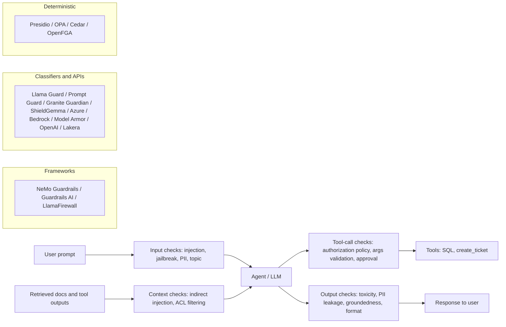
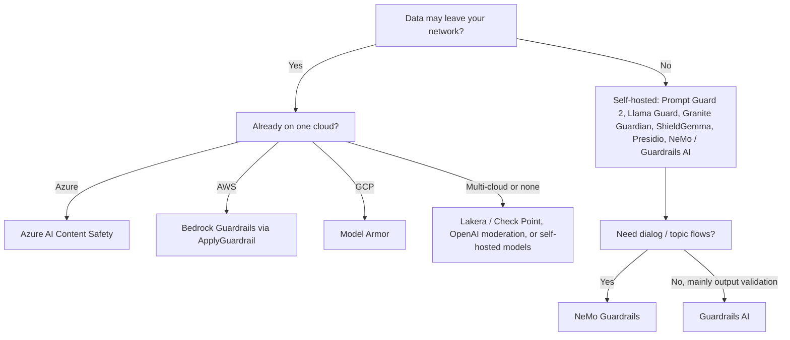

# Guardrail Tools: The Landscape (October 2026 snapshot)

> **TL;DR**
>
> - **Enforce authorization with deterministic policy engines first.** Use OPA, Cedar, or OpenFGA for RBAC and tool access before adding probabilistic classifiers.
> - **Combine specialized guardrail layers.** Pair an injection classifier or managed API, a PII engine, a policy engine, and red-teaming tools.
> - **Know what each detector actually checks.** Content-safety models like Llama Guard do not detect prompt injection or enterprise data leaks.
> - **Measure every guardrail on your own traffic.** Track false-positive rate, false-negative rate, and p95 latency across your domain documents and languages.

- **You will learn:**
    - What each guardrail tool detects and where it runs
    - Open models vs managed APIs vs policy engines
    - Capability matrix and latency profiles
    - How to evaluate guardrails
- **Prerequisites:** [Guardrails architecture](../04-guardrails/01-guardrails-architecture.md), [Threat model & OWASP](../04-guardrails/07-threat-model-owasp.md)
- **Related:** [Eval & observability tools](./01-eval-and-observability-tools.md), [Guardrail selection decision tree](../05-decision-framework/02-guardrail-selection-decision-tree.md), [Input guardrails](../04-guardrails/02-input-guardrails.md), [Tool & action guardrails](../04-guardrails/05-tool-and-action-guardrails.md)

---

## Read this first: this is a dated snapshot

This document reflects the ecosystem as of **October 2026**. Security companies acquired several guardrail vendors during 2025–2026, and maintainers archived several popular open-source projects (see [Ownership and status changes](#ownership-and-status-changes-to-know-about)).

- [ ] **Check repository status first:** Review the project's README, changelog, latest release date, license, and archive status before you adopt it.
- [ ] **Look past detector marketing names:** "Prompt injection detection" can mean a 22M-parameter classifier or a slow reasoning LLM with different recall and latency.
- [ ] **Benchmark every guardrail on your own data:** Never deploy a guardrail in production before you measure its accuracy and latency ([Evaluate guardrails on your own data](#evaluate-guardrails-on-your-own-data)).

The architecture in [04-guardrails](../04-guardrails/README.md) is durable, while product names change rapidly. Wrap every guardrail behind your own interface so you can swap vendors easily.

---

## The landscape at a glance

Frameworks **orchestrate** checks across the request path. Classifiers and managed APIs **detect** risks probabilistically. Policy engines and PII recognizers **authorize or redact** deterministically or semi-deterministically. Red-teaming tools **attack** the full pipeline offline and in CI.

---

## Ownership and status changes to know about

| Project | Status (October 2026) | What it means for you |
|---|---|---|
| **LLM Guard** (Protect AI) | Maintainers **archived** the GitHub repo and Hugging Face models. `protectai.com` now redirects to Palo Alto Networks Prisma AIRS. | Do not start new projects on LLM Guard. Pin versions and migrate existing deployments. |
| **Rebuff** (Protect AI) | Maintainers **archived** the repository after its last push in August 2024. | Study its four-layer defense design (heuristics, LLM, vector DB, and canary tokens), but do not deploy the code. |
| **Lakera Guard** | **Check Point** acquired Lakera, and `docs.lakera.ai` is now titled Check Point AI Security / AI Guardrails. | The product continues actively. Expect rebranding, packaging, and pricing updates. |
| **Microsoft Presidio** | Presidio moved to the community-owned **data-privacy-stack/presidio** organization under the MIT license. | Update your repository links and check community maintainer activity. |
| **PyRIT** | Microsoft moved the repo from `Azure/PyRIT` (archived) to **microsoft/PyRIT** and released v1.1.0 in September 2026. | Point your package installs and documentation bookmarks to `microsoft/PyRIT`. |
| **NeMo Guardrails** | NVIDIA moved the repo to **NVIDIA-NeMo/Guardrails** under Apache-2.0 and actively ships v0.24.x releases. | Old GitHub URLs redirect automatically. Check release notes for any import path changes. |
| **promptfoo** | Promptfoo joined OpenAI and remains MIT-licensed. | Red-teaming features continue actively. Watch the project roadmap for changes. |

---

## A. Guardrail frameworks (orchestrators)

Each card covers six fields: **Link · Type/License · Strengths · Detects/covers · Best for · Watch-outs**. "Detects/covers" lists only capabilities documented by the project.

### NVIDIA NeMo Guardrails (Colang)

| Field | Details |
|---|---|
| **Link** | [Docs](https://docs.nvidia.com/nemo/guardrails) · [GitHub](https://github.com/NVIDIA-NeMo/Guardrails) · [Paper (arXiv 2310.10501)](https://arxiv.org/abs/2310.10501) |
| **Type / License** | OSS toolkit (Python, `nemoguardrails`), Apache-2.0 |
| **Strengths** | Runs programmable rails at five stages: **input, dialog, retrieval, execution, and output**. Uses **Colang** to model conversational flows and topic boundaries. Integrates self-check prompts, jailbreak detection, RAG fact-checking, Presidio, GLiNER, Llama Guard, Patronus, Cleanlab, Guardrails AI, and commercial security APIs. |
| **Detects/covers** | Jailbreak heuristics, prompt and code injection, PII (via Presidio or GLiNER), content safety (via Llama Guard or NVIDIA models), RAG groundedness, off-topic dialog, and unsafe tool execution. |
| **Best for** | Teams that want one programmable orchestration layer around the LLM with **dialog and topic control**. |
| **Watch-outs** | Colang requires learning a custom DSL, and Colang 1.0 and 2.x syntax differ. Every LLM-based rail adds a model call, so measure latency per rail. |

### Guardrails AI (validators hub)

| Field | Details |
|---|---|
| **Link** | [Docs](https://guardrailsai.com/guardrails/docs) · [Hub](https://guardrailsai.com/hub) · [GitHub](https://github.com/guardrails-ai/guardrails) |
| **Type / License** | OSS framework (Python), Apache-2.0, with a community validator hub and commercial hosted offering |
| **Strengths** | Composes hub **validators** (PII, toxicity, competitor mentions, regex, valid SQL, JSON schema, provenance) inside a `Guard` object. Enforces explicit failure actions via `OnFailAction` (`reask`, `fix`, `filter`, `refrain`, `noop`, `exception`, `fix_reask`, `custom`). Excels at Pydantic **structured output validation** and can run as a server. |
| **Detects/covers** | Depends on installed validators: PII, toxic language, jailbreaks, off-topic text, hallucination/provenance, schema validity, and custom rules. |
| **Best for** | Validating and repairing structured outputs (such as generated SQL or ticket payloads) using pluggable checks. |
| **Watch-outs** | Hub validator quality varies, and some validators download models or call external LLMs. Avoid `reask` loops on latency-sensitive paths, and pin validator versions. |

### Meta LlamaFirewall (Purple Llama)

| Field | Details |
|---|---|
| **Link** | [Site](https://meta-llama.github.io/PurpleLlama/LlamaFirewall/) · [GitHub (Purple Llama)](https://github.com/meta-llama/PurpleLlama) |
| **Type / License** | OSS framework from Meta's Purple Llama project (check individual component licenses) |
| **Strengths** | Targets **agentic systems** by layering specialized scanners: **PromptGuard 2** for fast injection classification, **AlignmentCheck** to audit chain-of-thought reasoning for goal hijacking, **CodeShield** for insecure code detection, and custom regex scanners. |
| **Detects/covers** | Direct prompt injection and jailbreaks, indirect injection that hijacks agent goals, insecure generated code, and custom regex patterns. |
| **Best for** | Agent pipelines that execute tools or code and need **trajectory alignment checks** in addition to text scanning. |
| **Watch-outs** | AlignmentCheck invokes a capable LLM at each agent step and adds significant latency. Benchmark this newer framework carefully on your own traces. |

### LLM Guard (Protect AI): archived

| Field | Details |
|---|---|
| **Link** | [GitHub (archived)](https://github.com/protectai/llm-guard) |
| **Type / License** | OSS (Python), MIT (**archived and unmaintained**) |
| **Strengths** | Shipped a clean pipeline of input scanners (Anonymize, BanCode, BanCompetitors, BanSubstrings, BanTopics, Gibberish, InvisibleText, Language, PromptInjection, Regex, Secrets, Sentiment, TokenLimit, Toxicity) and output scanners (Bias, Deanonymize, FactualConsistency, JSON, MaliciousURLs, NoRefusal, Relevance, Sensitive, Toxicity). |
| **Detects/covers** | PII (via Presidio), prompt injection, toxicity, secrets, invisible text, banned topics, relevance, and malicious URLs. |
| **Best for** | Studying scanner pipeline architecture or maintaining legacy deployments during migration. |
| **Watch-outs** | Maintainers archived the repository and models. Reuse the pipeline design, but do not add `llm-guard` as a new dependency. |

---

## B. Open safety classifier models

You host these open-weight models on your own infrastructure. They give you **full data residency** and predictable compute cost, while your team manages model serving, scaling, and threshold calibration.

### Meta Llama Guard (1 → 4)

| Field | Details |
|---|---|
| **Link** | [Llama protections](https://www.llama.com/llama-protections/) · [Llama-Guard-4-12B on Hugging Face](https://huggingface.co/meta-llama/Llama-Guard-4-12B) · [Paper (arXiv 2312.06674)](https://arxiv.org/abs/2312.06674) |
| **Type / License** | Open weights under Meta's Llama community license (custom, non-OSI license) |
| **Versions** | • **Llama Guard 1** (Dec 2023, 7B) • **Meta-Llama-Guard-2-8B** (Apr 2024) • **Llama-Guard-3-8B** (Jul 2024) • **Llama-Guard-3-1B** and **Llama-Guard-3-11B-Vision** (Sep 2024) • **Llama-Guard-4-12B** (Apr 2025, natively multimodal for text and multiple images, pruned from Llama 4 Scout) |
| **Strengths** | Classifies **both user prompts and model responses** as safe or unsafe and outputs violated category codes. Uses the MLCommons hazard taxonomy (S1–S14, including Code Interpreter Abuse) and supports custom category definitions in the prompt. |
| **Detects/covers** | Violent and non-violent crimes, sex-related crimes, child exploitation, defamation, specialized advice, privacy violations, intellectual property, indiscriminate weapons, hate, self-harm, sexual content, elections, and code interpreter abuse. |
| **Best for** | Self-hosting input and output content-safety classification. Use the 1B variant for tight latency budgets. |
| **Watch-outs** | Llama Guard is a **content-safety classifier, not a prompt-injection detector**. It will mark an enterprise salary-table leak as "safe" unless it violates a harm category. Host 8B and 12B models on GPUs. |

### Meta Llama Prompt Guard (1 → 2)

| Field | Details |
|---|---|
| **Link** | [Llama-Prompt-Guard-2-86M](https://huggingface.co/meta-llama/Llama-Prompt-Guard-2-86M) · [Llama-Prompt-Guard-2-22M](https://huggingface.co/meta-llama/Llama-Prompt-Guard-2-22M) |
| **Type / License** | Open weights under Meta's Llama community license |
| **Versions** | • **Prompt-Guard-86M** (v1, 2024) • **Llama-Prompt-Guard-2-86M** (multilingual) and **Llama-Prompt-Guard-2-22M** (DeBERTa-xsmall architecture with ~75% lower latency than 86M) |
| **Strengths** | Runs tiny BERT-style classifiers on CPU in milliseconds. Cheap enough to scan **every** user prompt and **every** retrieved document chunk. |
| **Detects/covers** | v2 performs **binary** benign/malicious classification for prompt injections and jailbreaks (v1 output separate injection and jailbreak labels). |
| **Best for** | Running a fast first-pass filter over user inputs and untrusted context (retrieved chunks and tool outputs). |
| **Watch-outs** | Enforces a 512-token context window, so split long documents into chunks and score each chunk. Tune thresholds for false positives on security-related text, and pair with architectural defenses ([Retrieval & context guardrails](../04-guardrails/03-retrieval-and-context-guardrails.md)). |

### IBM Granite Guardian

| Field | Details |
|---|---|
| **Link** | [GitHub](https://github.com/ibm-granite/granite-guardian) · [Paper (arXiv 2412.07724)](https://arxiv.org/abs/2412.07724) |
| **Type / License** | Open weights, Apache-2.0 |
| **Versions** | • 3.0 → 3.2 (2024–2025) • **3.3 8B** (Aug 2025) with hybrid think/no-think modes • **4.1 8B** (Apr 2026) with improved Bring Your Own Criteria (BYOC) for multi-part policies |
| **Strengths** | Evaluates prompts and responses for both general harm and **RAG or agent risks** under a permissive Apache-2.0 license. Supports natural-language BYOC policies, fast `no-think` scoring, and explainable `think` reasoning traces. |
| **Detects/covers** | Harm, jailbreaks, profanity, **RAG hallucination** (groundedness, context relevance, answer relevance), **agent function-call hallucination**, and custom BYOC rules. |
| **Best for** | Self-hosting RAG groundedness, tool-call validation, and content safety under an Apache-2.0 license. |
| **Watch-outs** | Requires GPU serving for low-latency 8B inference, and `think` mode increases latency. Calibrate groundedness score thresholds against your own labeled dataset. |

### Google ShieldGemma

| Field | Details |
|---|---|
| **Link** | [Docs](https://ai.google.dev/gemma/docs/shieldgemma) · [ShieldGemma 2 (image)](https://huggingface.co/google/shieldgemma-2-4b-it) |
| **Type / License** | Open weights under the Gemma Terms of Use |
| **Versions** | • **shieldgemma-2b / 9b / 27b** text classifiers (Jul 2024) • **shieldgemma-2-4b-it** image safety classifier (Mar 2025) |
| **Strengths** | Scores policy violations conditioned on the policy text you pass in the prompt. Offers 2B, 9B, and 27B text model sizes so you can trade accuracy for latency. |
| **Detects/covers** | Text: sexually explicit content, dangerous content, harassment, and hate speech. Image: sexually explicit content, dangerous content, and violence/gore. |
| **Best for** | Self-hosting content moderation with tunable probability thresholds or scanning images for safety. |
| **Watch-outs** | Detects content harms only, not prompt injection, PII, or RAG groundedness. Evaluates one policy per call, so checking multiple custom policies multiplies inference calls. |

### OpenAI gpt-oss-safeguard

| Field | Details |
|---|---|
| **Link** | [gpt-oss-safeguard-20b on Hugging Face](https://huggingface.co/openai/gpt-oss-safeguard-20b) |
| **Type / License** | Open weights (20B and 120B), Apache-2.0 |
| **Strengths** | Uses a **safety reasoning** model to classify content against any custom written policy you supply at inference time. Explains its reasoning and adapts to new policies without retraining. |
| **Detects/covers** | Any custom business policy you write (such as blocking customer PII exports or unauthorized cross-team ticket priority changes). |
| **Best for** | Enforcing nuanced, domain-specific policies offline or generating training labels for a smaller, faster classifier. |
| **Watch-outs** | Reasoning models run much slower and cost more compute than small classifiers. Use them for asynchronous review or dataset labeling rather than inline hot paths. Requires the harmony response format. |

---

## C. PII detection and anonymization

### Microsoft Presidio (community-owned)

| Field | Details |
|---|---|
| **Link** | [Site](https://presidio.dataprivacystack.org) · [GitHub](https://github.com/data-privacy-stack/presidio) |
| **Type / License** | OSS (Python), MIT |
| **Strengths** | Combines **Analyzer** (NER, regex, checksum, and context-word recognizers), **Anonymizer** (redact, replace, mask, hash, or reversibly encrypt), **Image Redactor**, and **Structured** data redaction. Supports custom recognizers for internal employee or ticket IDs. |
| **Detects/covers** | Names, emails, phone numbers, credit cards, IBANs, national IDs across multiple countries, IP addresses, locations, dates, and custom internal patterns. |
| **Best for** | Self-hosting PII detection and redaction across user inputs, retrieved chunks, telemetry traces, and model outputs. |
| **Watch-outs** | Default NER models miss names in messy enterprise text. Tune confidence thresholds, add custom regex and deny-lists, and monitor community governance activity. |

---

## D. Managed safety APIs

### Azure AI Content Safety (Prompt Shields, groundedness detection)

| Field | Details |
|---|---|
| **Link** | [Overview](https://learn.microsoft.com/en-us/azure/ai-services/content-safety/overview) · [Prompt Shields](https://learn.microsoft.com/en-us/azure/ai-services/content-safety/concepts/jailbreak-detection) · [Groundedness detection](https://learn.microsoft.com/en-us/azure/ai-services/content-safety/concepts/groundedness) |
| **Type / License** | Commercial Azure service (also integrated into Microsoft Foundry content filters) |
| **Strengths** | Offers a comprehensive single-vendor safety suite. **Prompt Shields** detects both direct **user prompt attacks** and indirect **document attacks** hidden in retrieved text or emails. **Groundedness detection** checks answers against source chunks, and **task adherence** flags misaligned agent tool calls. |
| **Detects/covers** | Hate, sexual, violence, and self-harm with severity levels, protected text and code material, custom categories, direct and indirect prompt attacks, ungrounded claims, and agent task adherence. |
| **Best for** | Azure-hosted applications that want prompt injection, harm filtering, and groundedness checks from one managed API. |
| **Watch-outs** | Several features remain in preview, vary by Azure region, or enforce character limits. Verify regional availability and container options before committing. |

### Amazon Bedrock Guardrails (contextual grounding, automated reasoning)

| Field | Details |
|---|---|
| **Link** | [Overview](https://docs.aws.amazon.com/bedrock/latest/userguide/guardrails.html) · [Components](https://docs.aws.amazon.com/bedrock/latest/userguide/guardrails-components.html) · [Contextual grounding](https://docs.aws.amazon.com/bedrock/latest/userguide/guardrails-contextual-grounding-check.html) · [Automated Reasoning checks](https://docs.aws.amazon.com/bedrock/latest/userguide/guardrails-automated-reasoning-checks.html) · [ApplyGuardrail API](https://docs.aws.amazon.com/bedrock/latest/userguide/guardrails-use-independent-api.html) |
| **Type / License** | Commercial AWS service |
| **Strengths** | Bundles **content filters** (Hate, Insults, Sexual, Violence, Misconduct, Prompt Attack), natural-language **denied topics**, **word filters**, **PII filters** (block or mask), **contextual grounding checks**, and **Automated Reasoning checks** that verify outputs against formal logic derived from policy docs. The **ApplyGuardrail** API works independently with any model. |
| **Detects/covers** | Harmful content, jailbreaks, prompt injection, prompt leakage (Standard tier), PII, off-topic queries, ungrounded or irrelevant answers, and formal policy violations. |
| **Best for** | AWS-hosted applications that want one managed policy for topic boundaries, PII masking, and RAG grounding. |
| **Watch-outs** | Compare **Standard** tier (stronger multilingual and code support, cross-Region inference) against **Classic** tier (English, French, Spanish). You must pass retrieved chunks explicitly for grounding checks, and Automated Reasoning requires formal policy authoring. |

### Google Model Armor

| Field | Details |
|---|---|
| **Link** | [Overview](https://docs.cloud.google.com/model-armor/overview) |
| **Type / License** | Commercial Google Cloud service |
| **Strengths** | Screens **prompts, responses, and documents** for any model, regardless of cloud host. Uses separate input and output **templates** with configurable confidence thresholds (`HIGH`, `MEDIUM_AND_ABOVE`, `LOW_AND_ABOVE`). Scans PDF, CSV, TXT, and Office files up to 4 MB. |
| **Detects/covers** | Responsible AI harms (sexually explicit, dangerous, harassment, hate), prompt injection and jailbreaks, sensitive data via Cloud Sensitive Data Protection infoTypes, and malicious URLs (up to 256 URLs per payload). |
| **Best for** | GCP-hosted applications and pipelines that scan uploaded documents before indexing them for RAG. |
| **Watch-outs** | Does not include a RAG groundedness check. Calibrate confidence levels carefully because `LOW_AND_ABOVE` increases false positives. |

### OpenAI moderation API

| Field | Details |
|---|---|
| **Link** | [Moderation guide](https://developers.openai.com/api/docs/guides/moderation) |
| **Type / License** | Commercial API, **free to use** |
| **Strengths** | Runs `omni-moderation-latest` across text and images and returns per-category probability scores at zero API cost. |
| **Detects/covers** | Harassment, hate, illicit behavior, self-harm, sexual content, violence, and their subcategories. |
| **Best for** | Adding a free baseline content-safety check on user inputs and model outputs. |
| **Watch-outs** | Checks content harms only. It does not detect prompt injection, PII, off-topic queries, or hallucinations, and you cannot customize categories. |

### Lakera Guard (now Check Point AI Guardrails)

| Field | Details |
|---|---|
| **Link** | [Docs](https://docs.lakera.ai) |
| **Type / License** | Commercial platform with SaaS and self-hosted container deployment options |
| **Strengths** | Focuses on adversarial AI security backed by data from the Gandalf red-teaming game. Provides low-latency per-project policies and agent-specific behavioral defenses. |
| **Detects/covers** | **Prompt Defense** (direct and indirect injection), **Content Moderation**, **Data Leakage Prevention** (PII and system prompt leaks), **malicious links**, and **Agent Behavior Defense** (goal-deviation checks and tool allow/deny lists). |
| **Best for** | Teams that want a dedicated prompt-injection detector with a self-hosted container option. |
| **Watch-outs** | Expect product packaging updates following the Check Point acquisition. Benchmark false-positive rates on your own domain traffic. |

---

## E. Prompt-injection prototypes

### Rebuff: archived

| Field | Details |
|---|---|
| **Link** | [GitHub (archived)](https://github.com/protectai/rebuff) |
| **Type / License** | OSS prototype, Apache-2.0 (**archived since 2024**) |
| **Strengths** | Demonstrated an influential **four-layer** defense: heuristics, LLM classification, a vector database of prior attacks, and **canary tokens** injected into system prompts to detect prompt leakage. |
| **Best for** | Learning layered defense concepts and copying the canary-token pattern for system prompt leak detection. |
| **Watch-outs** | Unmaintained prototype. Do not deploy Rebuff in production. |

---

## F. Policy engines (RBAC and tool authorization)

LLM classifiers only estimate risk probabilistically. **Authorization must be deterministic.** In our running example, a deterministic policy engine must decide whether a user can read a document, query a database table, or create a ticket in a queue. The agent cannot talk its way around a policy engine. See [Access control & RBAC](../04-guardrails/06-access-control-rbac.md).

| Engine | Link | License | Model | Best for in an agentic RAG app |
|---|---|---|---|---|
| **Open Policy Agent (OPA)** | [openpolicyagent.org](https://www.openpolicyagent.org) | Apache-2.0 (CNCF) | General-purpose policy-as-code in **Rego** over arbitrary JSON inputs | Authorizing tool calls (`create_ticket` given user, queue, and args), enforcing SQL allow-lists and row limits, and auditing decisions |
| **Cedar** | [cedarpolicy.com](https://cedarpolicy.com) | Apache-2.0 | Principal–action–resource policies with formal verification, also managed in **Amazon Verified Permissions** | Enforcing fine-grained RBAC and ABAC over documents and tools with formally analyzable policies |
| **OpenFGA** | [openfga.dev](https://openfga.dev) | Apache-2.0 (CNCF) | Zanzibar-style **relationship-based** access control (ReBAC) | Filtering document permissions at retrieval time (such as checking whether a user can view a parent folder) at scale |

Follow these proven authorization patterns:

- [ ] **Filter retrieval ACLs before prompting:** Filter chunks using the end user's identity before they enter the prompt, never the service account's identity.
- [ ] **Authorize every tool call with concrete arguments:** Check the end user's identity, the tool name, and the exact argument values on every call.
- [ ] **Log every policy decision in the trace:** Record the input, allow/deny decision, and policy version on the same OpenTelemetry trace as the LLM call.
- [ ] **Test policies like application code:** Write unit tests for allow/deny rules and run regression suites whenever roles or schemas change.

---

## Red-teaming tools

Red-teaming tools attack your application offline and in CI to test how well your guardrails hold up. They form the evaluation side of guardrails. See [Threat model & OWASP](../04-guardrails/07-threat-model-owasp.md) and [Generation quality & safety evals](../02-offline-evals/03-generation-quality-and-safety-evals.md).

### garak (NVIDIA)

| Field | Details |
|---|---|
| **Link** | [garak.ai](https://garak.ai) · [GitHub](https://github.com/NVIDIA/garak) |
| **Type / License** | OSS CLI (Python), Apache-2.0 |
| **Strengths** | Works like `nmap` for LLMs by combining **probes** (attack generators), **detectors** (attack evaluators), and **generators** (model or endpoint adapters). Ships a large catalog covering encodings, DAN jailbreaks, prompt injection, data leakage, malware, and package hallucination. |
| **Best for** | Running broad baseline vulnerability scans against a model or endpoint before and after you add guardrails. |
| **Watch-outs** | Targets models by default, so write a custom generator adapter to test a multi-step agent with tools. Budget time and tokens for large probe suites. |

### PyRIT (Microsoft)

| Field | Details |
|---|---|
| **Link** | [Docs](https://microsoft.github.io/PyRIT) · [GitHub](https://github.com/microsoft/PyRIT) |
| **Type / License** | OSS framework (Python), MIT |
| **Strengths** | Built by Microsoft's AI Red Team around composable **targets**, **converters** (encoding, translation, and obfuscation), **scorers**, **attack executors** (including multi-turn Crescendo escalation), and attack memory stores. |
| **Best for** | Security engineering teams running programmatic, multi-turn red-team campaigns against application endpoints. |
| **Watch-outs** | PyRIT is a Python framework rather than a single-command scanner, so expect to write test code. Install from `microsoft/PyRIT`. |

### promptfoo red teaming

| Field | Details |
|---|---|
| **Link** | [Red-team docs](https://www.promptfoo.dev/docs/red-team/) |
| **Type / License** | OSS CLI (MIT), part of OpenAI, with a commercial enterprise edition |
| **Strengths** | Generates adversarial attacks by pairing **plugins** (`pii`, `rbac`, `bola`, `bfla`, `sql-injection`, `shell-injection`, `excessive-agency`, `hallucination`, `indirect-prompt-injection`, `rag-document-exfiltration`, `prompt-extraction`) with delivery **strategies** (jailbreaks, encodings, multi-turn). Maps to **OWASP LLM Top 10, NIST AI RMF, and MITRE ATLAS** in the same YAML CI workflow as promptfoo evals. |
| **Best for** | Running automated application-level red teaming in CI, especially for RBAC bypass and agent tool misuse. |
| **Watch-outs** | Review generated attacks and calibrate the LLM graders. Treat red-team reports as investigation leads rather than a single KPI score. |

### DeepTeam (Confident AI)

| Field | Details |
|---|---|
| **Link** | [GitHub](https://github.com/confident-ai/deepteam) |
| **Type / License** | OSS (Python), Apache-2.0 |
| **Strengths** | Pairs vulnerability definitions with single-turn and multi-turn attack methods using the same Python workflow as DeepEval. Includes presets for OWASP Top 10 for LLMs (2025) and OWASP Top 10 for Agents (2026) and integrates with Confident AI. |
| **Best for** | Teams already using DeepEval that want red-teaming suites written in the same Python test style. |
| **Watch-outs** | Relies on LLM-generated attacks and LLM judges, so calibrate its graders against human review. |

### Giskard scan

| Field | Details |
|---|---|
| **Link** | [GitHub](https://github.com/Giskard-AI/giskard-oss) |
| **Type / License** | OSS (Python 3.12+), Apache-2.0 |
| **Strengths** | Uses `giskard-scan` (v3) to generate adversarial test suites from a plain-language agent description. Tests prompt injection, jailbreaks, harmful content, stereotypes, misinformation, and RAG knowledge-base quality (`quality_scan`). |
| **Best for** | Running a fast automated vulnerability scan during agent development. |
| **Watch-outs** | Requires Python 3.12+ in v3, while v2 is no longer maintained. |

---

## Comparison matrix

**Legend:**

- ✅ first-class / native
- 🟡 partial, via integration/plugin, preview, or with custom config
- ❌ not a primary capability
- ❔ not verified (ask the vendor)

"Self-host" means the detector runs inside your own environment.

> This matrix reflects our assessment of public documentation in **October 2026**. Verify capabilities before you decide.

| Tool | Input | Output | PII | Injection / jailbreak | Toxicity / harm | Groundedness | Topic control | Self-host | Latency notes |
|---|---|---|---|---|---|---|---|---|---|
| **NeMo Guardrails** | ✅ | ✅ | 🟡 (Presidio, vendors) | ✅ | 🟡 (plugged models) | 🟡 (fact-check rails) | ✅ (Colang dialog rails) | ✅ | Adds one model call per LLM-based rail |
| **Guardrails AI** | ✅ | ✅ | 🟡 (validator) | 🟡 (validator) | 🟡 (validator) | 🟡 (provenance validators) | 🟡 (validator) | ✅ | Depends on validators. `reask` adds a full LLM round-trip |
| **LlamaFirewall** | ✅ | ✅ | ❌ | ✅ | ❌ | ❌ | ❌ | ✅ | PromptGuard is fast. AlignmentCheck adds an LLM call per step |
| **LLM Guard** *(archived)* | ✅ | ✅ | ✅ | ✅ | ✅ | 🟡 | 🟡 | ✅ | Local transformer models on CPU or GPU |
| **Llama Guard 3/4** | ✅ | ✅ | 🟡 (privacy category) | ❌ | ✅ | ❌ | 🟡 (custom categories) | ✅ | 1B: low latency. 8B/12B: GPU, tens to hundreds of ms |
| **Prompt Guard 2** | ✅ | ❌ | ❌ | ✅ | ❌ | ❌ | ❌ | ✅ | 22M/86M: milliseconds on CPU |
| **Granite Guardian** | ✅ | ✅ | ❌ | ✅ (jailbreak) | ✅ | ✅ (RAG + function-call) | 🟡 (BYOC) | ✅ | 8B requires GPU. `think` mode is slower |
| **ShieldGemma** | ✅ | ✅ | ❌ | ❌ | ✅ | ❌ | 🟡 (policy text) | ✅ | 2B is fast. Requires one call per policy |
| **gpt-oss-safeguard** | ✅ | ✅ | 🟡 (via policy) | 🟡 (via policy) | ✅ | ❌ | ✅ (via policy) | ✅ | Reasoning model: slowest, best for async review |
| **Presidio** | ✅ | ✅ | ✅ | ❌ | ❌ | ❌ | ❌ | ✅ | Fast with small spaCy models, slower with transformers |
| **Azure AI Content Safety** | ✅ | ✅ | 🟡 | ✅ (Prompt Shields, incl. documents) | ✅ | ✅ (preview) | 🟡 (custom categories) | 🟡 (some containers) | Network round-trip per check |
| **Bedrock Guardrails** | ✅ | ✅ | ✅ (block/mask) | ✅ | ✅ | ✅ (contextual grounding) | ✅ (denied topics) | ❌ | Network call, evaluates policies together |
| **Google Model Armor** | ✅ | ✅ | ✅ (SDP) | ✅ | ✅ | ❌ | ❌ | ❌ | Network call, scans documents up to 4 MB |
| **OpenAI moderation** | ✅ | ✅ | ❌ | ❌ | ✅ | ❌ | ❌ | ❌ | Network call, free API |
| **Lakera / Check Point** | ✅ | ✅ | ✅ | ✅ (direct + indirect) | ✅ | ❌ | 🟡 | ✅ (self-hosted option) | Designed for low latency. Benchmark on your traffic |
| **OPA / Cedar / OpenFGA** | 🟡 (authz on request) | ❌ | ❌ | ❌ (prevents impact, not detection) | ❌ | ❌ | 🟡 (by rule) | ✅ | Sub-millisecond to low ms, deterministic |

### What the matrix does *not* capture

- **Detection accuracy:** Two tools with ✅ in the same column can have very different recall and false-positive rates on your domain traffic.
- **Language coverage:** Most classifiers perform best in English, so benchmark every target language your users speak.
- **Context length limits:** Small classifiers truncate inputs (Prompt Guard 2 caps at 512 tokens), so split long retrieved documents into chunks and score each chunk.
- **Indirect injection scanning:** Only a few tools explicitly distinguish retrieved documents from user prompts (Azure document attacks, Lakera indirect defense, LlamaFirewall AlignmentCheck). With most tools, you must explicitly wire chunk and tool-output scanning yourself.
- **Agent-level privilege risks:** Stop excessive agency and confused-deputy bugs with deterministic authorization and human approvals rather than text classifiers.

---

## Same risk, different tool: a mapping for the running example

| Risk in the enterprise assistant | Primary control (deterministic) | Detector (probabilistic) | Red-team check |
|---|---|---|---|
| User sees docs they lack access to | Enforce retrieval ACL filters via OpenFGA or OPA | None | Run promptfoo `rbac`, `bola`, and `rag-document-exfiltration` plus role-swap tests |
| Text-to-SQL reads restricted tables or rows | Use a read-only DB role, OPA/Cedar SQL allow-lists, and row-level security | Guardrails AI SQL validators | Run promptfoo SQL injection plugins and PyRIT campaigns |
| `create_ticket` abused (wrong queue, spam, priority escalation) | Enforce OPA/Cedar tool authorization, rate limits, and human approval for high impact | LlamaFirewall AlignmentCheck, Azure task adherence | Run promptfoo `excessive-agency` and `bfla` plugins or DeepTeam |
| Direct jailbreak / prompt injection | Enforce system prompt hierarchy and least privilege | Prompt Guard 2, Azure Prompt Shields, Bedrock prompt attack, Model Armor, Lakera | Run garak, PyRIT, and promptfoo |
| Indirect injection in a wiki page | Apply spotlighting delimiters and isolate tool privileges from content | Prompt Guard 2 on chunks, Azure document attacks, Lakera | Run promptfoo indirect injection plugins |
| PII in prompts, logs or answers | Redact before logging and mask before indexing | Presidio, Bedrock sensitive info filters, Model Armor SDP | Run PII-leakage probes |
| Hallucinated or ungrounded answers | Require citations and refuse when evidence is missing | Granite Guardian groundedness, Bedrock contextual grounding, Azure groundedness | Evaluate against a dataset of unanswerable questions |
| Toxic or harmful output | None | Llama Guard, ShieldGemma, OpenAI moderation, managed cloud APIs | Run garak toxicity probes |

---

## How to choose

### Step 1: Put deterministic controls first

Deterministic controls like authorization policies, least-privilege roles, read-only database connections, retrieval ACLs, and human approval gates do not suffer from classifier false negatives. Implement a policy engine or IAM check before you add probabilistic detectors. See [Tool & action guardrails](../04-guardrails/05-tool-and-action-guardrails.md).

### Step 2: Decide where detection must run

### Step 3: Fill gaps by risk

| If your top risk is … | Start with | Add if needed |
|---|---|---|
| Prompt injection (direct + indirect) | Prompt Guard 2 on user input and on every retrieved chunk and tool output | A managed injection API, or LlamaFirewall AlignmentCheck for agents |
| Data leakage across roles | Policy engine (OPA, Cedar, OpenFGA) + retrieval ACL filtering | Output PII scanning and canary tokens for system prompt leaks |
| PII exposure | Presidio (self-hosted) or your cloud's managed PII filter | Custom regex and context recognizers for internal IDs |
| Hallucination | Strict citation checks + a groundedness model (Granite Guardian, Bedrock, Azure) | Offline faithfulness evaluations ([Eval & observability tools](./01-eval-and-observability-tools.md)) |
| Harmful content | Llama Guard (self-hosted) or OpenAI moderation (free API) | ShieldGemma for custom harm policies or managed cloud APIs |
| Off-topic use | Bedrock denied topics or NeMo Colang dialog rails | A small topic classifier fine-tuned on your production logs |
| Business-specific policy | gpt-oss-safeguard or Granite Guardian BYOC | Distill labels into a small, fast classifier for inline checks |

### Step 4: Rules of thumb

- **Run fast, cheap checks first:** Execute regex, schema, and policy checks before small classifiers, and run LLM rails last.
- **Execute independent checks in parallel:** Run input classifiers concurrently with vector retrieval to hide guardrail latency.
- **Define fail-closed vs fail-open per stage:** Fail closed before executing state-changing tools, and document your fallback policy for each check.
- **Wrap every detector behind one interface:** Use a single `check(stage, text, context) -> decision` contract so you can swap vendors by changing configuration.
- **Never rely on an LLM guardrail for authorization:** Enforce permissions in OPA, Cedar, OpenFGA, or your database.

---

## Latency and cost

| Class | Typical placement | Rough latency profile | Cost driver |
|---|---|---|---|
| Regex, deny-lists, schema validation | Inline on every request | Microseconds to milliseconds | Negligible CPU |
| Policy engines (OPA, Cedar, OpenFGA) | Inline on every tool call and retrieval | Sub-millisecond to low milliseconds locally (plus network if remote) | Infrastructure only |
| Small classifiers (Prompt Guard 2, Presidio with small NER) | Inline on every message and retrieved chunk | Milliseconds on CPU | Infrastructure only |
| 1B–12B guard models (Llama Guard, Granite Guardian, ShieldGemma) | Inline on high-risk paths or sampled asynchronously | Tens to hundreds of milliseconds on GPU | Dedicated GPU hours |
| Managed APIs (Azure, Bedrock, Model Armor, Lakera, OpenAI) | Inline | Network round-trip plus inference time (varies by region and payload size) | Per-call or per-character fees (OpenAI moderation is free) |
| Reasoning safety models, LLM-as-judge rails | Asynchronous, sampled, or high-risk actions only | Seconds | Input and output tokens |

Treat these numbers as order-of-magnitude planning estimates. Benchmark p50, p95, and p99 latency on your own payload sizes, and remember that scanning 10 retrieved chunks requires 10 classifier inputs (batched or sequential).

---

## Evaluate guardrails on your own data

Every probabilistic guardrail is a classifier. Evaluate it like a classifier before launch and monitor it continuously in production. See [Online evals](../03-online-evals-and-observability/01-online-evals.md) and [Monitoring, alerting & drift](../03-online-evals-and-observability/04-monitoring-alerting-and-drift.md).

- [ ] **Build a labeled benchmark dataset** per guardrail with hard benign examples (security docs, code, quoted emails) and real attack samples.
- [ ] **Measure both error rates:** Compute false-positive rate (benign traffic blocked) and false-negative rate (attacks missed) per category and language.
- [ ] **Select thresholds from an ROC or PR curve:** Never ship a vendor's default threshold without calibrating it to your risk appetite.
- [ ] **Benchmark p95 and p99 latency** using realistic production payload sizes, including full retrieved document batches.
- [ ] **Test the full chunking pipeline:** Verify whether attacks split across document chunks bypass a 512-token classifier window.
- [ ] **Run red-teaming suites before and after changes** and save the reports as regression baselines.
- [ ] **Monitor production block and appeal rates:** Sample both blocked and passed requests every week for human review.
- [ ] **Re-evaluate after model or API updates:** Re-run your benchmark whenever a vendor updates a hosted detector.

Use a scorecard like this for each detector:

| Metric | Target (example) | Measured |
|---|---|---|
| Recall on injection set (direct) | ≥ 0.90 | |
| Recall on injection set (indirect, in retrieved docs) | ≥ 0.80 | |
| FPR on benign production sample | ≤ 1% | |
| FPR on "security-flavored" benign sample | ≤ 5% | |
| p95 latency added | ≤ 50 ms | |

Set your own target numbers based on your application's risk profile and latency budget.

---

## A reference stack for the running example

| Stage | Self-hosted option | Managed option (AWS example) |
|---|---|---|
| Input | Prompt Guard 2 (22M) + Presidio + Llama Guard 3 1B | Bedrock Guardrails (prompt attack, PII mask, denied topics) via ApplyGuardrail |
| Retrieval | OpenFGA or OPA ACL filter + Prompt Guard 2 on each chunk | OpenFGA or OPA ACL filter + ApplyGuardrail on each chunk |
| Text-to-SQL | Read-only DB role, SQL parser allow-list, OPA table/column policy, row limits | Same deterministic controls (cloud-agnostic) |
| `create_ticket` tool | OPA or Cedar authorization with end-user identity + human approval above threshold | Cedar in Amazon Verified Permissions + human approval |
| Output | Granite Guardian groundedness + Presidio + Llama Guard | Bedrock contextual grounding + sensitive info filter |
| Orchestration | NeMo Guardrails or a thin in-house Python wrapper | Thin in-house Python wrapper |
| Red teaming (CI + quarterly) | promptfoo red team + garak in CI, and PyRIT for deep campaigns | Same red-teaming suite |

---

## Common mistakes

| Mistake | Consequence | Fix |
|---|---|---|
| Using a content-safety model (Llama Guard, moderation) to catch prompt injection | Prompt injections pass through marked as "safe" | Use dedicated injection detectors and architectural controls |
| Scanning only the user's direct prompt | Indirect injections in wiki pages or tool outputs hijack the agent | Scan retrieved chunks and tool outputs, and isolate tool privileges |
| Letting an LLM decide access control or authorization | Attackers bypass RBAC via prompt injection or confused-deputy bugs | Enforce authorization deterministically in OPA, Cedar, or OpenFGA |
| Shipping default classifier thresholds | Causes high user friction (false positives) or missed attacks (false negatives) | Calibrate thresholds on your own labeled domain dataset |
| Running every heavy guardrail synchronously inline | Blows your end-to-end response latency budget | Tier checks from fast to slow, run in parallel, and sample heavy judges |
| Depending on an archived open-source library | Leaves your app exposed to new attack patterns with no upstream patches | Check repository maintenance status every year and plan migrations |
| Failing to log guardrail scores and decisions | Makes false blocks impossible to debug and hides production drift | Record every guardrail score, threshold, and decision in your trace spans |
| Treating a red-team pass rate as a KPI to maximize | Overfits your defenses to one tool's static attack templates | Treat red-team findings as leads and add real incident patterns to your test set |

---

## Key takeaways

- **Layer deterministic and probabilistic controls:** Combine **policy engines** (OPA, Cedar, OpenFGA), **detectors** (classifiers or managed APIs), **PII redaction** (Presidio), and **red teaming**.
- **Match each detector to its exact threat:** Content-safety models (Llama Guard, ShieldGemma, OpenAI moderation) do not catch prompt injection, and injection classifiers do not replace least-privilege architecture.
- **Weigh residency against managed breadth:** Self-host open models when data cannot leave your network, or use managed cloud APIs for turnkey groundedness, document scanning, and automated reasoning.
- **Keep authorization 100% deterministic:** Enforce document, SQL, and tool permissions in OPA, Cedar, or OpenFGA using the end user's identity.
- **Measure every guardrail on your own data:** Track false-positive rate, false-negative rate, and p95 latency before launch and after every vendor update.
- **Wrap every guardrail behind your own interface:** The security market consolidates fast (LLM Guard and Rebuff archived, Lakera → Check Point, Protect AI → Palo Alto Networks, Presidio → community, promptfoo → OpenAI).

## Further reading

- [Guardrails architecture](../04-guardrails/01-guardrails-architecture.md): where each guardrail check sits in the request lifecycle
- [Input guardrails](../04-guardrails/02-input-guardrails.md) and [Retrieval & context guardrails](../04-guardrails/03-retrieval-and-context-guardrails.md)
- [Output guardrails](../04-guardrails/04-output-guardrails.md) and [Tool & action guardrails](../04-guardrails/05-tool-and-action-guardrails.md)
- [Access control & RBAC](../04-guardrails/06-access-control-rbac.md): deterministic authorization patterns for RAG and tools
- [Guardrail selection decision tree](../05-decision-framework/02-guardrail-selection-decision-tree.md)
- [Eval & observability tools](./01-eval-and-observability-tools.md): companion landscape for evaluation and tracing tools
- Simon Willison, [The lethal trifecta for AI agents](https://simonwillison.net/2025/Jun/16/the-lethal-trifecta/): why classifiers alone cannot solve prompt injection
- Beurer-Kellner et al., [Design Patterns for Securing LLM Agents against Prompt Injections](https://arxiv.org/abs/2506.08837)
- Hines et al., [Spotlighting](https://arxiv.org/abs/2403.14720): defending against indirect prompt injection in retrieved text
- [OWASP Top 10 for LLM Applications](https://genai.owasp.org/llm-top-10/)
- [References](../07-references/README.md): full curated reading list
