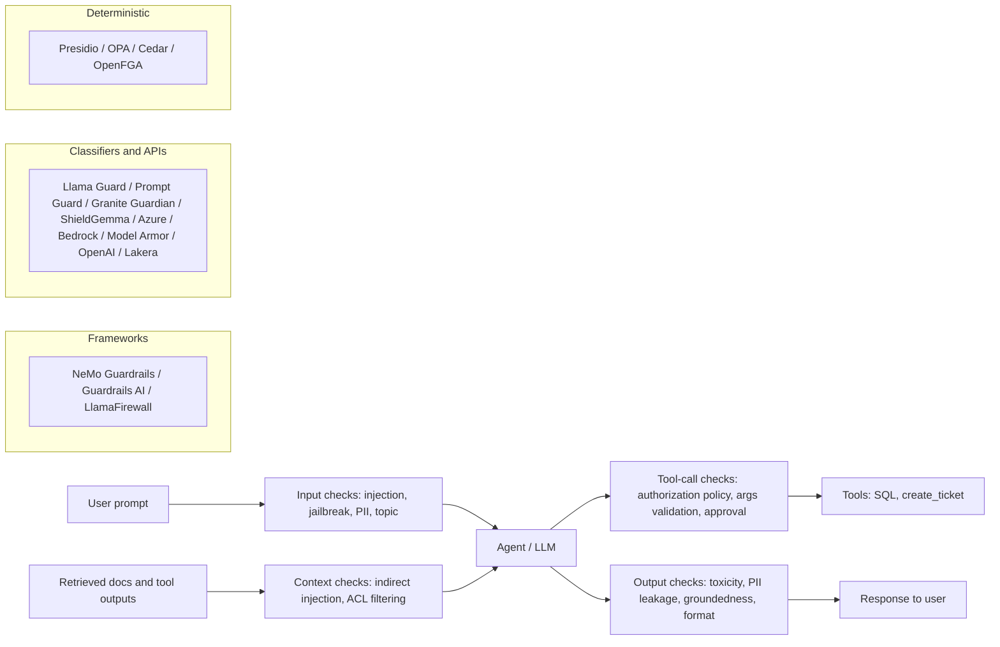
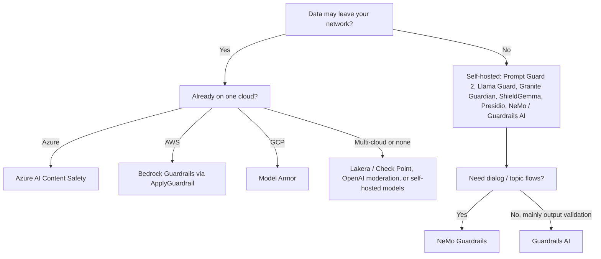

# Guardrail Tools: The Landscape (October 2026 snapshot)

> **TL;DR** — Guardrail tooling comes in six shapes: **orchestration frameworks** that wire checks around an LLM call (NeMo Guardrails, Guardrails AI, LlamaFirewall), **open safety classifier models** you host yourself (Llama Guard, Prompt Guard, Granite Guardian, ShieldGemma, gpt-oss-safeguard), **PII engines** (Presidio), **managed safety APIs** (Azure AI Content Safety, Amazon Bedrock Guardrails, Google Model Armor, OpenAI moderation, Check Point/Lakera), **policy engines** for deterministic authorization (OPA, Cedar, OpenFGA), and **red-teaming tools** that attack your app to test all of the above (garak, PyRIT, promptfoo, DeepTeam). No single tool covers an agentic RAG app: combine a classifier or managed API for content and injection, a PII engine, a policy engine for RBAC and tool authorization, and a red-teaming loop. Then measure false-positive and false-negative rates on **your own traffic**.

**You'll learn:** what each major guardrail tool detects and where it runs · open models vs managed APIs vs policy engines · a capability matrix (input/output, PII, injection, toxicity, groundedness, topic control, self-host, latency) · ownership/status changes (archived and acquired projects) · how to choose and how to evaluate guardrails on your own data  ·  **Prerequisites:** [Guardrails architecture](../04-guardrails/01-guardrails-architecture.md), [Threat model & OWASP](../04-guardrails/07-threat-model-owasp.md)  ·  **Related:** [Eval & observability tools](./01-eval-and-observability-tools.md), [Guardrail selection decision tree](../05-decision-framework/02-guardrail-selection-decision-tree.md), [Input guardrails](../04-guardrails/02-input-guardrails.md), [Tool & action guardrails](../04-guardrails/05-tool-and-action-guardrails.md)

---

## Read this first: this is a dated snapshot

This document reflects the ecosystem as of **October 2026**. Guardrail vendors were among the most acquired companies in AI security during 2025–2026, and several popular open-source projects are now archived (see [Ownership and status changes](#ownership-and-status-changes-to-know-about)).

- [ ] Before adopting anything, re-check the README/changelog, last release, license, and whether the repo is archived.
- [ ] Treat detector names as marketing. "Prompt injection detection" in two tools can mean a 22M-parameter classifier or an LLM reasoning over a policy. Their recall, false-positive rate and latency differ by orders of magnitude.
- [ ] Never ship a guardrail you have not measured on your own labeled data (see [Evaluate guardrails on your own data](#evaluate-guardrails-on-your-own-data)).

The architecture in [04-guardrails](../04-guardrails/README.md) is durable; the product names here are not. Put every guardrail behind your own interface so you can swap it.

---

## The landscape at a glance

Frameworks **orchestrate** checks. Classifiers and managed APIs **detect** probabilistically. Policy engines and PII recognizers **decide or redact** deterministically or semi-deterministically. Red-teaming tools (not shown) **attack** the whole pipeline offline.

---

## Ownership and status changes to know about

| Project | Status (October 2026) | What it means for you |
|---|---|---|
| **LLM Guard** (Protect AI) | GitHub repo **archived**; README says the project and its Hugging Face models are no longer maintained. protectai.com now redirects to Palo Alto Networks Prisma AIRS. | Do not start new work on it. If you already use it, pin versions and plan a migration. |
| **Rebuff** (Protect AI) | **Archived**; last push August 2024; always described itself as a prototype. | Read it for the layered-defense idea (heuristics + LLM + vector store + canary tokens), not for production. |
| **Lakera Guard** | Lakera was acquired by **Check Point**; docs at docs.lakera.ai are now titled Check Point AI Security / AI Guardrails. | Product continues; expect rebranding, packaging and pricing changes. |
| **Microsoft Presidio** | Moved to the community-owned **data-privacy-stack/presidio** organization; still MIT. | Update links and dependency sources; check governance before relying on long-term roadmap. |
| **PyRIT** | Repo moved from Azure/PyRIT (archived) to **microsoft/PyRIT**; v1.1.0 released September 2026. | Point installs and docs at the new location. |
| **NeMo Guardrails** | Repo moved to **NVIDIA-NeMo/Guardrails**; still Apache-2.0, actively released (v0.24.x). | Old GitHub links redirect; update imports only if release notes say so. |
| **promptfoo** | Now part of OpenAI; still MIT. | Red-teaming features continue; watch for roadmap shifts. |

---

## A. Guardrail frameworks (orchestrators)

Each card uses the same fields: **Link · Type/License · Strengths · Detects/covers · Best for · Watch-outs**. "Detects/covers" lists only capabilities the project documents.

### NVIDIA NeMo Guardrails (Colang)

| Field | Details |
|---|---|
| **Link** | [Docs](https://docs.nvidia.com/nemo/guardrails) · [GitHub](https://github.com/NVIDIA-NeMo/Guardrails) · [Paper (arXiv 2310.10501)](https://arxiv.org/abs/2310.10501) |
| **Type / License** | OSS toolkit (Python, `nemoguardrails`), Apache-2.0 |
| **Strengths** | Programmable "rails" at five points: **input, dialog, retrieval, execution, output**. Dialog flows and topical control are written in **Colang**, a modeling language for conversational flows. Large built-in library of integrations: self-check prompts, jailbreak and injection detection, fact-checking/hallucination, sensitive data detection, topic safety, tool safety checks, Llama Guard, Patronus, Cleanlab, Guardrails AI validators, and several commercial security vendors. |
| **Detects/covers** | Jailbreak heuristics, prompt/code injection, PII (via Presidio, GLiNER or vendors), content safety (via Llama Guard / NVIDIA safety models / vendors), RAG fact-checking against retrieved chunks, off-topic dialog, unsafe tool use. |
| **Best for** | Teams that want one programmable layer around the LLM and need **dialog/topic control** in addition to classifiers. |
| **Watch-outs** | Colang has a learning curve, and Colang 1.0 vs 2.x syntax differ. Every LLM-based rail adds a model call — measure latency per rail. The framework orchestrates; detection quality depends on the model/vendor you plug in. |

### Guardrails AI (validators hub)

| Field | Details |
|---|---|
| **Link** | [Docs](https://guardrailsai.com/guardrails/docs) · [Hub](https://guardrailsai.com/hub) · [GitHub](https://github.com/guardrails-ai/guardrails) |
| **Type / License** | OSS framework (Python), Apache-2.0; hub of community and first-party validators; commercial hosted offering |
| **Strengths** | A `Guard` composes **validators** from the hub (PII, toxicity, competitor mentions, regex, valid SQL, JSON schema, provenance/groundedness, etc.). Explicit failure policies via `OnFailAction`: `reask`, `fix`, `filter`, `refrain`, `noop`, `exception`, `fix_reask`, `custom`. Strong for **structured output validation** (Pydantic). Can run as a server. |
| **Detects/covers** | Depends on installed validators: PII, toxic language, jailbreak, off-topic, hallucination/provenance, format and schema validity, custom rules. |
| **Best for** | Output validation and repair, structured outputs (e.g. SQL or ticket payloads), and teams that want a menu of pluggable checks. |
| **Watch-outs** | Validator quality varies; some call LLMs or download models. `reask` loops add latency and cost. Pin validator versions — they evolve independently of the core. |

### Meta LlamaFirewall (Purple Llama)

| Field | Details |
|---|---|
| **Link** | [Site](https://meta-llama.github.io/PurpleLlama/LlamaFirewall/) · [GitHub (Purple Llama)](https://github.com/meta-llama/PurpleLlama) |
| **Type / License** | OSS framework from Meta's Purple Llama project (check the per-component licenses) |
| **Strengths** | Built specifically for **agents**. Layers scanners: **PromptGuard 2** (fast injection/jailbreak classifier), **AlignmentCheck** (an LLM audits the agent's reasoning for goal hijacking and indirect injection), **CodeShield** (insecure code detection), and regex/custom scanners. |
| **Detects/covers** | Direct injection and jailbreaks, indirect injection that changes the agent's goal, insecure generated code, custom patterns. |
| **Best for** | Agent pipelines that execute tools or code and need a check on the *trajectory*, not just the text. |
| **Watch-outs** | AlignmentCheck requires a capable LLM and adds latency per step. Young project — re-check maturity and benchmarks on your own traces. |

### LLM Guard (Protect AI) — archived

| Field | Details |
|---|---|
| **Link** | [GitHub (archived)](https://github.com/protectai/llm-guard) |
| **Type / License** | OSS (Python), MIT — **archived, unmaintained** |
| **Strengths** | A clean catalogue of scanners. Input: Anonymize, BanCode, BanCompetitors, BanSubstrings, BanTopics, Gibberish, InvisibleText, Language, PromptInjection, Regex, Secrets, Sentiment, TokenLimit, Toxicity. Output: Bias, Deanonymize, FactualConsistency, JSON, MaliciousURLs, NoRefusal, Relevance, Sensitive, Toxicity and more. |
| **Detects/covers** | PII (via Presidio), injection, toxicity, secrets, invisible text, banned topics, relevance, malicious URLs. |
| **Best for** | Learning the shape of a scanner pipeline; existing deployments only. |
| **Watch-outs** | No further fixes or model updates. The idea of a scanner pipeline is reusable; the code should not be your new dependency. |

---

## B. Open safety classifier models

These are model weights you host yourself. They give you **data residency** and predictable cost, but you own serving, scaling and threshold tuning.

### Meta Llama Guard (1 → 4)

| Field | Details |
|---|---|
| **Link** | [Llama protections](https://www.llama.com/llama-protections/) · [Llama-Guard-4-12B on Hugging Face](https://huggingface.co/meta-llama/Llama-Guard-4-12B) · [Paper (arXiv 2312.06674)](https://arxiv.org/abs/2312.06674) |
| **Type / License** | Open weights under Meta's Llama community licenses (custom, not OSI) |
| **Versions** | **Llama Guard 1** (Dec 2023, 7B) · **Meta-Llama-Guard-2-8B** (Apr 2024) · **Llama-Guard-3-8B** (Jul 2024) · **Llama-Guard-3-1B** and **Llama-Guard-3-11B-Vision** (Sep 2024) · **Llama-Guard-4-12B** (Apr 2025, natively multimodal: text plus multiple images, pruned from Llama 4 Scout) |
| **Strengths** | Classifies **both prompts and responses** as safe/unsafe and names the violated categories. Recent versions use the MLCommons hazard taxonomy (S1–S14, including Code Interpreter Abuse). Categories can be adjusted in the prompt. |
| **Detects/covers** | Violent and non-violent crimes, sex-related crimes, child exploitation, defamation, specialized advice, privacy, IP, indiscriminate weapons, hate, self-harm, sexual content, elections, code interpreter abuse. |
| **Best for** | Self-hosted content-safety classification for input and output. The 1B variant fits latency-sensitive paths. |
| **Watch-outs** | A content-safety model, **not** a prompt-injection detector. Its taxonomy is about harm; an enterprise assistant leaking a salary table is "safe" to Llama Guard. GPU serving needed for 8B/12B. |

### Meta Llama Prompt Guard (1 → 2)

| Field | Details |
|---|---|
| **Link** | [Llama-Prompt-Guard-2-86M](https://huggingface.co/meta-llama/Llama-Prompt-Guard-2-86M) · [Llama-Prompt-Guard-2-22M](https://huggingface.co/meta-llama/Llama-Prompt-Guard-2-22M) |
| **Type / License** | Open weights under Meta's Llama community license |
| **Versions** | **Prompt-Guard-86M** (v1, 2024) · **Llama-Prompt-Guard-2-86M** (multilingual) and **-22M** (DeBERTa-xsmall based, roughly 75% less latency than 86M) |
| **Strengths** | Tiny BERT-style classifiers that run on CPU in milliseconds. Suitable for scanning **every** user message and every retrieved chunk. |
| **Detects/covers** | v2 is a **binary** benign/malicious classifier for prompt injection and jailbreak attempts (v1 had separate injection and jailbreak labels). |
| **Best for** | A cheap first-pass filter on user input and untrusted context (retrieved docs, tool outputs). |
| **Watch-outs** | 512-token context: split long documents into segments and score each. Expect false positives on legitimate text that discusses prompts or security. A classifier cannot prove the absence of injection — pair it with architectural controls (see [Retrieval & context guardrails](../04-guardrails/03-retrieval-and-context-guardrails.md)). |

### IBM Granite Guardian

| Field | Details |
|---|---|
| **Link** | [GitHub](https://github.com/ibm-granite/granite-guardian) · [Paper (arXiv 2412.07724)](https://arxiv.org/abs/2412.07724) |
| **Type / License** | Open weights, Apache-2.0 |
| **Versions** | 3.0 → 3.2 (2024–2025); **3.3 8B** (Aug 2025) adds a hybrid think/no-think mode; **4.1 8B** (April 2026) improves Bring Your Own Criteria (BYOC) for arbitrary, multi-part criteria |
| **Strengths** | One model judges prompts and responses for harm *and* RAG/agent-specific risks. Permissive license. BYOC lets you describe your own criteria in natural language. `no-think` mode gives the lowest latency; `think` mode emits a reasoning trace before the score. |
| **Detects/covers** | Pre-baked criteria including harm, jailbreak attempts and profanity; **RAG hallucination criteria** (e.g. groundedness, context relevance, answer relevance); **function-call hallucination** in agents; plus any BYOC criterion. |
| **Best for** | Self-hosted groundedness and tool-call checks alongside content safety, under a business-friendly license. |
| **Watch-outs** | 8B-class models need a GPU for low latency; "think" mode is slower. Validate groundedness thresholds against your own annotated answers. |

### Google ShieldGemma

| Field | Details |
|---|---|
| **Link** | [Docs](https://ai.google.dev/gemma/docs/shieldgemma) · [ShieldGemma 2 (image)](https://huggingface.co/google/shieldgemma-2-4b-it) |
| **Type / License** | Open weights under the Gemma terms of use |
| **Versions** | **shieldgemma-2b / 9b / 27b** text classifiers (Jul 2024) · **shieldgemma-2-4b-it** image classifier (Mar 2025) |
| **Strengths** | Policy-conditioned: you pass the policy text and get the probability of a violation. Three text sizes trade quality for latency. |
| **Detects/covers** | Text: sexually explicit, dangerous content, harassment, hate speech. Image: sexually explicit, dangerous, violence/gore. |
| **Best for** | Self-hosted content moderation with tunable thresholds; image safety. |
| **Watch-outs** | Content harms only — not injection, PII or groundedness. One policy per call; scoring several policies multiplies calls. |

### OpenAI gpt-oss-safeguard

| Field | Details |
|---|---|
| **Link** | [gpt-oss-safeguard-20b on Hugging Face](https://huggingface.co/openai/gpt-oss-safeguard-20b) |
| **Type / License** | Open weights (20B and 120B), Apache-2.0 |
| **Strengths** | A **safety reasoning** model: you supply a written policy at inference time and it classifies content against it with an explanation. New policies need no retraining. |
| **Detects/covers** | Whatever your policy describes (e.g. "requests to export customer PII", "attempts to change ticket priority for other teams"). |
| **Best for** | Custom, business-specific policies that off-the-shelf taxonomies do not cover; offline labeling to train a smaller classifier. |
| **Watch-outs** | Reasoning models are slow and expensive compared with small classifiers — often better for async review or labeling than for the hot path. Uses the harmony response format. |

---

## C. PII detection and anonymization

### Microsoft Presidio (community-owned)

| Field | Details |
|---|---|
| **Link** | [Site](https://presidio.dataprivacystack.org) · [GitHub](https://github.com/data-privacy-stack/presidio) |
| **Type / License** | OSS (Python), MIT |
| **Strengths** | **Analyzer** (NER + regex + checksum + context-word recognizers), **Anonymizer** (redact, replace, mask, hash, encrypt — reversible with encryption), **Image Redactor**, **Structured** (tabular/JSON). Custom recognizers for internal IDs (employee IDs, ticket numbers). Used under the hood by many other tools. |
| **Detects/covers** | Names, emails, phone numbers, credit cards, IBANs, national IDs for several countries, IP addresses, locations, dates, plus your custom entities. |
| **Best for** | Self-hosted PII redaction on input, retrieved context, logs/traces and output. |
| **Watch-outs** | Recall depends heavily on the NLP model and language; out-of-the-box recall on names in messy enterprise text is imperfect. Tune score thresholds and add deny-lists. Governance moved to a community org in 2026 — check maintainer activity. |

---

## D. Managed safety APIs

### Azure AI Content Safety (Prompt Shields, groundedness detection)

| Field | Details |
|---|---|
| **Link** | [Overview](https://learn.microsoft.com/en-us/azure/ai-services/content-safety/overview) · [Prompt Shields](https://learn.microsoft.com/en-us/azure/ai-services/content-safety/concepts/jailbreak-detection) · [Groundedness detection](https://learn.microsoft.com/en-us/azure/ai-services/content-safety/concepts/groundedness) |
| **Type / License** | Commercial Azure service (also integrated into Microsoft Foundry content filters) |
| **Strengths** | Broadest single-vendor menu. **Prompt Shields** detects **user prompt attacks** (formerly "jailbreak risk detection") and **document attacks** (indirect injection hidden in documents/emails). **Groundedness detection** (preview) checks a response against supplied grounding sources. **Task adherence** flags agent tool use that is misaligned with the user's task. |
| **Detects/covers** | Hate, sexual, violence, self-harm with **severity levels**; protected material (text and code); custom categories (preview); prompt and document attacks; ungrounded content; task adherence. |
| **Best for** | Azure-hosted apps that want injection, harm and groundedness from one API. |
| **Watch-outs** | Several features are preview, region-limited, or have input-length limits — check the docs before designing around them. Not self-hostable (some containers exist for specific features; verify). |

### Amazon Bedrock Guardrails (contextual grounding, automated reasoning)

| Field | Details |
|---|---|
| **Link** | [Overview](https://docs.aws.amazon.com/bedrock/latest/userguide/guardrails.html) · [Components](https://docs.aws.amazon.com/bedrock/latest/userguide/guardrails-components.html) · [Contextual grounding](https://docs.aws.amazon.com/bedrock/latest/userguide/guardrails-contextual-grounding-check.html) · [Automated Reasoning checks](https://docs.aws.amazon.com/bedrock/latest/userguide/guardrails-automated-reasoning-checks.html) · [ApplyGuardrail API](https://docs.aws.amazon.com/bedrock/latest/userguide/guardrails-use-independent-api.html) |
| **Type / License** | Commercial AWS service |
| **Strengths** | A configurable policy bundle. **Content filters** (Hate, Insults, Sexual, Violence, Misconduct, **Prompt Attack**) with tunable strength. **Denied topics** in natural language. **Word filters** (including profanity). **Sensitive information filters** (PII types + custom regex; block or mask). **Contextual grounding check** scores grounding and relevance against a reference source. **Automated Reasoning checks** validate responses against formal logic derived from your natural-language policy documents. The **ApplyGuardrail** API works on any text, so you can use it with non-Bedrock models. |
| **Detects/covers** | Harmful content; jailbreaks, prompt injection and (Standard tier) prompt leakage; PII; off-topic requests; ungrounded or irrelevant answers; policy-rule violations (automated reasoning). |
| **Best for** | AWS-hosted apps that want one managed policy for topic control, PII masking and grounding. |
| **Watch-outs** | Safeguard tiers differ: **Standard** is more robust, supports more languages and code elements, and uses cross-Region inference; **Classic** supports English, French and Spanish. Grounding check works on text you pass in — you must supply the retrieved chunks. Automated reasoning needs well-written policy documents and has its own setup effort. |

### Google Model Armor

| Field | Details |
|---|---|
| **Link** | [Overview](https://docs.cloud.google.com/model-armor/overview) |
| **Type / License** | Commercial Google Cloud service |
| **Strengths** | Screens **prompts and responses** for any model, including models running outside Google Cloud. Configured via **templates** with confidence levels (HIGH, MEDIUM_AND_ABOVE, LOW_AND_ABOVE). Separate input and output templates are recommended for granular tuning. Scans documents (PDF, CSV, TXT, Office formats; up to 4 MB). |
| **Detects/covers** | Responsible AI categories (sexually explicit, dangerous, harassment, hate), prompt injection and jailbreak, sensitive data via Sensitive Data Protection infoTypes, malicious URLs (up to the first 256 URLs per payload). |
| **Best for** | GCP-hosted apps; screening uploaded documents before they enter a RAG index. |
| **Watch-outs** | No groundedness check. Pick confidence levels deliberately — LOW_AND_ABOVE is thorough but raises false positives. |

### OpenAI moderation API

| Field | Details |
|---|---|
| **Link** | [Moderation guide](https://developers.openai.com/api/docs/guides/moderation) |
| **Type / License** | Commercial API, **free to use** |
| **Strengths** | `omni-moderation-latest` classifies text and images with per-category scores. Zero cost makes it an easy baseline. |
| **Detects/covers** | Harassment, hate, illicit, self-harm, sexual, violence (and subcategories). |
| **Best for** | A free baseline content check on input and output. |
| **Watch-outs** | Content harms only — no injection, PII, topic or groundedness. Policy categories are fixed by OpenAI. |

### Lakera Guard (now Check Point AI Guardrails)

| Field | Details |
|---|---|
| **Link** | [Docs](https://docs.lakera.ai) |
| **Type / License** | Commercial; SaaS or self-hosted deployment |
| **Strengths** | Security-first focus with a large adversarial dataset (Gandalf game heritage). Agent-specific defenses. Policy-based configuration per project. |
| **Detects/covers** | **Prompt Defense** (direct and indirect injection), **Content Moderation**, **Data Leakage Prevention** (PII, system prompt leakage), **malicious links**, **Agent Behavior Defense** (dangerous-deviation detection, tool allow/deny lists). |
| **Best for** | Teams that want a dedicated, security-vendor injection detector with a self-host option. |
| **Watch-outs** | Post-acquisition rebranding and packaging changes. Benchmark on your own traffic. |

---

## E. Prompt-injection prototypes

### Rebuff — archived

| Field | Details |
|---|---|
| **Link** | [GitHub (archived)](https://github.com/protectai/rebuff) |
| **Type / License** | OSS prototype, Apache-2.0 — **archived since 2024** |
| **Strengths** | Influential **four-layer** design: heuristics, LLM-based detection, a vector database of past attacks, and **canary tokens** inserted into prompts to detect leakage. |
| **Best for** | Learning. The canary-token idea is worth copying into your own system prompt leak detection. |
| **Watch-outs** | Unmaintained; do not deploy. |

---

## F. Policy engines (RBAC and tool authorization)

LLM classifiers estimate risk. **Authorization must be deterministic.** For the running example, "can this user see this document / query this table / create a ticket in this queue?" belongs in a policy engine that the agent cannot talk its way around. See [Access control & RBAC](../04-guardrails/06-access-control-rbac.md).

| Engine | Link | License | Model | Best for in an agentic RAG app |
|---|---|---|---|---|
| **Open Policy Agent (OPA)** | [openpolicyagent.org](https://www.openpolicyagent.org) | Apache-2.0 (CNCF) | General-purpose policy-as-code in **Rego**; evaluate any JSON input | Tool-call authorization (`allow` for `create_ticket` given user, queue, args), SQL guard rules (allowed schemas, row limits), central audit of decisions |
| **Cedar** | [cedarpolicy.com](https://cedarpolicy.com) | Apache-2.0 | Principal–action–resource policies with formal analysis; managed in **Amazon Verified Permissions** | Fine-grained RBAC/ABAC on documents and tools with analyzable, readable policies |
| **OpenFGA** | [openfga.dev](https://openfga.dev) | Apache-2.0 (CNCF) | Zanzibar-style **relationship-based** access control (ReBAC) | Document-level permissions for retrieval filtering ("user is viewer of folder that contains doc") at scale |

Patterns that work:

- [ ] Enforce retrieval ACLs **before** chunks reach the prompt — filter by the end user's identity, never the service account's.
- [ ] Authorize every tool call with the **end user's** identity and the concrete arguments, not just the tool name.
- [ ] Log every policy decision (input, decision, policy version) into the same trace as the LLM call.
- [ ] Test policies like code: unit tests for allow/deny, and regression tests when roles change.

---

## Red-teaming tools

Red-teaming tools attack your application offline (and in CI) to measure how well the guardrails above actually work. They are the eval side of guardrails. See [Threat model & OWASP](../04-guardrails/07-threat-model-owasp.md) and [Generation quality & safety evals](../02-offline-evals/03-generation-quality-and-safety-evals.md).

### garak (NVIDIA)

| Field | Details |
|---|---|
| **Link** | [garak.ai](https://garak.ai) · [GitHub](https://github.com/NVIDIA/garak) |
| **Type / License** | OSS CLI (Python), Apache-2.0 |
| **Strengths** | "nmap for LLMs": **probes** (attack generators), **detectors** (decide if an attack succeeded) and **generators** (adapters to models/endpoints). Large catalogue: encoding attacks, DAN-style jailbreaks, prompt injection, data leakage, malware generation, package hallucination and more. |
| **Best for** | Broad vulnerability scanning of a model or endpoint; baseline before and after adding guardrails. |
| **Watch-outs** | Model-centric; testing a multi-step agent with tools requires a custom generator wrapping your app. Many probes — budget time and tokens. |

### PyRIT (Microsoft)

| Field | Details |
|---|---|
| **Link** | [Docs](https://microsoft.github.io/PyRIT) · [GitHub](https://github.com/microsoft/PyRIT) |
| **Type / License** | OSS framework (Python), MIT |
| **Strengths** | Python Risk Identification Tool from Microsoft's AI Red Team. Building blocks: **targets**, **converters** (encode/translate/obfuscate attacks), **scorers**, **attack executors** for single- and multi-turn attacks (e.g. Crescendo escalation), and a memory of all attempts. |
| **Best for** | Security teams running structured, multi-turn red-team campaigns against an application endpoint. |
| **Watch-outs** | A framework, not a push-button scanner — expect to write code. Repo location changed; use microsoft/PyRIT. |

### promptfoo red teaming

| Field | Details |
|---|---|
| **Link** | [Red-team docs](https://www.promptfoo.dev/docs/red-team/) |
| **Type / License** | OSS CLI (MIT), part of OpenAI; commercial enterprise edition |
| **Strengths** | Generates adversarial test cases from **plugins** (what to attack: e.g. `pii`, `rbac`, `bola`, `bfla`, `sql-injection`, `shell-injection`, `excessive-agency`, `hallucination`, `indirect-prompt-injection`, `rag-document-exfiltration`, `prompt-extraction`) and **strategies** (how to deliver: jailbreak iterations, encodings, multi-turn). Presets map to **OWASP LLM Top 10, NIST AI RMF and MITRE ATLAS**. Same YAML config and CI flow as promptfoo evals. |
| **Best for** | Application-level red teaming in CI, especially for RBAC bypass and tool misuse in agents. |
| **Watch-outs** | Generated attacks need review; graders are LLM-based and can be wrong. Treat the report as a list of leads, not a score to optimize. |

### DeepTeam (Confident AI)

| Field | Details |
|---|---|
| **Link** | [GitHub](https://github.com/confident-ai/deepteam) |
| **Type / License** | OSS (Python), Apache-2.0 |
| **Strengths** | Red-teaming sibling of DeepEval: vulnerabilities × attack methods, single- and multi-turn, with framework presets (e.g. OWASP Top 10 for LLMs 2025, OWASP Top 10 for Agents 2026). Runs locally; results can integrate with Confident AI. |
| **Best for** | Teams already on DeepEval who want red teaming in the same Python test style. |
| **Watch-outs** | LLM-generated attacks and LLM-graded results — calibrate graders as you would any judge. |

### Giskard scan

| Field | Details |
|---|---|
| **Link** | [GitHub](https://github.com/Giskard-AI/giskard-oss) |
| **Type / License** | OSS (Python), Apache-2.0 |
| **Strengths** | `giskard-scan` (v3) generates adversarial test suites from a plain-language description of your agent: prompt injection, jailbreaks, harmful content, stereotypes, misinformation; plus a knowledge-base `quality_scan` for RAG. |
| **Best for** | A quick automated scan during development. |
| **Watch-outs** | v3 is a rewrite (Python 3.12+); v2 is unmaintained. |

---

## Comparison matrix

**Legend:** ✅ first-class / native · 🟡 partial, via integration/plugin, preview, or with custom config · ❌ not a primary capability · ❔ not verified — ask the vendor. "Self-host" means the detection runs in your environment.

> This matrix is the author's assessment from public docs as of **October 2026**. Verify before deciding.

| Tool | Input | Output | PII | Injection / jailbreak | Toxicity / harm | Groundedness | Topic control | Self-host | Latency notes |
|---|---|---|---|---|---|---|---|---|---|
| **NeMo Guardrails** | ✅ | ✅ | 🟡 (Presidio, vendors) | ✅ | 🟡 (plugged models) | 🟡 (fact-check rails) | ✅ (Colang dialog rails) | ✅ | Adds one model call per LLM-based rail |
| **Guardrails AI** | ✅ | ✅ | 🟡 (validator) | 🟡 (validator) | 🟡 (validator) | 🟡 (provenance validators) | 🟡 (validator) | ✅ | Depends on validators; `reask` adds a full LLM round-trip |
| **LlamaFirewall** | ✅ | ✅ | ❌ | ✅ | ❌ | ❌ | ❌ | ✅ | PromptGuard fast; AlignmentCheck is an LLM call per step |
| **LLM Guard** *(archived)* | ✅ | ✅ | ✅ | ✅ | ✅ | 🟡 | 🟡 | ✅ | Local transformer models, CPU/GPU |
| **Llama Guard 3/4** | ✅ | ✅ | 🟡 (privacy category) | ❌ | ✅ | ❌ | 🟡 (custom categories) | ✅ | 1B: low; 8B/12B: GPU, tens–hundreds of ms |
| **Prompt Guard 2** | ✅ | ❌ | ❌ | ✅ | ❌ | ❌ | ❌ | ✅ | 22M/86M: milliseconds, CPU-friendly |
| **Granite Guardian** | ✅ | ✅ | ❌ | ✅ (jailbreak) | ✅ | ✅ (RAG + function-call) | 🟡 (BYOC) | ✅ | 8B: GPU; think mode slower |
| **ShieldGemma** | ✅ | ✅ | ❌ | ❌ | ✅ | ❌ | 🟡 (policy text) | ✅ | 2B fast; one call per policy |
| **gpt-oss-safeguard** | ✅ | ✅ | 🟡 (via policy) | 🟡 (via policy) | ✅ | ❌ | ✅ (via policy) | ✅ | Reasoning model: slowest; better async |
| **Presidio** | ✅ | ✅ | ✅ | ❌ | ❌ | ❌ | ❌ | ✅ | Fast with small spaCy models; slower with transformers |
| **Azure AI Content Safety** | ✅ | ✅ | 🟡 | ✅ (Prompt Shields, incl. documents) | ✅ | ✅ (preview) | 🟡 (custom categories) | 🟡 (some containers) | Network call per check |
| **Bedrock Guardrails** | ✅ | ✅ | ✅ (block/mask) | ✅ | ✅ | ✅ (contextual grounding) | ✅ (denied topics) | ❌ | Network call; policies evaluated together |
| **Google Model Armor** | ✅ | ✅ | ✅ (SDP) | ✅ | ✅ | ❌ | ❌ | ❌ | Network call; doc scanning up to 4 MB |
| **OpenAI moderation** | ✅ | ✅ | ❌ | ❌ | ✅ | ❌ | ❌ | ❌ | Network call; free |
| **Lakera / Check Point** | ✅ | ✅ | ✅ | ✅ (direct + indirect) | ✅ | ❌ | 🟡 | ✅ (self-hosted option) | Positioned for low latency; measure |
| **OPA / Cedar / OpenFGA** | 🟡 (authz on request) | ❌ | ❌ | ❌ (prevents impact, not detection) | ❌ | ❌ | 🟡 (by rule) | ✅ | Sub-millisecond to low ms, deterministic |

### What the matrix does *not* capture

- **Detection quality.** Two ✅ cells can differ wildly in recall and false-positive rate on your traffic.
- **Language coverage.** Many classifiers are strongest in English; check multilingual results if your users write in other languages.
- **Context length.** Small classifiers truncate (Prompt Guard 2: 512 tokens). Long retrieved documents must be chunked and each chunk scored.
- **Indirect injection.** Few tools explicitly score *retrieved documents or tool outputs* (Azure document attacks, Lakera indirect, LlamaFirewall AlignmentCheck). Most just scan whatever text you pass — it is on you to pass the right text.
- **Agent-level risk.** Excessive agency and confused-deputy attacks are best stopped by authorization and approval steps, not detectors.

---

## Same risk, different tool: a mapping for the running example

| Risk in the enterprise assistant | Primary control (deterministic) | Detector (probabilistic) | Red-team check |
|---|---|---|---|
| User sees docs they lack access to | Retrieval ACL filter via OpenFGA/OPA | — | promptfoo `rbac`, `bola`, `rag-document-exfiltration`; your own role-swap tests |
| Text-to-SQL reads restricted tables or rows | Read-only DB role; SQL allow-list via OPA/Cedar; row-level security | Guardrails AI SQL validators | promptfoo SQL injection plugin; PyRIT campaigns |
| `create_ticket` abused (wrong queue, spam, priority escalation) | Tool authorization in OPA/Cedar; rate limits; human approval for high impact | LlamaFirewall AlignmentCheck; Azure task adherence | promptfoo `excessive-agency`, `bfla`; DeepTeam |
| Direct jailbreak / prompt injection | System prompt hierarchy; least privilege | Prompt Guard 2, Prompt Shields, Bedrock prompt attack, Model Armor, Lakera | garak, PyRIT, promptfoo |
| Indirect injection in a wiki page | Spotlighting/delimiting; tool privileges independent of content | Prompt Guard 2 on chunks, Azure document attacks, Lakera | promptfoo indirect injection plugin |
| PII in prompts, logs or answers | Redact before logging; mask before indexing | Presidio, Bedrock sensitive info, Model Armor SDP | PII-leak probes |
| Hallucinated or ungrounded answers | Require citations; refuse without evidence | Granite Guardian groundedness, Bedrock contextual grounding, Azure groundedness | Eval set with unanswerable questions |
| Toxic or harmful output | — | Llama Guard, ShieldGemma, OpenAI moderation, managed APIs | garak toxicity probes |

---

## How to choose

### Step 1 — Put deterministic controls first

Authorization, least privilege, read-only database roles, retrieval ACLs and human approval for risky actions do not have false negatives the way classifiers do. Choose a policy engine (or your existing IAM) before you pick any detector. See [Tool & action guardrails](../04-guardrails/05-tool-and-action-guardrails.md).

### Step 2 — Decide where detection must run

### Step 3 — Fill gaps by risk

| If your top risk is … | Start with | Add if needed |
|---|---|---|
| Prompt injection (direct + indirect) | Prompt Guard 2 on input and on every retrieved chunk / tool output | A managed injection API; LlamaFirewall AlignmentCheck for agents |
| Data leakage across roles | Policy engine + retrieval ACLs | Output PII scan; canary tokens for system prompt leaks |
| PII | Presidio (self-host) or your cloud's PII filter | Custom recognizers for internal IDs |
| Hallucination | Citation requirement + groundedness check (Granite Guardian, Bedrock, Azure) | Offline faithfulness evals (see [01](./01-eval-and-observability-tools.md)) |
| Harmful content | Llama Guard or OpenAI moderation | ShieldGemma for custom policies; managed APIs |
| Off-topic use | Denied topics (Bedrock) or Colang dialog rails | A small topic classifier trained on your logs |
| Business-specific policy | gpt-oss-safeguard or Granite Guardian BYOC | Distill into a small classifier for the hot path |

### Step 4 — Rules of thumb

- **Cheap and fast first, expensive and smart last.** Regex/deny-lists → small classifiers → LLM-based checks only for what survives.
- **Run in parallel where possible.** Input checks can run concurrently with retrieval; output checks can stream with care.
- **Fail closed for actions, fail open (with logging) for low-risk content** — decide per guardrail, and write it down.
- **One interface, many backends.** Wrap every guardrail behind `check(stage, text, context) -> decision` so you can swap vendors.
- **Never use only an LLM-based guardrail for authorization.**

---

## Latency and cost

| Class | Typical placement | Rough latency profile | Cost driver |
|---|---|---|---|
| Regex, deny-lists, schema validation | Inline, every request | Microseconds–milliseconds | Negligible |
| Policy engines (OPA, Cedar, OpenFGA) | Inline, every tool call / retrieval | Sub-millisecond to low milliseconds (local); add network if remote | Infra only |
| Small classifiers (Prompt Guard 2, Presidio with small NER) | Inline, every message and chunk | Milliseconds on CPU | Infra only |
| 1B–12B guard models (Llama Guard, Granite Guardian, ShieldGemma) | Inline for high-risk paths; sampled otherwise | Tens to hundreds of ms on GPU | GPU hours |
| Managed APIs (Azure, Bedrock, Model Armor, Lakera, OpenAI) | Inline | Network round-trip plus processing; varies by region and payload | Per-call / per-character pricing (OpenAI moderation is free) |
| Reasoning safety models, LLM-as-judge rails | Async, sampled, or highest-risk only | Seconds | Tokens |

These are orders of magnitude for planning, not benchmarks. Measure p50/p95/p99 on your own payload sizes, and remember that scoring 10 retrieved chunks means 10 calls (or one batched call).

---

## Evaluate guardrails on your own data

A guardrail is a classifier. Evaluate it like one before production and continuously after. See [Online evals](../03-online-evals-and-observability/01-online-evals.md) and [Monitoring, alerting & drift](../03-online-evals-and-observability/04-monitoring-alerting-and-drift.md).

- [ ] **Build a labeled set** per guardrail: benign production samples (including tricky benign ones — security docs, code, quoted emails) plus attacks from red-team tools, public datasets and your own incidents.
- [ ] **Measure both error types:** false-positive rate (benign blocked → user friction) and false-negative rate (attacks passed → risk). Report per category and per language.
- [ ] **Pick thresholds on a curve,** not the default. Choose the operating point from your risk appetite and the volume of traffic.
- [ ] **Measure latency** at p95/p99 with realistic payload sizes (including long retrieved documents).
- [ ] **Test the pipeline, not just the model:** an attack in a PDF that the chunker splits may pass a 512-token classifier.
- [ ] **Run red-teaming tools before and after** each guardrail change and keep the reports as regression baselines.
- [ ] **Monitor in production:** block rate, override/appeal rate, and samples of blocked and passed traffic for human review.
- [ ] **Re-evaluate on model or vendor updates** — a silent detector update can shift your FPR overnight.

Example scorecard for one detector:

| Metric | Target (example) | Measured |
|---|---|---|
| Recall on injection set (direct) | ≥ 0.90 | |
| Recall on injection set (indirect, in retrieved docs) | ≥ 0.80 | |
| FPR on benign production sample | ≤ 1% | |
| FPR on "security-flavored" benign sample | ≤ 5% | |
| p95 latency added | ≤ 50 ms | |

Targets are illustrative; set your own from risk and UX requirements.

---

## A reference stack for the running example

| Stage | Self-hosted option | Managed option (AWS example) |
|---|---|---|
| Input | Prompt Guard 2 (22M) + Presidio + Llama Guard 3 1B | Bedrock Guardrails (prompt attack, PII mask, denied topics) via ApplyGuardrail |
| Retrieval | OpenFGA/OPA ACL filter + Prompt Guard 2 on each chunk | Same ACL filter + ApplyGuardrail on chunks |
| Text-to-SQL | Read-only role, SQL parser allow-list, OPA policy on tables/columns, row limits | Same (deterministic, cloud-agnostic) |
| `create_ticket` tool | OPA/Cedar authorization with end-user identity + human approval above a threshold | Cedar in Amazon Verified Permissions |
| Output | Granite Guardian groundedness + Presidio + Llama Guard | Bedrock contextual grounding + sensitive info filter |
| Orchestration | NeMo Guardrails or a thin in-house wrapper | Thin in-house wrapper |
| Red teaming (CI + quarterly) | promptfoo red team + garak; PyRIT for deep campaigns | Same |

---

## Common mistakes

| Mistake | Consequence | Fix |
|---|---|---|
| Using a content-safety model (Llama Guard, moderation) as an injection detector | Injections pass as "safe" | Use injection-specific detectors and architectural controls |
| Scanning only the user prompt | Indirect injection via documents and tool outputs | Scan retrieved chunks and tool results; isolate privileges |
| Letting the LLM decide authorization | Confused-deputy and RBAC bypass | Deterministic policy engine with end-user identity |
| Default thresholds | Unknown FPR/FNR; either friction or leakage | Calibrate on your labeled data |
| Adding every check inline | Latency budget blown | Tier checks; run in parallel; sample expensive ones |
| Depending on an archived project | No fixes for new attacks | Check repo status yearly; plan migrations |
| No logging of guardrail decisions | Cannot debug blocks or measure drift | Log decisions and scores in the trace |
| Treating red-team scores as a KPI to maximize | Overfitting to the tool's attacks | Use reports as leads; add novel attacks from incidents |

---

## Key takeaways

- No single tool covers an agentic RAG app. Combine **deterministic controls** (policy engine, ACLs, least privilege), **detectors** (classifiers or managed APIs), **PII redaction**, and **red teaming**.
- Know what each detector is for: content-safety models (Llama Guard, ShieldGemma, OpenAI moderation) are **not** injection detectors; injection classifiers (Prompt Guard) are **not** proof of safety.
- Self-hosted open models give residency and predictable cost; managed APIs give breadth (groundedness, automated reasoning, document scanning) with network latency and lock-in.
- Authorization for tools, SQL and documents belongs in OPA, Cedar or OpenFGA — never in a prompt.
- Measure every guardrail's FPR, FNR and p95 latency on **your** data, and re-measure after vendor or model updates.
- The market is consolidating (LLM Guard and Rebuff archived, Lakera → Check Point, Protect AI → Palo Alto Networks, Presidio → community, promptfoo → OpenAI). Wrap tools behind your own interface.

## Further reading

- [Guardrails architecture](../04-guardrails/01-guardrails-architecture.md) — where each check sits in the request path
- [Input guardrails](../04-guardrails/02-input-guardrails.md) and [Retrieval & context guardrails](../04-guardrails/03-retrieval-and-context-guardrails.md)
- [Output guardrails](../04-guardrails/04-output-guardrails.md) and [Tool & action guardrails](../04-guardrails/05-tool-and-action-guardrails.md)
- [Access control & RBAC](../04-guardrails/06-access-control-rbac.md) — deterministic authorization patterns
- [Guardrail selection decision tree](../05-decision-framework/02-guardrail-selection-decision-tree.md)
- [Eval & observability tools](./01-eval-and-observability-tools.md) — companion landscape
- Simon Willison, [The lethal trifecta for AI agents](https://simonwillison.net/2025/Jun/16/the-lethal-trifecta/) — why detectors alone cannot solve injection
- Beurer-Kellner et al., [Design Patterns for Securing LLM Agents against Prompt Injections](https://arxiv.org/abs/2506.08837)
- Hines et al., [Spotlighting](https://arxiv.org/abs/2403.14720) — defending against indirect prompt injection
- [OWASP Top 10 for LLM Applications](https://genai.owasp.org/llm-top-10/)
- [References](../07-references/README.md) — full curated reading list
