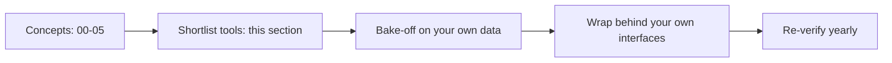

# 06 · Tooling Landscape

> **TL;DR**
>
> - **Map concepts to real products.** Connect datasets, metrics, judges, and guardrails to open-source libraries, platforms, and cloud services.
> - **Treat this guide as a dated October 2026 snapshot.** Re-verify ownership, license, maintenance status, and pricing before you adopt any tool.
> - **Avoid vendor lock-in.** Instrument traces with OpenTelemetry, store datasets in your repo, and wrap guardrails behind your own interface.
> - **Run a bake-off on your own data.** Measure judge agreement, false positives, false negatives, and p95 latency on domain traffic.

The rest of this repository is tool-agnostic. Datasets, metrics, judges, guardrail layers, and decision trees work with any product. This section maps actual open-source libraries, platforms, open models, cloud services, and policy engines onto those concepts. Use it to build your tool shortlist.

Both files represent a **dated snapshot from October 2026**. In the 18 months before this snapshot, vendors acquired, rebranded, re-licensed, rewrote, archived, or sunset several tools. For example, Humanloop shut down, promptfoo joined OpenAI, Langfuse joined ClickHouse, and Cisco acquired Galileo, which is now sold as Splunk Agent Observability. Lakera joined Check Point, WhyLabs is discontinuing operations, Invariant Labs' `mcp-scan` became Snyk Agent Scan, and maintainers archived LLM Guard and Rebuff. Re-check project status, licenses, and pricing before you adopt any tool.

We use one running example throughout this section: an **internal enterprise assistant**. It combines docs RAG, text-to-SQL over a data warehouse, a `create_ticket` tool, and role-based access control (RBAC).

## Files in this section

| File | What it covers | Read when… |
|---|---|---|
| [01-eval-and-observability-tools.md](./01-eval-and-observability-tools.md) | Open-source eval libraries (RAGAS, DeepEval, TruLens, promptfoo, OpenAI Evals, Inspect, Giskard, lm-evaluation-harness, ARES). Eval and observability platforms (LangSmith, Langfuse, Phoenix/Arize AX, Braintrust, W&B Weave, MLflow, Opik, Galileo, Patronus, Humanloop, Confident AI). Other tools to recognize (OpenLLMetry, Helicone, Logfire, Laminar, Arthur Engine, Datadog, Cleanlab TLM, HELM, and dormant UpTrain and WhyLabs). Cloud-native services (Microsoft Foundry, Amazon Bedrock and AgentCore, Google Gen AI evaluation service). Also covers a capability matrix, metric crosswalk, selection guide, and bake-off checklist. | You need to choose a system of record for traces, datasets, and experiments, or a metric library for CI. |
| [02-guardrail-tools.md](./02-guardrail-tools.md) | Frameworks (NeMo Guardrails, Guardrails AI, LlamaFirewall, LLM Guard). Open safety models (Llama Guard, Prompt Guard, Granite Guardian, ShieldGemma, gpt-oss-safeguard, Qwen3Guard, NemoGuard, WildGuard) and Presidio. Managed APIs (Azure AI Content Safety, Bedrock Guardrails, Model Armor, OpenAI moderation, Lakera/Check Point). Policy engines (OPA, Cedar, OpenFGA), agent/MCP and gateway security (Snyk Agent Scan, AgentCore Gateway and Policy, AI gateways), commercial AI-security platforms, and red-teaming tools (garak, PyRIT, promptfoo, DeepTeam, Giskard). Also covers a capability matrix, latency/cost profiles, guardrail evaluation methods, and public benchmarks. | You need runtime protection, PII redaction, tool and document authorization, MCP or gateway controls, or an automated red-teaming loop. |

## Suggested reading order

1. Read the core concepts first in [The evals & guardrails map](../00-foundations/02-the-evals-and-guardrails-map.md). Next, review the [eval selection](../05-decision-framework/01-eval-selection-decision-tree.md) and [guardrail selection](../05-decision-framework/02-guardrail-selection-decision-tree.md) decision trees. Know *what* you need before you read *who* sells it.
2. Read **[01 · Eval & observability tools](./01-eval-and-observability-tools.md)**. Start with "Ownership and status changes", review the comparison matrix, and follow "How to choose".
3. Read **[02 · Guardrail tools](./02-guardrail-tools.md)**. Start with the policy engines section for deterministic controls, review the comparison matrix, and follow "Evaluate guardrails on your own data".

**In a hurry?** Read the two comparison matrices and the two "reference stack for the running example" sections.

## Cautions before you choose

### Vendor lock-in

SDK calls rarely cause vendor lock-in. Lock-in happens when your **data and metric definitions** live only inside a vendor platform.

- [ ] **Instrument traces with OpenTelemetry:** Use the [GenAI semantic conventions](https://github.com/open-telemetry/semantic-conventions-genai) or OpenInference so you can switch trace backends later. The GenAI conventions still have Development status, so pin the version you emit.
- [ ] **Keep datasets exportable:** Version golden datasets, labels, and annotations in your own storage and sync them into tools.
- [ ] **Store judge prompts in Git:** Keep prompts and rubrics in your repository because prompts, models, and scales define your metrics.
- [ ] **Wrap guardrails behind one interface:** Call every detector through `check(stage, payload, context) -> decision` to make vendor swaps easy.
- [ ] **Keep authorization in IAM or policy engines:** Never let a guardrail vendor or an LLM decide who can view data or run tools.
- [ ] **Verify your exit plan:** Confirm export formats, self-host options, and data retention policies before you sign a contract.

### Evaluate tools against your own data

Public benchmarks and vendor demos tell you very little about your production traffic. Use public benchmarks only as a baseline ([Public benchmarks as a baseline](./02-guardrail-tools.md#public-benchmarks-as-a-baseline)).

- [ ] **Build a labeled domain dataset:** Include hard negatives like benign security questions and long internal docs ([Dataset strategy](../01-datasets/01-dataset-strategy.md), [SME golden datasets](../01-datasets/02-sme-golden-datasets.md)).
- [ ] **Measure judge agreement with human labels:** Validate every eval metric and LLM judge before you trust its score. Starting bar: ≥ 100 labelled items with ≥ 30–50 FAILs, TPR and TNR ≥ 0.85, Cohen's κ ≥ 0.60 ([LLM-as-a-judge](../02-offline-evals/07-llm-as-a-judge.md)).
- [ ] **Measure guardrail error rates and latency:** Track false-positive rate, false-negative rate, and p95 latency per category and language. Report Wilson intervals. To show a false-positive rate below 1%, you need about 300 benign cases with zero false positives (rule of three).
- [ ] **Compare 2–3 shortlisted tools side by side:** Run the exact same dataset, judge model, and thresholds across all candidates.
- [ ] **Re-run your bake-off regularly:** Re-test whenever a vendor ships a new model or your production traffic shifts.

### The snapshot will age

- [ ] **Check project activity:** Review each project's latest release date, open issues, and active maintainers.
- [ ] **Check repository status:** Verify whether maintainers archived or moved the repo, as several changed organizations in 2025–2026.
- [ ] **Check license terms:** Confirm whether an open platform uses source-available licenses like ELv2 or separate `ee/` enterprise folders. Check open model weights too: some evaluator models (for example Patronus Lynx and Glider) are CC-BY-NC-4.0, which does not allow commercial use.
- [ ] **Check ownership:** Acquisitions change roadmaps, pricing, and data terms. Re-read the vendor's current docs, not old blog posts.

## How this section connects to the rest

- Review the concepts behind every eval tool in [02-offline-evals](../02-offline-evals/README.md) and [03-online-evals-and-observability](../03-online-evals-and-observability/README.md).
- Review the concepts behind every guardrail tool in [04-guardrails](../04-guardrails/README.md).
- See where tool choice fits into a rollout in [Implementation playbook](../05-decision-framework/04-implementation-playbook.md) and [Maturity model](../05-decision-framework/05-maturity-model.md).
- Explore papers, standards, blogs, and courses in [07-references](../07-references/README.md).
