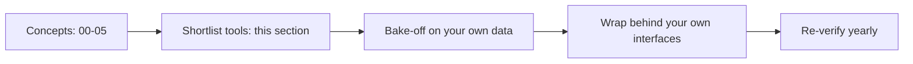

# 06 · Tooling Landscape

The rest of this repository is deliberately tool-agnostic: datasets, metrics, judges, guardrail layers and decision trees work no matter which product you use. This section is the exception. It maps the **actual tools** — open-source libraries, platforms, open models, cloud services and policy engines — onto those concepts so you can build a shortlist.

Both files are a **dated snapshot (October 2026)**. In the 18 months before this snapshot, several tools were acquired, rebranded, re-licensed, rewritten, archived or sunset (for example: Humanloop sunset, promptfoo joined OpenAI, Langfuse joined ClickHouse, Galileo became Splunk Agent Observability, Lakera joined Check Point, LLM Guard and Rebuff were archived). Re-check status, license and pricing before you adopt anything.

Running example used throughout: an **internal enterprise assistant** with docs RAG, text-to-SQL over a data warehouse, a `create_ticket` tool, and RBAC.

## Files in this section

| File | What it covers | Read when… |
|---|---|---|
| [01-eval-and-observability-tools.md](./01-eval-and-observability-tools.md) | Open-source eval libraries (RAGAS, DeepEval, TruLens, promptfoo, OpenAI Evals, Inspect, Giskard, lm-evaluation-harness, ARES); eval + observability platforms (LangSmith, Langfuse, Phoenix/Arize AX, Braintrust, W&B Weave, MLflow, Opik, Galileo, Patronus, Humanloop, Confident AI); cloud-native services (Microsoft Foundry, Amazon Bedrock, Google Gen AI evaluation service); capability matrix, metric crosswalk, how to choose, bake-off checklist | You need to pick a system of record for traces/datasets/experiments, or a metric library for CI |
| [02-guardrail-tools.md](./02-guardrail-tools.md) | Frameworks (NeMo Guardrails, Guardrails AI, LlamaFirewall, LLM Guard); open safety models (Llama Guard, Prompt Guard, Granite Guardian, ShieldGemma, gpt-oss-safeguard); Presidio; managed APIs (Azure AI Content Safety, Bedrock Guardrails, Model Armor, OpenAI moderation, Lakera/Check Point); policy engines (OPA, Cedar, OpenFGA); red-teaming tools (garak, PyRIT, promptfoo, DeepTeam, Giskard); capability matrix, latency/cost, how to evaluate guardrails | You need runtime protection, PII redaction, authorization for tools and documents, or a red-teaming loop |

## Suggested reading order

1. Read the concepts first: [The evals & guardrails map](../00-foundations/02-the-evals-and-guardrails-map.md), then the [eval selection](../05-decision-framework/01-eval-selection-decision-tree.md) and [guardrail selection](../05-decision-framework/02-guardrail-selection-decision-tree.md) decision trees. Know *what* you need before reading *who* sells it.
2. **[01 · Eval & observability tools](./01-eval-and-observability-tools.md)** — start with "Ownership and status changes", then the comparison matrix, then "How to choose".
3. **[02 · Guardrail tools](./02-guardrail-tools.md)** — start with the policy engines section (deterministic controls first), then the comparison matrix and "Evaluate guardrails on your own data".

**In a hurry?** Read the two comparison matrices and the two "reference stack for the running example" sections.

## Cautions before you choose

### Vendor lock-in

Lock-in rarely comes from the SDK call; it comes from **data and definitions** that live only inside a vendor.

- [ ] **Traces:** instrument with OpenTelemetry (GenAI semantic conventions or OpenInference) so you can send spans to a different backend later.
- [ ] **Datasets:** keep golden datasets, labels and annotations exportable — ideally versioned in your own storage, mirrored into the tool.
- [ ] **Judge prompts and rubrics:** keep them in your repository, not only in a vendor UI. A "faithfulness" score is defined by its prompt, judge model and scale.
- [ ] **Guardrails:** call every detector through your own `check(stage, payload, context) -> decision` interface so a vendor swap is a config change.
- [ ] **Authorization:** never let a guardrail vendor or an LLM be the source of truth for who may see or do what. Keep it in your policy engine / IAM.
- [ ] **Exit plan:** before signing, confirm export formats, self-host options, data retention and what happens if the product is acquired or sunset.

### Evaluate tools against your own data

Public benchmarks and vendor demos tell you little about your traffic.

- [ ] Build a small labeled set from your own domain (see [Dataset strategy](../01-datasets/01-dataset-strategy.md) and [SME golden datasets](../01-datasets/02-sme-golden-datasets.md)) — including hard negatives such as benign security questions and long internal documents.
- [ ] For eval metrics and judges: measure agreement with human labels before trusting a score (see [LLM-as-a-judge](../02-offline-evals/07-llm-as-a-judge.md)).
- [ ] For guardrails: measure false-positive rate, false-negative rate and p95 latency per category and language.
- [ ] Run the same set through 2–3 shortlisted tools and compare on the same judge model and thresholds.
- [ ] Re-run the bake-off when a vendor ships a new model or when your traffic changes.

### The snapshot will age

- [ ] Check each project's last release, open issues and maintainers.
- [ ] Check whether a repo is archived or moved (several moved organizations in 2025–2026).
- [ ] Check license changes (some "open" platforms use source-available licenses such as ELv2, or separate enterprise folders).

## How this section connects to the rest

- Concepts behind every eval tool: [02-offline-evals](../02-offline-evals/README.md) and [03-online-evals-and-observability](../03-online-evals-and-observability/README.md).
- Concepts behind every guardrail tool: [04-guardrails](../04-guardrails/README.md).
- Where tool choice fits in a rollout: [Implementation playbook](../05-decision-framework/04-implementation-playbook.md) and [Maturity model](../05-decision-framework/05-maturity-model.md).
- Papers, standards, blogs and courses: [07-references](../07-references/README.md).
