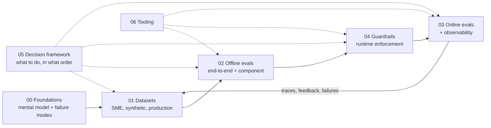

# Research: Evals & Guardrails for AI Agents

> **TL;DR**
>
> - **Build an agent that is measurably accurate and safely bounded.** This guide covers datasets, offline evals, online monitoring, and runtime guardrails in one connected system.
> - **Follow the real engineering order:** understand the failure modes → build a dataset → measure offline → add runtime guardrails → monitor live traffic → feed failures back into your dataset.
> - **Use agentic RAG as the worked example, not the limit.** For coding, browser, research, or workflow agents, start with [Agent Archetypes](./00-foundations/05-agent-archetypes.md).

---

## Start here (pick your goal)

| If you are… | Read this first | Read this second |
|---|---|---|
| **New to evals and guardrails** | [The Evals & Guardrails Map](./00-foundations/02-the-evals-and-guardrails-map.md) | [Why Evals and Guardrails](./00-foundations/01-why-evals-and-guardrails.md) → [Failure Modes](./00-foundations/03-agentic-rag-failure-modes.md) |
| **Building your first RAG or agent prototype** | [Implementation Playbook](./05-decision-framework/04-implementation-playbook.md) | [Dataset Strategy](./01-datasets/01-dataset-strategy.md) → [End-to-End RAG Evals](./02-offline-evals/01-end-to-end-rag-evals.md) |
| **Building a coding, browser, research, or workflow agent** | [Agent Archetypes](./00-foundations/05-agent-archetypes.md) | [Agent Eval Environments & Graders](./02-offline-evals/09-agent-eval-environments-and-graders.md) → [Tool & Action Guardrails](./04-guardrails/05-tool-and-action-guardrails.md) |
| **Choosing which metrics to run** | [Eval Selection Decision Tree](./05-decision-framework/01-eval-selection-decision-tree.md) | [Metric Cheatsheet](./05-decision-framework/03-metric-cheatsheet.md) |
| **Choosing which guardrails to add** | [Guardrail Selection Decision Tree](./05-decision-framework/02-guardrail-selection-decision-tree.md) | [Guardrails Architecture](./04-guardrails/01-guardrails-architecture.md) |
| **Getting ready for launch** | [Implementation Playbook: Launch Readiness](./05-decision-framework/04-implementation-playbook.md) | [Threat Model & OWASP](./04-guardrails/07-threat-model-owasp.md) |
| **Debugging a drop in live quality** | [Monitoring, Alerting & Drift](./03-online-evals-and-observability/04-monitoring-alerting-and-drift.md) | [Production Data Flywheel](./01-datasets/04-production-data-flywheel.md) |
| **Preparing for a security or RBAC review** | [Access Control & RBAC](./04-guardrails/06-access-control-rbac.md) | [Tool & Action Guardrails](./04-guardrails/05-tool-and-action-guardrails.md) |
| **Benchmarking your team's maturity** | [Maturity Model](./05-decision-framework/05-maturity-model.md) | [Implementation Playbook](./05-decision-framework/04-implementation-playbook.md) |
| **Comparing open-source and vendor tools** | [Eval & Observability Tools](./06-tooling-landscape/01-eval-and-observability-tools.md) | [Guardrail Tools](./06-tooling-landscape/02-guardrail-tools.md) |

---

## The core mental model in one table

Every eval and guardrail in this repository is defined by six choices:

| Choice | Your options | Where to learn more |
|---|---|---|
| **1. When it runs** | • **Offline** (on datasets before deploy) • **Online** (async on live traffic) • **Runtime guardrail** (inline on live requests) | [The Map](./00-foundations/02-the-evals-and-guardrails-map.md) |
| **2. Data it uses** | • **SME golden dataset** • **Synthetic dataset** • **Production-sampled traces** | [01 · Datasets](./01-datasets/README.md) |
| **3. Scope** | • **End-to-end** (question → final answer) • **Component** (retriever, reranker, router, tool caller, SQL generator, citation step) | [02 · Offline Evals](./02-offline-evals/README.md) |
| **4. Grading method** | • **Deterministic code** • **Statistical/IR math** • **Small ML classifier** • **LLM-as-a-judge** • **Human review** | [LLM-as-a-Judge](./02-offline-evals/07-llm-as-a-judge.md) |
| **5. Reference data** | • **Reference-based** (compares against a known-correct answer) • **Reference-free** (grades using only question + context + output) | [End-to-End RAG Evals](./02-offline-evals/01-end-to-end-rag-evals.md) |
| **6. Guardrail action** | • **Blocking** (allow, deny, modify, escalate) • **Non-blocking** (flag and log) • **Rollout:** `shadow` → `flag` → `block` • **Sync vs. Async** | [Guardrails Architecture](./04-guardrails/01-guardrails-architecture.md) |

> **The central rule:** A single check (such as *"Is every claim supported by retrieved context?"*) can run as an **offline eval** in CI, an **online monitor** on a 1–5% sample of live traffic, and a **blocking guardrail** before returning high-risk answers. Only the latency budget and failure action change.

---

## Full table of contents

### [00 · Foundations](./00-foundations/README.md)
| Guide | What you will learn |
|---|---|
| [01 · Why Evals and Guardrails](./00-foundations/01-why-evals-and-guardrails.md) | Why demos fail in production, how evals and guardrails share one check, the **error analysis loop** (Analyze → Measure → Improve), and how to tell whether a change is real |
| [02 · The Evals & Guardrails Map](./00-foundations/02-the-evals-and-guardrails-map.md) | The five axes that classify every check, the three reliability loops, master lookup tables, and Python code showing one check deployed three ways |
| [03 · Agentic RAG Failure Modes](./00-foundations/03-agentic-rag-failure-modes.md) | Stage-by-stage failures (query, routing, retrieval, generation, citations, tools, SQL, security, multi-turn memory, long-horizon and multi-agent runs), each with its symptom, root cause, eval, and fix |
| [04 · Glossary](./00-foundations/04-glossary.md) | Plain-English definitions for ~200 terms used across this repository |
| [05 · Agent Archetypes](./00-foundations/05-agent-archetypes.md) | How to reuse this guide for agents beyond RAG: what carries over, what changes per archetype, and three axes (autonomy, horizon, blast radius) |

### [01 · Datasets](./01-datasets/README.md)
| Guide | What you will learn |
|---|---|
| [01 · Dataset Strategy](./01-datasets/01-dataset-strategy.md) | Five data sources, JSON row schemas per eval type, coverage tuples and unanswerable slices, and dataset sizing with paired tests and power |
| [02 · SME Golden Datasets](./01-datasets/02-sme-golden-datasets.md) | Working with domain experts, binary rubrics and key facts, judge-validation sets (≥100 labels, 30–50 FAILs), and reviewer agreement (κ, AC1, prevalence paradox) |
| [03 · Synthetic Datasets](./01-datasets/03-synthetic-datasets.md) | Structured generation (dimensions → tuples → scenario → query) for QA, multi-hop, tool, SQL, and adversarial cases, then over-generate and filter |
| [04 · Production Data Flywheel](./01-datasets/04-production-data-flywheel.md) | Measurement vs. discovery sampling, inclusion probabilities and re-weighting, judge-error correction, regression suites, and PII-scrubbed, versioned datasets |

### [02 · Offline Evals](./02-offline-evals/README.md)
| Guide | What you will learn |
|---|---|
| [01 · End-to-End RAG Evals](./02-offline-evals/01-end-to-end-rag-evals.md) | The RAG triad, answer correctness, context recall, abstention on unanswerable questions, the 2×2 diagnosis matrix, and current RAGAS v0.4 metric names |
| [02 · Retrieval Metrics](./02-offline-evals/02-retrieval-metrics.md) | `Recall@k`, `Precision@k`, `Hit Rate@k`, `MRR`, `MAP`, `nDCG@k` (linear vs. exponential gain), ERR, RBP, span-level labels, and per-stage retrieval evals in Python |
| [03 · Generation Quality & Safety](./02-offline-evals/03-generation-quality-and-safety-evals.md) | Tone, conciseness, toxicity, bias, PII leakage, harmful advice, over- and under-refusal, and indirect prompt injection (attack success rate, utility under attack) |
| [04 · Agent, Tool & Trajectory Evals](./02-offline-evals/04-agent-tool-and-trajectory-evals.md) | Tool selection and argument matching, trajectories, final-state checks, error recovery, pass^k vs. pass@k, and simulated multi-turn users |
| [05 · Text-to-SQL Evals](./02-offline-evals/05-text-to-sql-evals.md) | Static syntax, schema, and safety checks, database-enforced read-only controls, execution and test-suite accuracy, efficiency, and schema linking |
| [06 · Instruction & Citation Adherence](./02-offline-evals/06-instruction-and-citation-adherence.md) | System prompts as testable contracts, format and JSON schema checks, citation precision/recall, and refusal recall vs. false refusals |
| [07 · LLM-as-a-Judge](./02-offline-evals/07-llm-as-a-judge.md) | Binary Pass/Fail rubrics, validating judges against human labels (TPR/TNR ≥ 0.85, κ ≥ 0.60), bias and injection tests, and correcting pass rates (Rogan–Gladen, PPI) |
| [08 · Running Offline Experiments](./02-offline-evals/08-running-offline-experiments.md) | Paired comparisons (McNemar, paired bootstrap), power and sample size, slice gates, ablations, and staged CI gates |
| [09 · Agent Eval Environments & Graders](./02-offline-evals/09-agent-eval-environments-and-graders.md) | Resettable environments and outcome graders for agent evals, task validity checks, grader hacking, and long-horizon milestones |

### [03 · Online Evals & Observability](./03-online-evals-and-observability/README.md)
| Guide | What you will learn |
|---|---|
| [01 · Online Evals](./03-online-evals-and-observability/01-online-evals.md) | Deterministic checks on 100% of traffic, sampled LLM judges, sample sizing and judge-error correction, and shadow, canary, and A/B tests (CUPED, sequential tests) |
| [02 · Observability & Tracing](./03-online-evals-and-observability/02-observability-and-tracing.md) | One trace per turn, version tags, OpenTelemetry GenAI conventions and OpenInference, PII scrubbing and trace ACLs, span links, and metric cardinality |
| [03 · User Feedback & Implicit Signals](./03-online-evals-and-observability/03-user-feedback-and-implicit-signals.md) | Explicit and implicit feedback linked to traces, feedback as a triage signal (not a rate), and staged promotion to dataset labels |
| [04 · Monitoring, Alerting & Drift](./03-online-evals-and-observability/04-monitoring-alerting-and-drift.md) | Sliced KPIs, SLOs and multi-window burn-rate alerts, drift statistics (PSI, KS, two-proportion tests), four drift axes, and an AI incident runbook |

### [04 · Guardrails](./04-guardrails/README.md)
| Guide | What you will learn |
|---|---|
| [01 · Guardrails Architecture](./04-guardrails/01-guardrails-architecture.md) | Defense-in-depth layers, guardrail actions, latency budgets, fail-open vs. fail-closed rules, and the `shadow` → `flag` → `block` rollout |
| [02 · Input Guardrails](./04-guardrails/02-input-guardrails.md) | Input normalization (invisible Unicode, confusables, encodings), prompt injection and jailbreak detectors and their limits, PII, scope, and over-blocking tests |
| [03 · Retrieval & Context Guardrails](./04-guardrails/03-retrieval-and-context-guardrails.md) | Ingestion-time provenance and injection scanning, permission-filtered search, relevance gates, spotlighting, and limiting actions after untrusted content |
| [04 · Output Guardrails](./04-guardrails/04-output-guardrails.md) | Groundedness and citation checks, PII and secret redaction, hidden context exposure (`LLM08:2026`), schema validation, markdown exfiltration, and streaming |
| [05 · Tool & Action Guardrails](./04-guardrails/05-tool-and-action-guardrails.md) | Tool tiers, a tool-call gate, approval, budgets, sandboxing, taint tracking, SQL guards, MCP safety, multi-agent and A2A guardrails, and coding or computer-use controls |
| [06 · Access Control & RBAC](./04-guardrails/06-access-control-rbac.md) | End-user identity propagation, ACL pre-filters, row-level security that agent SQL cannot switch off, agent workload identity, and RBAC test matrices |
| [07 · Threat Model & OWASP](./04-guardrails/07-threat-model-owasp.md) | OWASP LLM Top 10 (2026) with a 2025 → 2026 mapping, OWASP Agentic Top 10 (2026), the lethal trifecta and Rule of Two, NIST AI RMF, MITRE ATLAS, and red-teaming |

### [05 · Decision Framework](./05-decision-framework/README.md)
| Guide | What you will learn |
|---|---|
| [01 · Eval Selection Decision Tree](./05-decision-framework/01-eval-selection-decision-tree.md) | Five scoping questions, a universal core, and decision trees to pick metrics for your architecture and stage |
| [02 · Guardrail Selection Decision Tree](./05-decision-framework/02-guardrail-selection-decision-tree.md) | Risk scoring into Tiers 1–3, and which guardrails must block, run synchronously or asynchronously, and fail closed |
| [03 · Metric Cheatsheet](./05-decision-framework/03-metric-cheatsheet.md) | Every metric and guardrail check summarized in one reference table |
| [04 · Implementation Playbook](./05-decision-framework/04-implementation-playbook.md) | A 7-phase rollout plan from day zero to production, with RACI tables and launch checklists |
| [05 · Maturity Model](./05-decision-framework/05-maturity-model.md) | Levels 0 to 4 with a self-assessment scorecard for your team |

### [06 · Tooling Landscape](./06-tooling-landscape/README.md)
| Guide | What you will learn |
|---|---|
| [01 · Eval & Observability Tools](./06-tooling-landscape/01-eval-and-observability-tools.md) | One system of record plus swappable metric libraries: RAGAS, DeepEval, TruLens, promptfoo, Arize Phoenix, Langfuse, LangSmith, Braintrust, and more compared |
| [02 · Guardrail Tools](./06-tooling-landscape/02-guardrail-tools.md) | Policy engines (OPA, Cedar, OpenFGA), injection classifiers, guard models (Llama Guard, Qwen3Guard), NeMo Guardrails, Presidio, and cloud guardrails compared |

### [07 · References](./07-references/README.md)
Curated papers, practitioner essays, security standards, benchmarks, and courses.

---

## The running example

To keep every concept concrete, all guides use the same scenario:

> **Acme Internal Assistant**, an enterprise agent that:
>
> 1. **Answers document questions** over company policies and wikis using vector + keyword search, reranking, and citations.
> 2. **Answers data questions** by generating SQL against a data warehouse (text-to-SQL).
> 3. **Takes actions** via tools (such as `create_ticket`, `send_email`, and `run_python`). The full list of nine tools and their risk tiers is in [Tool & Action Guardrails](./04-guardrails/05-tool-and-action-guardrails.md#running-example).
> 4. **Serves multiple user roles** (`employee`, `manager`, `analyst`, `support_agent`, `hr_partner`, `finance`, `admin`), enforcing strict RBAC on every document, table, and tool call.

The example is RAG-heavy, but most checks apply to any agent. [Agent Archetypes](./00-foundations/05-agent-archetypes.md) shows what changes for coding, browser, deep research, and policy-bound workflow agents.

## How these guides are written

- **Quick orientation:** Every page starts with a 3–4 bullet **TL;DR** and ends with **Key takeaways** and **Further reading**.
- **Consistent metric cards:** Metrics are explained using a standard card: *What it measures · Inputs required · How it works · Score range · Common pitfalls · When to use*.
- **Calibrate your own thresholds:** Sample sizes and score thresholds in this repo are starting rules of thumb. Always calibrate them on your own data.
