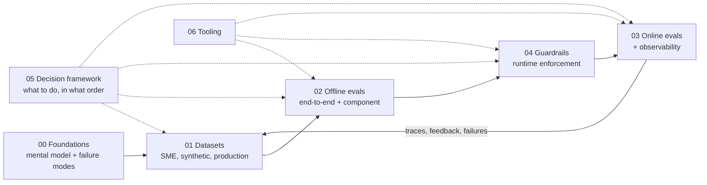

# Research: Evals & Guardrails for Agentic RAG

> **TL;DR** — A structured knowledge base covering everything it takes to make an agentic RAG application *measurably* good and *safely* bounded: datasets, offline evals, online evals, observability, guardrails, access control, and decision frameworks that tell you what to do next.

This folder is organised the way you'd actually build a reliable agent: understand the landscape → build datasets → evaluate offline → ship with guardrails → evaluate online → loop production data back into datasets.

---

## Start here

| If you are… | Read this first | Then |
|---|---|---|
| New to evals & guardrails | [The evals & guardrails map](./00-foundations/02-the-evals-and-guardrails-map.md) | [Why evals and guardrails](./00-foundations/01-why-evals-and-guardrails.md) → [Failure modes](./00-foundations/03-agentic-rag-failure-modes.md) |
| Building your first RAG / agent prototype | [Implementation playbook](./05-decision-framework/04-implementation-playbook.md) | [Dataset strategy](./01-datasets/01-dataset-strategy.md) → [End-to-end RAG evals](./02-offline-evals/01-end-to-end-rag-evals.md) |
| Choosing which evals to run | [Eval selection decision tree](./05-decision-framework/01-eval-selection-decision-tree.md) | [Metric cheatsheet](./05-decision-framework/03-metric-cheatsheet.md) |
| Choosing which guardrails to add | [Guardrail selection decision tree](./05-decision-framework/02-guardrail-selection-decision-tree.md) | [Guardrails architecture](./04-guardrails/01-guardrails-architecture.md) |
| About to launch | [Implementation playbook — launch readiness](./05-decision-framework/04-implementation-playbook.md) | [Threat model & OWASP](./04-guardrails/07-threat-model-owasp.md) |
| In production and quality dropped | [Monitoring, alerting & drift](./03-online-evals-and-observability/04-monitoring-alerting-and-drift.md) | [Production data flywheel](./01-datasets/04-production-data-flywheel.md) |
| Facing a security / access review | [Access control & RBAC](./04-guardrails/06-access-control-rbac.md) | [Tool & action guardrails](./04-guardrails/05-tool-and-action-guardrails.md) |
| Assessing your team's maturity | [Maturity model](./05-decision-framework/05-maturity-model.md) | [Implementation playbook](./05-decision-framework/04-implementation-playbook.md) |
| Picking tools / vendors | [Eval & observability tools](./06-tooling-landscape/01-eval-and-observability-tools.md) | [Guardrail tools](./06-tooling-landscape/02-guardrail-tools.md) |

---

## The core mental model in one page

| Axis | Options | Where |
|---|---|---|
| **When** it runs | Offline (pre-deploy, on datasets) · Online (on production traffic, usually async) · Runtime guardrail (in the request path) | [Map](./00-foundations/02-the-evals-and-guardrails-map.md) |
| **Data** it needs | SME / golden datasets · Synthetic datasets · Production-sampled traces | [01-datasets](./01-datasets/README.md) |
| **Scope** | End-to-end (question → final answer) · Component (retriever, reranker, router, tool caller, SQL generator, generator, citer) | [02-offline-evals](./02-offline-evals/README.md) |
| **Method** | Deterministic code · Statistical / reference similarity · LLM-as-a-judge · Classifier · Human review | [LLM-as-a-judge](./02-offline-evals/07-llm-as-a-judge.md) |
| **Ground truth** | Reference-based (needs expected answer/contexts) · Reference-free (works on live traffic) | [E2E RAG evals](./02-offline-evals/01-end-to-end-rag-evals.md) |
| **Guardrail mode** | Blocking (allow / deny / modify / escalate) · Non-blocking (flag / log / alert) · Sync vs async | [Guardrails architecture](./04-guardrails/01-guardrails-architecture.md) |

**Key idea:** the *same check* (e.g. "is the answer grounded in the retrieved context?") can be an offline eval on a dataset, an online monitor on sampled traffic, *and* a blocking guardrail in the request path. What changes is the data, the latency budget, and what happens when it fails.

---

## Full table of contents

### [00 — Foundations](./00-foundations/README.md)
| File | Covers |
|---|---|
| [01 Why evals and guardrails](./00-foundations/01-why-evals-and-guardrails.md) | Why reliability is the hard part; eval-driven development; error analysis first |
| [02 The evals & guardrails map](./00-foundations/02-the-evals-and-guardrails-map.md) | Master taxonomy across all axes, with a placement matrix |
| [03 Agentic RAG failure modes](./00-foundations/03-agentic-rag-failure-modes.md) | Failure taxonomy per pipeline stage → detecting eval → mitigating guardrail |
| [04 Glossary](./00-foundations/04-glossary.md) | Definitions of every term used in this repo |

### [01 — Datasets](./01-datasets/README.md)
| File | Covers |
|---|---|
| [01 Dataset strategy](./01-datasets/01-dataset-strategy.md) | Dataset types, schemas per eval type, coverage & slicing, sizing |
| [02 SME golden datasets](./01-datasets/02-sme-golden-datasets.md) | Working with experts, rubrics, inter-annotator agreement |
| [03 Synthetic datasets](./01-datasets/03-synthetic-datasets.md) | Generating QA, multi-hop, tool, SQL and adversarial cases; quality control |
| [04 Production data flywheel](./01-datasets/04-production-data-flywheel.md) | Turning traces & feedback into eval data; versioning; privacy |

### [02 — Offline evals](./02-offline-evals/README.md)
| File | Covers |
|---|---|
| [01 End-to-end RAG evals](./02-offline-evals/01-end-to-end-rag-evals.md) | Answer correctness, faithfulness, answer relevancy, context precision/recall |
| [02 Retrieval metrics](./02-offline-evals/02-retrieval-metrics.md) | Precision/recall/F1@k, hit rate, MRR, MAP, nDCG — with code |
| [03 Generation quality & safety](./02-offline-evals/03-generation-quality-and-safety-evals.md) | Toxicity, profanity, bias, tone, conciseness, refusals, hallucination |
| [04 Agent, tool & trajectory evals](./02-offline-evals/04-agent-tool-and-trajectory-evals.md) | Tool selection & args, trajectories, task completion, multi-turn |
| [05 Text-to-SQL evals](./02-offline-evals/05-text-to-sql-evals.md) | Exact/component match, SQL similarity, execution accuracy, safety |
| [06 Instruction & citation adherence](./02-offline-evals/06-instruction-and-citation-adherence.md) | Verifiable instructions, format adherence, citation precision/recall |
| [07 LLM-as-a-judge](./02-offline-evals/07-llm-as-a-judge.md) | Designing, validating and calibrating judges against humans |
| [08 Running offline experiments](./02-offline-evals/08-running-offline-experiments.md) | Baselines, CI gates, significance testing, ablations |

### [03 — Online evals & observability](./03-online-evals-and-observability/README.md)
| File | Covers |
|---|---|
| [01 Online evals](./03-online-evals-and-observability/01-online-evals.md) | Deterministic checks, sampled judges, shadow/canary/A-B |
| [02 Observability & tracing](./03-online-evals-and-observability/02-observability-and-tracing.md) | What to trace, OpenTelemetry GenAI conventions, privacy |
| [03 User feedback & implicit signals](./03-online-evals-and-observability/03-user-feedback-and-implicit-signals.md) | Explicit & implicit feedback, turning it into labels |
| [04 Monitoring, alerting & drift](./03-online-evals-and-observability/04-monitoring-alerting-and-drift.md) | KPIs, SLOs, drift types, AI incident runbook |

### [04 — Guardrails](./04-guardrails/README.md)
| File | Covers |
|---|---|
| [01 Guardrails architecture](./04-guardrails/01-guardrails-architecture.md) | Layers, actions, blocking vs non-blocking, latency, measuring guardrails |
| [02 Input guardrails](./04-guardrails/02-input-guardrails.md) | Prompt injection, jailbreaks, PII, topic scope, SQL-in-input detection |
| [03 Retrieval & context guardrails](./04-guardrails/03-retrieval-and-context-guardrails.md) | Permission filtering, indirect injection, provenance, relevance thresholds |
| [04 Output guardrails](./04-guardrails/04-output-guardrails.md) | Groundedness, citation verification, PII leakage, schema validation |
| [05 Tool & action guardrails](./04-guardrails/05-tool-and-action-guardrails.md) | Least privilege, HITL approval, budgets, SQL execution guards, MCP |
| [06 Access control & RBAC](./04-guardrails/06-access-control-rbac.md) | Identity propagation, document-level security, RBAC test matrices |
| [07 Threat model & OWASP](./04-guardrails/07-threat-model-owasp.md) | OWASP LLM Top 10 (2025), NIST AI RMF, MITRE ATLAS, red teaming |

### [05 — Decision framework](./05-decision-framework/README.md)
| File | Covers |
|---|---|
| [01 Eval selection decision tree](./05-decision-framework/01-eval-selection-decision-tree.md) | Which evals for which architecture, stage, and data availability |
| [02 Guardrail selection decision tree](./05-decision-framework/02-guardrail-selection-decision-tree.md) | Risk-tiered guardrail stacks; blocking/sync/fail-closed decisions |
| [03 Metric cheatsheet](./05-decision-framework/03-metric-cheatsheet.md) | Every metric and check in one table |
| [04 Implementation playbook](./05-decision-framework/04-implementation-playbook.md) | Phased plan from zero to production, anti-patterns, launch checklist |
| [05 Maturity model](./05-decision-framework/05-maturity-model.md) | Levels 0–4 with a self-assessment scorecard |

### [06 — Tooling landscape](./06-tooling-landscape/README.md)
| File | Covers |
|---|---|
| [01 Eval & observability tools](./06-tooling-landscape/01-eval-and-observability-tools.md) | RAGAS, DeepEval, TruLens, promptfoo, Phoenix, Langfuse, LangSmith, … |
| [02 Guardrail tools](./06-tooling-landscape/02-guardrail-tools.md) | NeMo Guardrails, Guardrails AI, Llama Guard, Presidio, cloud guardrails, … |

### [07 — References](./07-references/README.md)
Curated papers, practitioner writing, standards, benchmarks and courses.

---

## Running example used throughout

To keep things concrete, most documents use the same scenario:

> **Acme Internal Assistant** — an enterprise agent that
> 1. answers questions over company documents (vector + keyword search, reranking, citations),
> 2. answers data questions by generating SQL against a data warehouse (text-to-SQL),
> 3. can take actions via tools (e.g. create a support ticket), and
> 4. serves users in different roles (employee, manager, HR, finance, admin) — so every retrieval, query and tool call must respect RBAC.

It's small enough to reason about, yet exercises almost every eval and guardrail in this repo.

## Conventions

- Every content page opens with a **TL;DR**, and closes with **Key takeaways** and **Further reading**.
- Metrics are described as **cards**: what it measures · inputs required · how it's computed · score range · pitfalls · when to use · implemented in.
- Thresholds and sizes are **starting heuristics**, not universal truths — calibrate on your own data.
- The tooling landscape changes fast; tool pages are dated snapshots.
