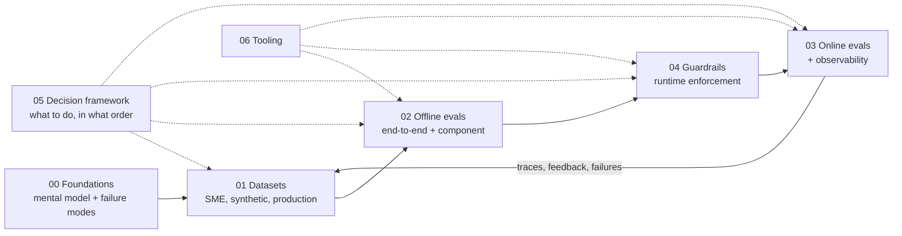

# Research: Evals & Guardrails for Agentic RAG

> **TL;DR**
> - **Build an agent that is measurably accurate and safely bounded.** This guide covers datasets, offline evals, online monitoring, and runtime guardrails in one connected system.
> - **Follow the real engineering order:** understand the failure modes → build a dataset → measure offline → add runtime guardrails → monitor live traffic → feed failures back into your dataset.

---

## Start here (pick your goal)

| If you are… | Read this first | Read this second |
|---|---|---|
| **New to evals and guardrails** | [The Evals & Guardrails Map](./00-foundations/02-the-evals-and-guardrails-map.md) | [Why Evals and Guardrails](./00-foundations/01-why-evals-and-guardrails.md) → [Failure Modes](./00-foundations/03-agentic-rag-failure-modes.md) |
| **Building your first RAG or agent prototype** | [Implementation Playbook](./05-decision-framework/04-implementation-playbook.md) | [Dataset Strategy](./01-datasets/01-dataset-strategy.md) → [End-to-End RAG Evals](./02-offline-evals/01-end-to-end-rag-evals.md) |
| **Choosing which metrics to run** | [Eval Selection Decision Tree](./05-decision-framework/01-eval-selection-decision-tree.md) | [Metric Cheatsheet](./05-decision-framework/03-metric-cheatsheet.md) |
| **Choosing which guardrails to add** | [Guardrail Selection Decision Tree](./05-decision-framework/02-guardrail-selection-decision-tree.md) | [Guardrails Architecture](./04-guardrails/01-guardrails-architecture.md) |
| **Getting ready for launch** | [Implementation Playbook — Launch Readiness](./05-decision-framework/04-implementation-playbook.md) | [Threat Model & OWASP](./04-guardrails/07-threat-model-owasp.md) |
| **Debugging a drop in live quality** | [Monitoring, Alerting & Drift](./03-online-evals-and-observability/04-monitoring-alerting-and-drift.md) | [Production Data Flywheel](./01-datasets/04-production-data-flywheel.md) |
| **Preparing for a security or RBAC review** | [Access Control & RBAC](./04-guardrails/06-access-control-rbac.md) | [Tool & Action Guardrails](./04-guardrails/05-tool-and-action-guardrails.md) |
| **Benchmarking your team's maturity** | [Maturity Model](./05-decision-framework/05-maturity-model.md) | [Implementation Playbook](./05-decision-framework/04-implementation-playbook.md) |
| **Comparing open-source and vendor tools** | [Eval & Observability Tools](./06-tooling-landscape/01-eval-and-observability-tools.md) | [Guardrail Tools](./06-tooling-landscape/02-guardrail-tools.md) |

---

## The core mental model in one table

Every eval and guardrail in this repository is defined by six choices:

| Choice | Your options | Where to learn more |
|---|---|---|
| **1. When it runs** | **Offline** (on datasets before deploy) · **Online** (async on live traffic) · **Runtime guardrail** (inline on live requests) | [The Map](./00-foundations/02-the-evals-and-guardrails-map.md) |
| **2. Data it uses** | **SME golden dataset** · **Synthetic dataset** · **Production-sampled traces** | [01 · Datasets](./01-datasets/README.md) |
| **3. Scope** | **End-to-end** (question → final answer) · **Component** (retriever, reranker, router, tool caller, SQL generator, citation step) | [02 · Offline Evals](./02-offline-evals/README.md) |
| **4. Grading method** | **Deterministic code** · **Statistical/IR math** · **Small ML classifier** · **LLM-as-a-judge** · **Human review** | [LLM-as-a-Judge](./02-offline-evals/07-llm-as-a-judge.md) |
| **5. Reference data** | **Reference-based** (compares against a known-correct answer) · **Reference-free** (grades using only question + context + output) | [End-to-End RAG Evals](./02-offline-evals/01-end-to-end-rag-evals.md) |
| **6. Guardrail action** | **Blocking** (allow, deny, modify, escalate) · **Non-blocking** (flag and log) · **Sync vs. Async** | [Guardrails Architecture](./04-guardrails/01-guardrails-architecture.md) |

> **The central rule:** A single check (such as *"Is every claim supported by retrieved context?"*) can run as an **offline eval** in CI, an **online monitor** on 5% of live traffic, and a **blocking guardrail** before returning high-risk answers. Only the latency budget and failure action change.

---

## Full table of contents

### [00 — Foundations](./00-foundations/README.md)
| Guide | What you will learn |
|---|---|
| [01 · Why Evals and Guardrails](./00-foundations/01-why-evals-and-guardrails.md) | Why demos fail in production, how evals and guardrails share checks, and the **Analyze → Measure → Improve** loop |
| [02 · The Evals & Guardrails Map](./00-foundations/02-the-evals-and-guardrails-map.md) | The five axes, master lookup tables, and Python code showing one check deployed three ways |
| [03 · Agentic RAG Failure Modes](./00-foundations/03-agentic-rag-failure-modes.md) | Stage-by-stage failures (query, routing, retrieval, generation, citations, tools, SQL, security) and how to catch each one |
| [04 · Glossary](./00-foundations/04-glossary.md) | Plain-English definitions for ~90 terms used across this repository |

### [01 — Datasets](./01-datasets/README.md)
| Guide | What you will learn |
|---|---|
| [01 · Dataset Strategy](./01-datasets/01-dataset-strategy.md) | Dataset sources, JSON schemas per eval type, slice coverage, and sample-size math |
| [02 · SME Golden Datasets](./01-datasets/02-sme-golden-datasets.md) | How to work with domain experts, write clear rubrics, and measure reviewer agreement |
| [03 · Synthetic Datasets](./01-datasets/03-synthetic-datasets.md) | How to generate QA, multi-hop, tool, SQL, and adversarial test cases—and filter out bad rows |
| [04 · Production Data Flywheel](./01-datasets/04-production-data-flywheel.md) | How to turn live traces and user feedback into versioned, PII-scrubbed test datasets |

### [02 — Offline Evals](./02-offline-evals/README.md)
| Guide | What you will learn |
|---|---|
| [01 · End-to-End RAG Evals](./02-offline-evals/01-end-to-end-rag-evals.md) | The RAG triad (context relevance, faithfulness, answer relevancy), answer correctness, and context recall |
| [02 · Retrieval Metrics](./02-offline-evals/02-retrieval-metrics.md) | `Precision@k`, `Recall@k`, `F1@k`, `Hit Rate@k`, `MRR`, `MAP`, and `nDCG@k` with Python implementations |
| [03 · Generation Quality & Safety](./02-offline-evals/03-generation-quality-and-safety-evals.md) | Toxicity, bias, tone, conciseness, refusal accuracy, and hallucination checks |
| [04 · Agent, Tool & Trajectory Evals](./02-offline-evals/04-agent-tool-and-trajectory-evals.md) | Tool selection, argument schemas, step trajectories, task completion, and multi-turn conversations |
| [05 · Text-to-SQL Evals](./02-offline-evals/05-text-to-sql-evals.md) | Execution accuracy, SQL component matching, syntax checks, and read-only safety rules |
| [06 · Instruction & Citation Adherence](./02-offline-evals/06-instruction-and-citation-adherence.md) | Format constraints, JSON schema checks, and citation precision/recall |
| [07 · LLM-as-a-Judge](./02-offline-evals/07-llm-as-a-judge.md) | How to write binary Pass/Fail rubrics and calibrate LLM judges against human labels |
| [08 · Running Offline Experiments](./02-offline-evals/08-running-offline-experiments.md) | Baselines, CI regression gates, statistical significance, and ablations |

### [03 — Online Evals & Observability](./03-online-evals-and-observability/README.md)
| Guide | What you will learn |
|---|---|
| [01 · Online Evals](./03-online-evals-and-observability/01-online-evals.md) | Running deterministic checks and sampled LLM judges on live traffic; shadow, canary, and A/B testing |
| [02 · Observability & Tracing](./03-online-evals-and-observability/02-observability-and-tracing.md) | What spans to log, OpenTelemetry GenAI conventions, and trace privacy |
| [03 · User Feedback & Implicit Signals](./03-online-evals-and-observability/03-user-feedback-and-implicit-signals.md) | Combining thumbs-up/down clicks with implicit signals like retries, edits, and escalations |
| [04 · Monitoring, Alerting & Drift](./03-online-evals-and-observability/04-monitoring-alerting-and-drift.md) | Dashboards, SLOs, drift detection, and an incident response runbook |

### [04 — Guardrails](./04-guardrails/README.md)
| Guide | What you will learn |
|---|---|
| [01 · Guardrails Architecture](./04-guardrails/01-guardrails-architecture.md) | Defense-in-depth layers, the five guardrail actions, latency budgets, and fail-open vs. fail-closed rules |
| [02 · Input Guardrails](./04-guardrails/02-input-guardrails.md) | Stopping direct prompt injection, jailbreaks, PII in prompts, and out-of-scope topics |
| [03 · Retrieval & Context Guardrails](./04-guardrails/03-retrieval-and-context-guardrails.md) | Pre-retrieval RBAC filters, indirect injection scanning, and minimum relevance cutoffs |
| [04 · Output Guardrails](./04-guardrails/04-output-guardrails.md) | Checking faithfulness, verifying citations, redacting leaked PII, and validating JSON schemas |
| [05 · Tool & Action Guardrails](./04-guardrails/05-tool-and-action-guardrails.md) | Least-privilege tools, human-in-the-loop confirmation, step budgets, SQL parsers, and MCP safety |
| [06 · Access Control & RBAC](./04-guardrails/06-access-control-rbac.md) | Propagating user identity across retrieval, SQL row-level security, tools, and caches |
| [07 · Threat Model & OWASP](./04-guardrails/07-threat-model-owasp.md) | OWASP LLM Top 10 (2025), NIST AI RMF, MITRE ATLAS, and red-teaming workflows |

### [05 — Decision Framework](./05-decision-framework/README.md)
| Guide | What you will learn |
|---|---|
| [01 · Eval Selection Decision Tree](./05-decision-framework/01-eval-selection-decision-tree.md) | Step-by-step trees to pick the right metrics for your architecture and stage |
| [02 · Guardrail Selection Decision Tree](./05-decision-framework/02-guardrail-selection-decision-tree.md) | Risk tiers (`R0`–`R3`) and which guardrails must run synchronously vs. asynchronously |
| [03 · Metric Cheatsheet](./05-decision-framework/03-metric-cheatsheet.md) | Every metric and guardrail check summarized in one reference table |
| [04 · Implementation Playbook](./05-decision-framework/04-implementation-playbook.md) | A 7-phase rollout plan from day zero to production, with RACI tables and launch checklists |
| [05 · Maturity Model](./05-decision-framework/05-maturity-model.md) | Levels 0 to 4 with a self-assessment scorecard for your team |

### [06 — Tooling Landscape](./06-tooling-landscape/README.md)
| Guide | What you will learn |
|---|---|
| [01 · Eval & Observability Tools](./06-tooling-landscape/01-eval-and-observability-tools.md) | Side-by-side comparison of RAGAS, DeepEval, TruLens, promptfoo, Arize Phoenix, Langfuse, LangSmith, Braintrust, and more |
| [02 · Guardrail Tools](./06-tooling-landscape/02-guardrail-tools.md) | Side-by-side comparison of NeMo Guardrails, Guardrails AI, Llama Guard, Presidio, Lakera, and cloud provider guardrails |

### [07 — References](./07-references/README.md)
Curated papers, practitioner essays, security standards, benchmarks, and courses.

---

## The running example

To keep every concept concrete, all guides use the same scenario:

> **Acme Internal Assistant** — an enterprise agent that:
> 1. **Answers document questions** over company policies and wikis using vector + keyword search, reranking, and citations.
> 2. **Answers data questions** by generating SQL against a data warehouse (text-to-SQL).
> 3. **Takes actions** via tools (such as `create_ticket` and `lookup_employee`).
> 4. **Serves multiple user roles** (Employee, Manager, HR, Finance, Admin), enforcing strict RBAC on every document, table, and tool call.

## How these guides are written

- **Quick orientation:** Every page starts with a 3–4 bullet **TL;DR** and ends with **Key takeaways** and **Further reading**.
- **Consistent metric cards:** Metrics are explained using a standard card: *What it measures · Inputs required · How it works · Score range · Common pitfalls · When to use*.
- **Calibrate your own thresholds:** Sample sizes and score thresholds in this repo are starting rules of thumb. Always calibrate them on your own data.
